<a id="top"></a>

# Pre1-2. Python 콘솔 퀴즈 게임

## 목차

1. [프로젝트 개요](#1-프로젝트-개요)
2. [실행 방법](#2-실행-방법)
3. [기능 목록](#3-기능-목록)
4. [파일 구조](#4-파일-구조)
5. [데이터 파일 설명 (state.json)](#5-데이터-파일-설명-statejson)
6. [설계 설명](#6-설계-설명)
7. [수행 내용 및 검증](#7-수행-내용-및-검증)
8. [핵심 개념 정리](#8-핵심-개념-정리)
9. [트러블슈팅](#9-트러블슈팅)
10. [보너스 과제 수행 내용](#10-보너스-과제-수행-내용)
11. [미션을 마치며](#11-미션을-마치며)

---

## 1. 프로젝트 개요

터미널에서 실행하는 Python 콘솔 퀴즈 게임을 만드는 프로젝트입니다.

Python 기본 문법으로 메뉴와 퀴즈 진행 기능을 구현하고, `Quiz`와 `QuizGame` 클래스로 역할을 나눕니다. 퀴즈와 최고 점수는 프로젝트 루트의 `state.json` 파일에 저장하여 프로그램을 다시 실행했을 때에도 유지되도록 구현합니다. 보너스 과제로 랜덤 출제, 문제 수 선택, 힌트, 퀴즈 삭제, 점수 기록 히스토리 기능을 추가했습니다.

Git으로 기능별 변경 이력을 기록하고 GitHub 저장소에 코드를 업로드합니다.

### 1-1. 개발 환경

| 구분 | 사용 환경 |
| --- | --- |
| 운영체제 | Windows 11 Home (64비트) |
| Terminal | Windows PowerShell |
| Python | Python 3.15.2 |
| Git | Git version 2.56.0.windows.4 |
| 코드 편집기 | Visual Studio Code |
| 외부 라이브러리 | 사용하지 않음 (Python 표준 라이브러리 `json`, `pathlib`, `random`, `datetime`만 사용) |

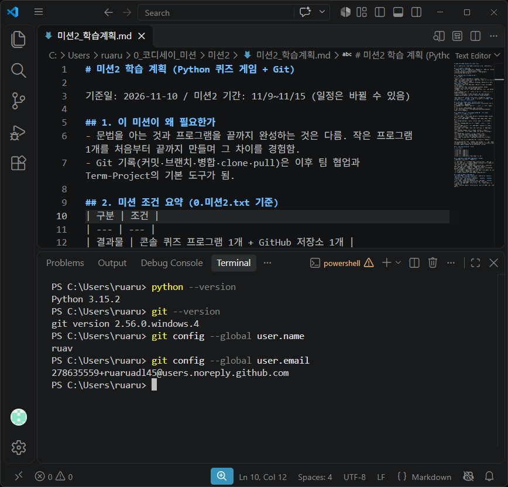

### 1-2. 퀴즈 주제와 선정 이유


- **주제**: 대전 지역의 역사·과학·문화 관련 상식
- **선정 이유**: 코디세이 AI 올인원 교육과정에는 다양한 연령대의 300명이 넘는 교육생들이 함께 참여하고 있습니다. 서로 다른 세대가 공통으로 관심을 갖고 편하게 소통할 수 있는 주제를 고민한 결과, 교육생들이 함께 생활하고 있는 지역인 대전을 선정했습니다. 지역의 역사와 문화, 과학 관련 상식을 통해 세대 간 공감대를 형성하고 즐겁게 참여할 수 있는 퀴즈를 만들고자 했습니다.
- **기본 퀴즈 5개**:
  1. 대전의 옛 이름과 유래
  2. 대전의 대표적인 연구개발 단지
  3. 1993년 대전 엑스포 공식 마스코트
  4. 대전광역시의 자치구 개수
  5. 대전의 대표적인 지역 축제

### 1-3. GitHub 저장소 정보

| 구분 | 내용 |
| --- | --- |
| 저장소 이름 | M2_python_quiz |
| 저장소 주소 | [https://github.com/ruaruadl45/M2_python_quiz](https://github.com/ruaruadl45/M2_python_quiz) |

[맨 위로 이동](#top)

---

## 2. 실행 방법

Windows PowerShell에서 다음 명령어를 실행합니다.

```powershell
# GitHub 저장소 복제
git clone https://github.com/ruaruadl45/M2_python_quiz.git

# 복제된 프로젝트 폴더로 이동
cd M2_python_quiz

# Python 버전 확인 (Python 3.15.2 환경에서 동작 확인)
python --version

# 프로그램 실행
python main.py
```

[맨 위로 이동](#top)

---

## 3. 기능 목록

| 번호 | 기능 | 설명 | 구현 위치 | 검증 기록 |
| :-: | --- | --- | --- | --- |
| 1 | 퀴즈 풀기 | 풀 문제 수 선택, 랜덤 출제, 힌트 보기(`0`), 정오 안내, 결과 표시, 게임 기록 저장 및 최고 점수 갱신 | `QuizGame.play()` | [7-2](#7-2-퀴즈-기능-구현-및-실행), [10장](#10-보너스-과제-수행-내용) |
| 2 | 퀴즈 추가 | 문제·선택지 4개·정답 번호·힌트(선택)를 입력받아 등록 및 저장 (질문 입력에서 `0` 입력 시 취소) | `QuizGame.add_quiz()` | [7-2](#7-2-퀴즈-기능-구현-및-실행), [7-3](#7-3-데이터-저장-및-유지-검증) |
| 3 | 퀴즈 목록 | 등록된 퀴즈 목록 표시 | `QuizGame.show_quizzes()` | [7-2](#7-2-퀴즈-기능-구현-및-실행) |
| 4 | 점수 확인 | 최고 점수(달성한 문제 수 포함)와 전체 게임 기록 표시 | `QuizGame.show_scores()`, `QuizGame.play()` | [7-3](#7-3-데이터-저장-및-유지-검증), [10-5](#10-5-점수-기록-히스토리-및-최고-점수-기준) |
| 5 | 퀴즈 삭제 | 번호를 골라 퀴즈를 삭제하고 저장 (`0` 입력 시 취소) | `QuizGame.delete_quiz()` | [10-4](#10-4-퀴즈-삭제) |
| 6 | 종료 | 메뉴에서 종료를 선택하면 프로그램 종료 | `QuizGame.run()` | [7-4](#7-4-최종-기능-및-예외-상황-검증) |

※ 보너스 과제를 수행하며 메뉴가 바뀌었습니다. (`5. 퀴즈 삭제` 추가, 종료 `5` → `6`, 4번 `최고 점수 확인` → `점수 확인 (최고 점수·기록)`) 7장의 일부 화면과 로그는 변경 전 메뉴입니다.

### 3-1. 입력 및 예외 상황 처리

| 상황 | 처리 방식 | 확인 결과 |
| --- | --- | --- |
| 잘못된 입력 (문자 `abc`, 범위 밖 숫자 예: 메뉴 9·정답 5, 빈 입력) | 숫자로 변환할 수 없거나 허용 범위를 벗어나거나 비어 있는 입력은 오류 메시지를 표시하고 다시 입력받음 | 실행 확인 ([06](docs/screenshots/06_input_errors.png), [07](docs/screenshots/07_quiz_play.png), [08](docs/screenshots/08_quiz_add.png) 화면) |
| 입력 앞뒤 공백 (예: ` 1 `) | 입력값 앞뒤의 공백을 제거한 후 처리 | 실행 확인 ([07](docs/screenshots/07_quiz_play.png) 화면) |
| 풀 문제 수 입력 오류 (`abc`, `0`, `9`, 빈 입력) | 1~등록된 퀴즈 개수 범위만 허용하고 다시 입력받음 | 실행 확인 ([10-2 실행 로그](#10-2-문제-수-선택)) |
| 정답 입력에 `0` | 힌트를 보여준 뒤 다시 정답을 입력받음 | 실행 확인 ([23](docs/screenshots/23_hint_1.png) 화면) |
| 퀴즈 추가 중 질문에 `0` | 추가를 취소하고 메인 메뉴로 돌아감 | 코드 구현 확인 |
| 퀴즈 삭제 번호에 `0` | 삭제를 취소하고 메인 메뉴로 돌아감 | 실행 확인 ([10-4 실행 로그](#10-4-퀴즈-삭제)) |
| 퀴즈가 없는 상태에서 플레이/목록 선택 | 플레이 시 퀴즈가 없다는 안내 메시지를 출력하고, 목록 선택 시 전체 개수 0을 표시 | 실행 확인 ([7-4 실행 로그](#7-4-최종-기능-및-예외-상황-검증)) |
| 퀴즈가 없는 상태에서 삭제 선택 | 삭제할 퀴즈가 없다는 안내 메시지 출력 | 코드 구현 확인 |
| 아직 퀴즈를 풀지 않은 상태에서 점수 확인 | 초기 최고 점수 0점과 `아직 게임 기록이 없습니다.`를 표시 | 실행 확인 ([7-4 실행 로그](#7-4-최종-기능-및-예외-상황-검증), [25](docs/screenshots/25_history_1a.png) 화면) |
| Ctrl+C (`KeyboardInterrupt`) | 키보드 인터럽트 발생 시 안전하게 종료하도록 예외 처리 | 실행 확인 (현재 버전에서 직접 실행) |
| 입력 스트림 종료 (`EOFError`) | 입력 스트림 종료 시 예외를 처리하고 프로그램을 안전하게 종료하도록 구현 | 코드 구현 확인 |
| `state.json` 없음·손상·읽기/쓰기 오류 | 기본 데이터로 시작하거나 복구한 뒤 저장 (상황별 처리는 [5-4](#5-4-파일이-없거나-손상된-경우) 참고) | 없음·손상: 실행 확인 ([7-3](#7-3-데이터-저장-및-유지-검증)) / 읽기·쓰기 오류: 코드 구현 확인 |

※ '코드 구현 확인'은 소스 코드에 처리 로직이 있는 것을 확인한 상태이며, 직접 실행해 검증했다는 의미는 아닙니다.

※ 보너스 3(힌트) 이후 정답 입력의 `0`은 힌트 보기로 쓰입니다. [07](docs/screenshots/07_quiz_play.png) 화면은 변경 전 버전에서 `0`을 범위 밖 숫자로 처리한 모습입니다.

[맨 위로 이동](#top)

---

## 4. 파일 구조

```text
M2_python_quiz/
├── .gitignore          # Git에서 추적하지 않을 파일 지정
├── README.md           # 프로젝트 설명 및 검증 기록
├── main.py             # Quiz·QuizGame 클래스, 입력 검증 함수, 실행 코드
├── state.json          # 퀴즈 목록과 최고 점수 저장 (5장 참고)
└── docs/
    └── screenshots/    # 개발 환경·실행·Git 기록 스크린샷과 다이어그램
        ├── 01_env.png
        ├── 02_github_repo.png
        ├── ...
        ├── 21_git_init.png
        ├── 22_bonus_random_1.png   # 22~25: 보너스 과제 실행 화면
        ├── ...
        └── 25_history_2.png
```

※ 위 구조에서는 스크린샷 파일명 일부만 표기하고 나머지는 생략했습니다.

### 4-1. 데이터 파일 관리

- `state.json`은 기본 데이터 제공 및 실행 결과 보존을 위해 Git 저장소에 포함합니다.
- 보너스 5 커밋에서 `state.json`을 새 구조(힌트·게임 기록 포함)의 기본 데이터로 초기화해 올렸습니다. 예전 파일이 그대로 남아 있으면 clone한 사람이 힌트 없이 게임을 하게 되기 때문입니다. ([9-4](#9-4-문제-사례-4-힌트를-추가했는데-기존-statejson에-반영되지-않음) 참고)
- `state_backup.json`, `state_temp.json`은 복구 실습 중 만든 백업·임시 파일이며, `.gitignore`에 등록해 Git에는 추가하지 않았습니다.

※ 클래스·메서드 구성과 입력 검증 함수는 [6-1](#6-1-클래스의-책임-나누기), [6-2](#6-2-기능별-로직-분리)에 정리했습니다.

[맨 위로 이동](#top)

---

## 5. 데이터 파일 설명 (state.json)

`state.json`은 퀴즈 게임의 데이터를 저장하는 파일입니다. 프로그램을 종료한 뒤 다시 실행해도 퀴즈 목록과 최고 점수를 유지할 수 있도록 JSON 형식으로 관리합니다.

| 항목 | 내용 |
| --- | --- |
| 경로 | 프로젝트 루트의 `state.json` |
| 인코딩 | UTF-8 |
| 역할 | 퀴즈 목록, 최고 점수, 게임 기록 저장 |
| 생성 시점 | 최초 실행 시 파일이 없는 경우 기본 퀴즈 데이터로 생성 및 저장 |
| 갱신 시점 | 퀴즈 추가·삭제 시, 게임을 마칠 때마다(기록 추가, 최고 점수 갱신 포함), 또는 데이터 손상 감지 복구 시 |

### 5-1. 데이터 구조 (스키마)

`state.json`은 최상위에 `best_score`, `best_question_count`, `quizzes`, `history` 네 가지 항목을 가집니다.

| 키 | 자료형 | 설명 |
| --- | --- | --- |
| `best_score` | int | 최고 점수 (0~100점) |
| `best_question_count` | int | 최고 점수를 낸 판의 문제 수 (보너스 5에서 추가) |
| `quizzes` | list | 등록된 퀴즈 목록 |
| `quizzes[]` | dict | 개별 퀴즈 데이터 |
| `quizzes[].question` | str | 퀴즈 문제 |
| `quizzes[].choices` | list[str] | 4개의 선택지 |
| `quizzes[].answer` | int | 정답 번호 (1~4) |
| `quizzes[].hint` | str | 힌트 (없으면 빈 문자열, 보너스 3에서 추가) |
| `history` | list | 게임 기록 목록 (보너스 5에서 추가) |
| `history[].date` | str | 게임한 날짜·시간 (예: `2026-11-15 22:40`) |
| `history[].question_count` | int | 푼 문제 수 |
| `history[].correct_count` | int | 맞힌 문제 수 |
| `history[].hint_count` | int | 힌트를 사용한 문제 수 |
| `history[].score` | int | 힌트 차감 후 점수 |

**JSON 데이터 예시**

```json
{
    "best_score": 100,
    "best_question_count": 5,
    "quizzes": [
        {
            "question": "조선시대부터 불리던 대전의 옛 이름으로, '큰밭'이라는 순우리말에서 유래한 지명은 무엇인가요?",
            "choices": [
                "누리밭",
                "한밭",
                "솔밭",
                "늘밭"
            ],
            "answer": 2,
            "hint": "대전에 있는 '○○수목원', '○○대학교' 이름에도 쓰여요."
        }
    ],
    "history": [
        {
            "date": "2026-11-15 22:40",
            "question_count": 5,
            "correct_count": 5,
            "hint_count": 0,
            "score": 100
        }
    ]
}
```

※ 위 데이터는 구조를 설명하기 위한 예시이며, 실제 실행 시에는 기본 퀴즈 5개와 사용자가 추가한 퀴즈, 지금까지의 게임 기록이 저장될 수 있습니다.

### 5-2. 데이터 구조를 이렇게 설계한 이유

- **퀴즈 목록을 `list`로 관리하는 이유:** 여러 개의 퀴즈를 하나의 목록으로 관리하고, 퀴즈 추가 및 조회를 쉽게 하기 위해 사용합니다.
- **각 퀴즈를 `dict` 형태로 표현하는 이유:** 문제, 선택지, 정답처럼 서로 관련된 정보를 이름이 있는 항목으로 묶어 관리하기 위해 사용합니다.
- **`best_score`를 별도 항목으로 저장하는 이유:** 퀴즈 데이터와 최고 점수를 구분하여 관리하고, 프로그램을 다시 실행해도 최고 점수를 유지하기 위해 사용합니다.
- **`history`를 `list` 안의 `dict`로 저장하는 이유:** 게임 기록은 계속 쌓이므로 목록으로 두고, 기록 1개의 날짜·문제 수·점수는 이름 붙은 항목으로 묶었습니다. 퀴즈 목록과 같은 구조라 읽고 쓰는 방식이 일관됩니다.
- **`best_question_count`를 따로 저장하는 이유:** 점수가 같을 때 더 많은 문제를 푼 기록을 1등으로 하기 위해, 최고 점수를 낸 판의 문제 수를 함께 기억합니다.

### 5-3. 점수 계산 방식

- **점수 기준:** 맞힌 수를 **이번에 푼 문제 수**로 나눈 뒤 100점 만점으로 환산합니다. (보너스 2 이후 전체 퀴즈 수가 아닌 선택한 문제 수 기준)
- **점수 계산을 담당하는 메서드:** `QuizGame.calculate_score()`
- **계산 방식:** 계산된 정답률의 소수점 이하를 반올림하여 0~100점 범위의 정수 점수로 반환합니다.
- **힌트 차감:** 힌트를 사용한 문제 1개당 10점을 뺍니다. 한 문제에서 힌트를 여러 번 봐도 1번만 차감하고, 0점 아래로는 내려가지 않습니다.
- **최고 점수 갱신 조건:**
  1. 등록된 **모든 문제를 푼 판만** 후보가 됩니다. (일부만 풀면 기록에만 남음)
  2. 점수가 기존 최고 점수보다 높으면 갱신합니다.
  3. 점수가 같으면 **더 많은 문제를 푼 기록**으로 갱신합니다.
- **예외 처리:** 전체 퀴즈 수가 0개이면 0점을 반환합니다.

### 5-4. 파일이 없거나 손상된 경우

| 상황 | 처리 방식 |
| --- | --- |
| 파일이 없는 첫 실행 | 기본 퀴즈 5개를 사용하고 `state.json`을 새로 생성합니다. |
| JSON 형식이 손상된 경우 | 오류를 감지하고 기본 퀴즈 데이터와 최고 점수 0으로 초기화한 뒤 파일을 다시 저장합니다. |
| 데이터 항목이나 자료형이 올바르지 않은 경우 | 데이터 검증 과정에서 오류를 감지하면 기본 데이터로 복구합니다. |
| 파일 읽기 오류 | `OSError`를 감지하여 기본 데이터로 초기화하고 저장을 시도합니다. |
| 파일 쓰기 오류 | `OSError`를 감지하고 저장 실패 메시지를 출력합니다. |
| 예전 구조의 파일 (`hint`, `history`, `best_question_count` 없음) | `.get(키, 기본값)`으로 읽어 오류 없이 불러옵니다. 없는 항목은 빈 힌트, 빈 기록, 0문제로 채웁니다. |

**구조가 바뀌었을 때 기존 파일 처리**

기존 파일은 `.get()`으로 오류 없이 읽히지만 새 칸은 빈칸이고, 새 기본값을 쓰려면 파일을 새로 만들어야 합니다.

- `item["hint"]`처럼 꺼내면 이름표가 없을 때 `KeyError`가 나서 손상 파일로 처리되고, 사용자가 추가한 퀴즈까지 기본 데이터로 덮어써집니다. 그래서 새로 추가한 항목은 `.get()`으로 읽습니다.
- 코드의 기본 퀴즈(힌트 포함)는 파일이 없거나 손상됐을 때만 쓰이므로, 기존 파일의 퀴즈에 힌트가 자동으로 채워지지는 않습니다. ([9-4](#9-4-문제-사례-4-힌트를-추가했는데-기존-statejson에-반영되지-않음) 참고)

**기존 데이터 보호 및 한계**

- 손상된 데이터는 기본 데이터로 복구되지만, 손상 전 데이터를 자동으로 백업하는 기능은 없으므로 중요한 데이터는 별도로 복사해 보관해야 합니다.
- 파일 쓰기 오류가 발생하면 저장에 실패할 수 있으므로, 화면에 표시되는 오류 메시지를 확인해야 합니다.

[맨 위로 이동](#top)

---

## 6. 설계 설명

본 프로젝트는 퀴즈 데이터 관리, 게임 진행, 입력 검증, 데이터 저장 기능을 구분하여 코드의 역할을 명확하게 구성했습니다.


### 6-1. 클래스의 책임 나누기

| 클래스 | 맡은 일 | 관리하는 데이터 | 담당하지 않는 일 |
| --- | --- | --- | --- |
| `Quiz` | 개별 퀴즈의 문제·선택지·힌트를 출력하고 정답을 확인 | 문제(`question`), 선택지(`choices`), 정답 번호(`answer`), 힌트(`hint`) | 게임 메뉴 관리, 전체 점수 관리, 파일 저장 |
| `QuizGame` | 퀴즈 게임 전체 진행과 데이터 관리 | 퀴즈 목록(`quizzes`), 최고 점수(`best_score`, `best_question_count`), 게임 기록(`history`), 저장 파일 경로(`state_file`) | 개별 퀴즈의 출력 및 정답 판정 세부 처리 |

### 6-2. 기능별 로직 분리

| 구분 | 담당 함수/메서드 | 이렇게 나눈 이유 |
| --- | --- | --- |
| 입력 받기 및 검증 | `get_valid_number()`, `get_valid_text()` | 메뉴·정답 번호는 `get_valid_number()`, 문제·선택지는 `get_valid_text()`로 검증하여 잘못된 입력으로 인한 오류를 방지 |
| 메뉴 실행 | `QuizGame.run()` | 메뉴 출력, 기능 선택, 안전 종료 처리를 한곳에서 관리 |
| 퀴즈 진행 및 채점 | `Quiz.display()`, `Quiz.show_hint()`, `Quiz.check_answer()`, `QuizGame.play()` | 문제 출력, 힌트 출력, 정답 판정, 게임 진행을 구분하여 관리 |
| 퀴즈 추가·목록·삭제 | `QuizGame.add_quiz()`, `QuizGame.show_quizzes()`, `QuizGame.delete_quiz()` | 새로운 퀴즈 등록, 전체 퀴즈 조회, 퀴즈 삭제 기능을 독립적으로 관리 (삭제 시 목록 보기 기능 재사용) |
| 점수 관리 | `QuizGame.calculate_score()`, `QuizGame.show_scores()`, `QuizGame.play()` | 점수 계산, 최고 점수·기록 조회, 기록 추가와 최고 점수 갱신을 구분 |
| 데이터 저장 및 불러오기 | `QuizGame.save_state()`, `QuizGame.load_state()`, `QuizGame.get_default_quizzes()` | 데이터 저장, 기존 데이터 불러오기, 기본 데이터 복구를 별도로 관리 |

### 6-3. state.json 읽기/쓰기 흐름


| 순서 | 시점 | 읽기/쓰기 | 호출 함수/메서드 | 이유 |
| :-: | --- | :-: | --- | --- |
| 1 | 프로그램 시작 | 읽기 (필요 시 쓰기) | `QuizGame.__init__()` → `load_state()` | 저장된 데이터를 불러오며, 파일이 없거나 손상된 경우 기본 데이터를 새로 저장(`save_state()`) |
| 2 | 퀴즈 추가 직후 | 쓰기 | `add_quiz()` → `save_state()` | 새로 등록한 퀴즈를 프로그램 종료 후에도 유지하기 위해 |
| 3 | 퀴즈 삭제 직후 | 쓰기 | `delete_quiz()` → `save_state()` | 삭제 결과를 파일에 반영하기 위해 |
| 4 | 게임을 마칠 때마다 | 쓰기 | `play()` → `save_state()` | 게임 기록을 남기고, 최고 점수가 갱신됐다면 함께 저장하기 위해 (보너스 5 이전에는 최고 점수 갱신 때만 저장) |
| 5 | 프로그램 종료 시 | 별도 저장 없음 | `run()` | 데이터 변경 시점에 이미 저장하므로 종료 시 별도 저장이 필요하지 않음 |

### 6-4. 안전 종료 (Ctrl+C / EOF)

| 상황 | 처리하지 않으면 생길 수 있는 문제 | 실제 처리 방식 |
| --- | --- | --- |
| Ctrl+C (`KeyboardInterrupt`) | 실행 중단 시 오류 메시지와 함께 프로그램이 비정상 종료될 수 있음 | `QuizGame.run()`에서 예외를 처리하고 안전 종료 안내 메시지를 출력 |
| 입력 스트림 종료 (`EOFError`) | 입력을 기다리는 도중 입력이 종료되면 예외가 발생하여 비정상 종료될 수 있음 | `QuizGame.run()`에서 예외를 처리하고 안전 종료 안내 메시지를 출력 |

※ 종료 시 별도로 저장하지 않는 이유: 퀴즈 추가·삭제와 게임 종료(기록·최고 점수)가 일어나는 즉시 `save_state()`로 저장하므로([6-3](#6-3-statejson-읽기쓰기-흐름)), Ctrl+C나 EOF로 종료되어도 이미 저장된 데이터는 잃지 않습니다.

### 6-5. 커밋 단위와 메시지 규칙

- **커밋 단위:** 기능 하나가 완성되거나 의미 있는 코드 변경이 끝났을 때 커밋합니다.
- **메시지 형식:** `<접두어>: <변경 내용 요약>`
- **접두어 사용 규칙:**
  - `Feat:` 새로운 기능 추가
  - `Fix:` 기존 기능의 오류 수정
  - `Docs:` README 등 문서 수정
  - `Refactor:` 기능 변경 없이 코드 구조 개선
  - `Merge:` 기능 브랜치 병합 커밋 (예: `Merge: JSON 데이터 저장 기능 추가`)
- **규칙을 정한 이유:**
  - 변경 유형을 한눈에 파악하여 작업 이력을 체계적으로 관리하고, 오류 발생 시 추적을 용이하게 하기 위함입니다.


[맨 위로 이동](#top)

---

## 7. 수행 내용 및 검증

각 단계는 **수행 목적 → 실행 명령어/코드 → 실행 결과 → 확인한 내용** 순서로 기록합니다. 실제로 실행한 명령어와 결과를 남깁니다.

### 7-1. 프로젝트 초기 설정 및 메뉴 실행

#### 1) 프로젝트 준비

GitHub 저장소를 생성하고 로컬 컴퓨터에 프로젝트 작업 환경을 구성했습니다.


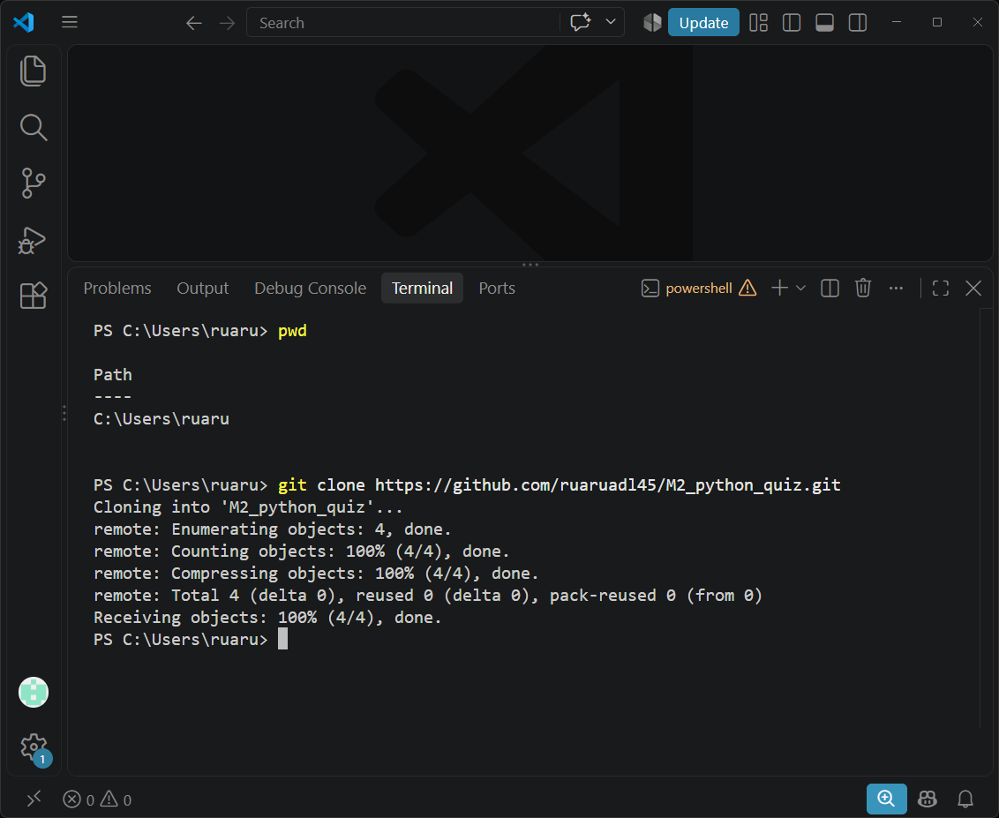

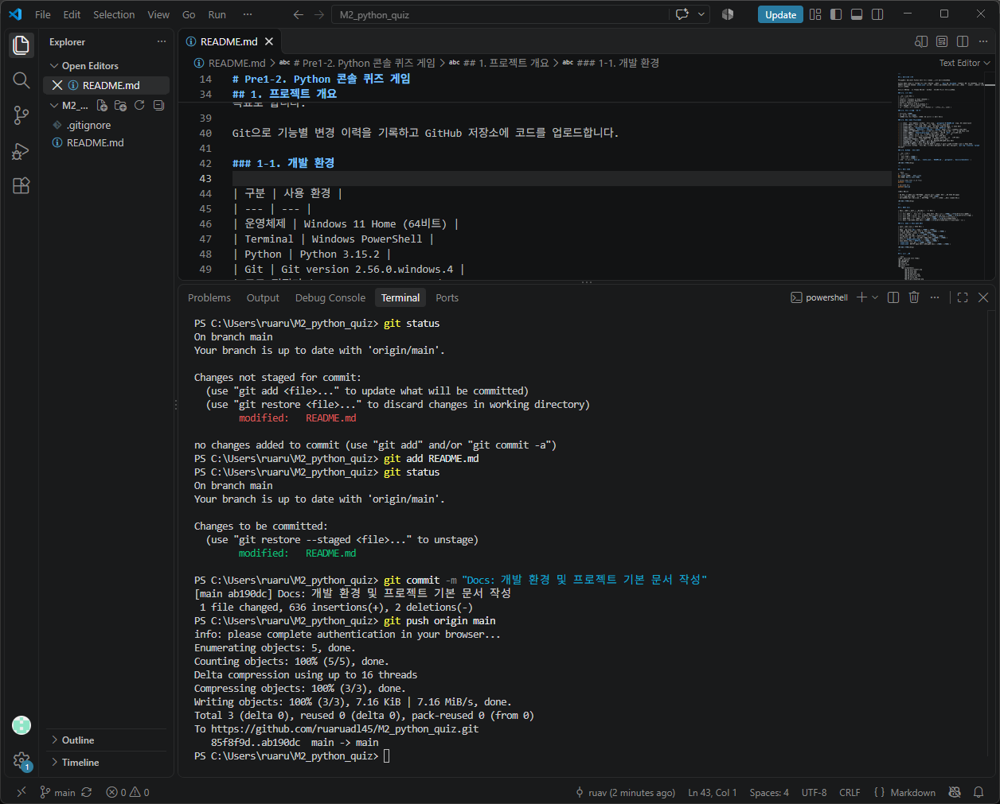

#### 2) 프로그램 실행

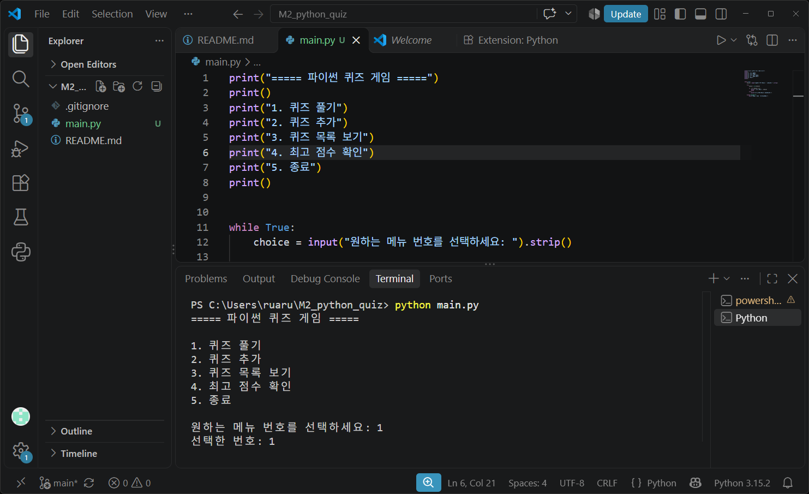

**실행 명령어**

```powershell
cd C:\Users\ruaru\M2_python_quiz
python main.py
```

→ 프로그램이 정상 실행되어 메인 메뉴가 출력되고, 메뉴 번호에 따라 기능이 선택되는 것을 확인했습니다.

### 7-2. 퀴즈 기능 구현 및 실행

기능별 구현 위치는 [3장 기능 목록](#3-기능-목록)에 정리했으며, 아래는 각 기능의 실행 화면입니다.

※ 7장의 화면은 보너스 과제 전 버전입니다. 보너스 과제 이후의 화면은 [10장](#10-보너스-과제-수행-내용)에 정리했습니다.

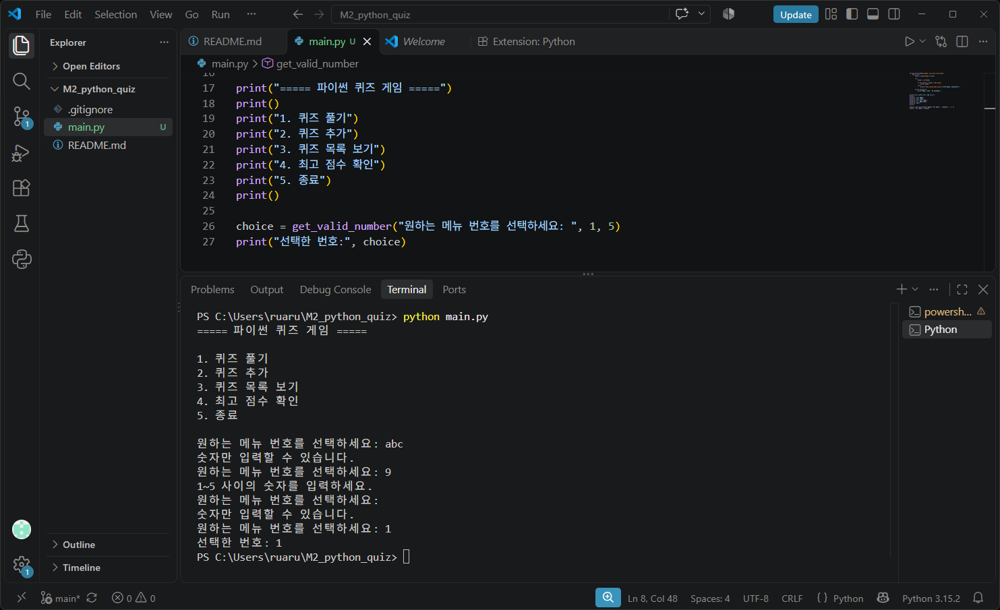

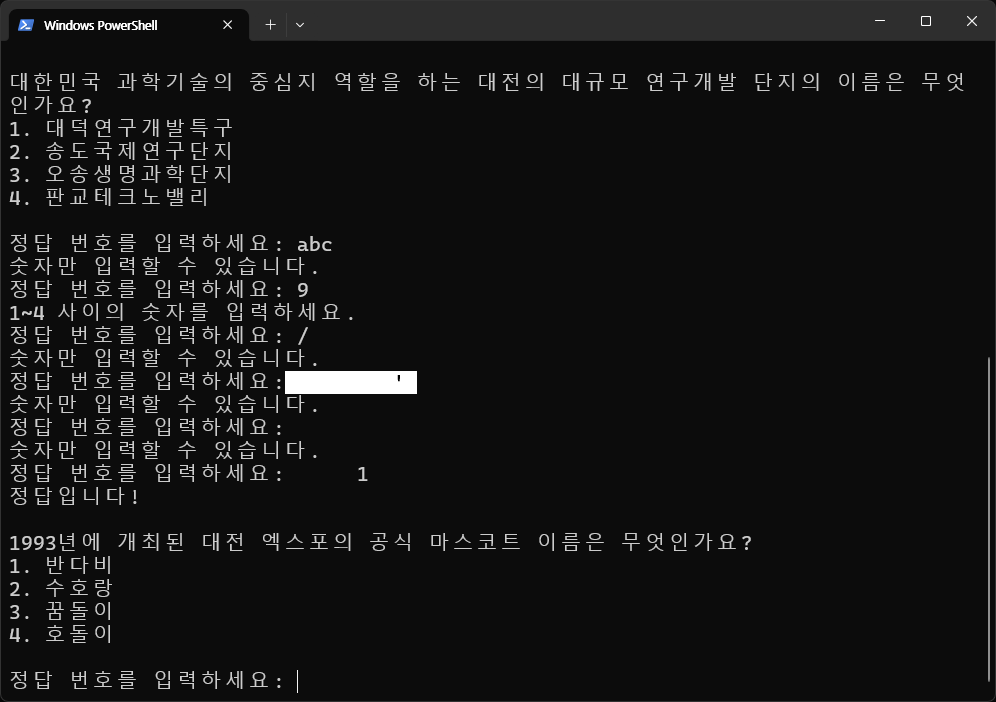

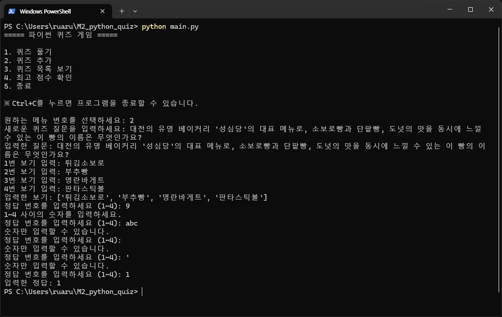
> ※ 이 화면은 JSON 저장 기능 구현 전 단계로, 현재 버전에서 출력되는 등록·저장 완료 메시지는 표시되지 않습니다. 추가한 퀴즈는 대전 성심당의 대표 메뉴인 튀김소보로 관련 문제입니다.


> ※ 이 화면은 JSON 저장 기능 구현 전(메모리에서만 유지되던 단계)입니다.

### 7-3. 데이터 저장 및 유지 검증

#### 1) 데이터 유지 테스트

| 테스트 항목 | 실행 결과 | 판정 |
|---|---|---|
| 퀴즈 추가 후 재실행 | 추가한 6번째 퀴즈 유지 확인 | PASS |
| 최고 점수 33점 저장 후 재실행 | 33점 유지 확인 | PASS |
| 최고 점수 67점으로 갱신 후 재실행 | 67점 유지 확인 | PASS |
| 저장 파일 손상 | 기본 퀴즈 5개와 최고 점수 0점으로 복구 확인 | PASS |
| 손상 전 백업 데이터 복원 | 퀴즈 6개와 최고 점수 67점 복원 확인 | PASS |
| `state.json` 파일 누락 | 기본 퀴즈 5개로 실행하고 파일 재생성 확인 | PASS |

#### 2) 저장 파일 복구 실습

```powershell
Copy-Item state.json state_backup.json                          # 1. 백업 파일 생성
Set-Content state.json "{ 잘못된 JSON 데이터 }" -Encoding UTF8   # 2. 손상 상황 재현
Copy-Item state_backup.json state.json -Force                   # 3. 백업 파일 복원
Move-Item state.json state_temp.json                            # 4. 파일 누락 상황 재현
python main.py
```

<details>
<summary>손상 복구 및 백업 복원 실습 로그 확인하기</summary>

※ 반복되는 메뉴 출력과 퀴즈 목록 일부는 생략했으며, 프롬프트 경로(`PS C:\Users\ruaru\M2_python_quiz>`)는 `PS>`로 줄여 표기했습니다.

```text
PS> Set-Content state.json "{ 잘못된 JSON 데이터 }" -Encoding UTF8
PS> Get-Content state.json -Encoding UTF8
{ 잘못된 JSON 데이터 }
PS> python main.py
저장 데이터에 문제가 있습니다: Unexpected UTF-8 BOM (decode using utf-8-sig): line 1 column 1 (char 0)
기본 퀴즈 데이터로 복구합니다.
게임 데이터가 저장되었습니다.
... (메뉴 출력 생략) ...
원하는 메뉴 번호를 선택하세요: 3
... (기본 퀴즈 1~5번 목록 생략) ...
총 5개의 퀴즈가 있습니다.
원하는 메뉴 번호를 선택하세요: 4
현재 최고 점수: 0점
원하는 메뉴 번호를 선택하세요: 5
프로그램을 종료합니다.

PS> Copy-Item state_backup.json state.json -Force
PS> python main.py
저장된 게임 데이터를 불러왔습니다.
원하는 메뉴 번호를 선택하세요: 3
... (기본 퀴즈 1~5번 목록 생략) ...
6. 대전의 유명 베이커리 '성심당'의 대표 메뉴로, ... 이 빵의 이름은 무엇인가요?
총 6개의 퀴즈가 있습니다.
원하는 메뉴 번호를 선택하세요: 4
현재 최고 점수: 67점
```
</details>


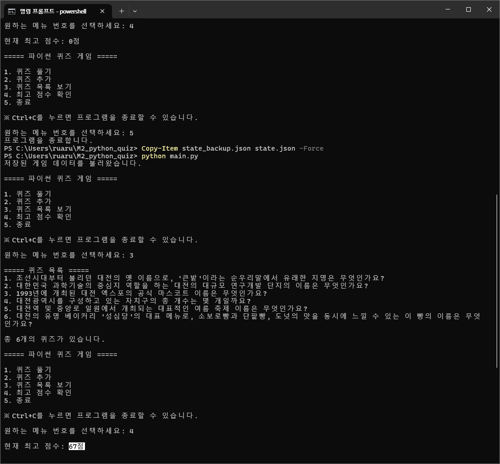

프로그램이 저장 파일의 손상 또는 누락 상황을 확인하고 기본 퀴즈 데이터를 이용해 실행되는 것을 확인했습니다.

> ※ 손상 파일 생성 시 PowerShell이 BOM을 붙여 BOM 오류로 감지된 뒤 복구되었습니다. 백업·임시 파일은 실습용으로 만든 파일이며 GitHub 저장소에는 포함하지 않았습니다.

### 7-4. 최종 기능 및 예외 상황 검증

입력·예외 상황별 처리와 검증 상태는 [3-1](#3-1-입력-및-예외-상황-처리)에 정리했으며, 여기에는 3-1에 없는 항목과 실습 로그를 남깁니다.

| 검증 항목 | 확인 내용 | 검증 상태 |
| --- | --- | --- |
| 기본 퀴즈 5개 | 대전 역사·과학·문화 퀴즈 5개가 목록과 퀴즈 풀기에서 제공됨 | 실행 확인 |
| 정상 종료 | 메뉴 5번(보너스 4 이후 6번) 선택 시 "프로그램을 종료합니다." 메시지 출력 후 종료 | 실행 확인 ([7-3](#7-3-데이터-저장-및-유지-검증)의 15번 화면, [24](docs/screenshots/24_delete_2.png) 화면) |

<details>
<summary>퀴즈 없음 · 초기 점수 0점 실습 로그 확인하기</summary>

※ 기존 `state.json`을 백업한 뒤 퀴즈가 없는 데이터로 바꿔 실행하고, 실습 후 원래 파일로 복원했습니다. 반복되는 메뉴 출력은 생략했습니다.

```text
PS> Copy-Item state.json state_before_empty.json
PS> Set-Content state.json '{"quizzes": [], "best_score": 0}' -Encoding ascii
PS> python main.py
저장된 게임 데이터를 불러왔습니다.
... (메뉴 출력 생략) ...
원하는 메뉴 번호를 선택하세요: 1
등록된 퀴즈가 없습니다.
원하는 메뉴 번호를 선택하세요: 3
===== 퀴즈 목록 =====
총 0개의 퀴즈가 있습니다.
원하는 메뉴 번호를 선택하세요: 4
현재 최고 점수: 0점
원하는 메뉴 번호를 선택하세요: 5
프로그램을 종료합니다.

PS> Copy-Item state_before_empty.json state.json -Force
PS> Remove-Item state_before_empty.json
```

※ `-Encoding UTF8`로 저장하면 PowerShell이 BOM을 붙여 손상 파일로 감지되므로, 한글이 없는 이 데이터는 `ascii`로 저장했습니다.
</details>

### 7-5. Git 작업 및 제출 증거

Git 명령어 7종의 역할은 [8-2](#8-2-git-기초-필수-명령어-7종)에 정리했고, 여기에는 실제 실행 기록을 남깁니다.

#### 1) 브랜치 생성 및 병합

기능별 작업을 분리하기 위해 `feature/quiz-play`, `feature/quiz-game-class`, `feature/json-persistence` 브랜치를 만들어 작업한 뒤 `main` 브랜치에 병합했습니다.

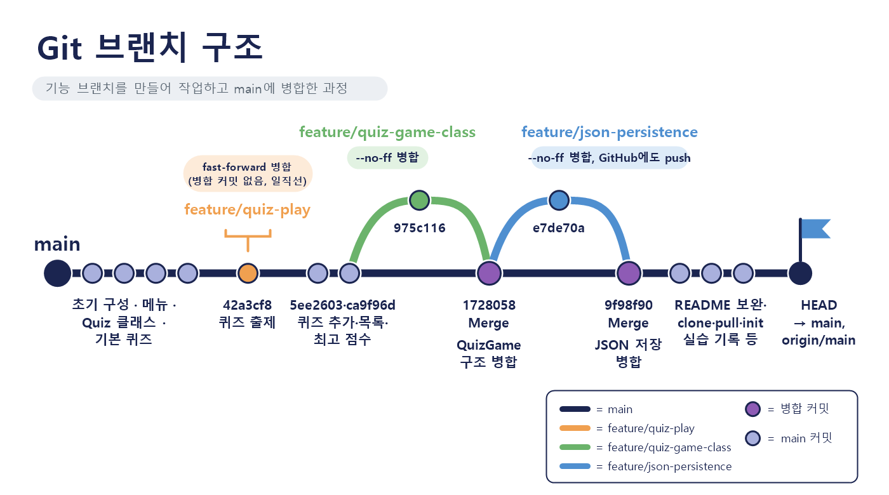


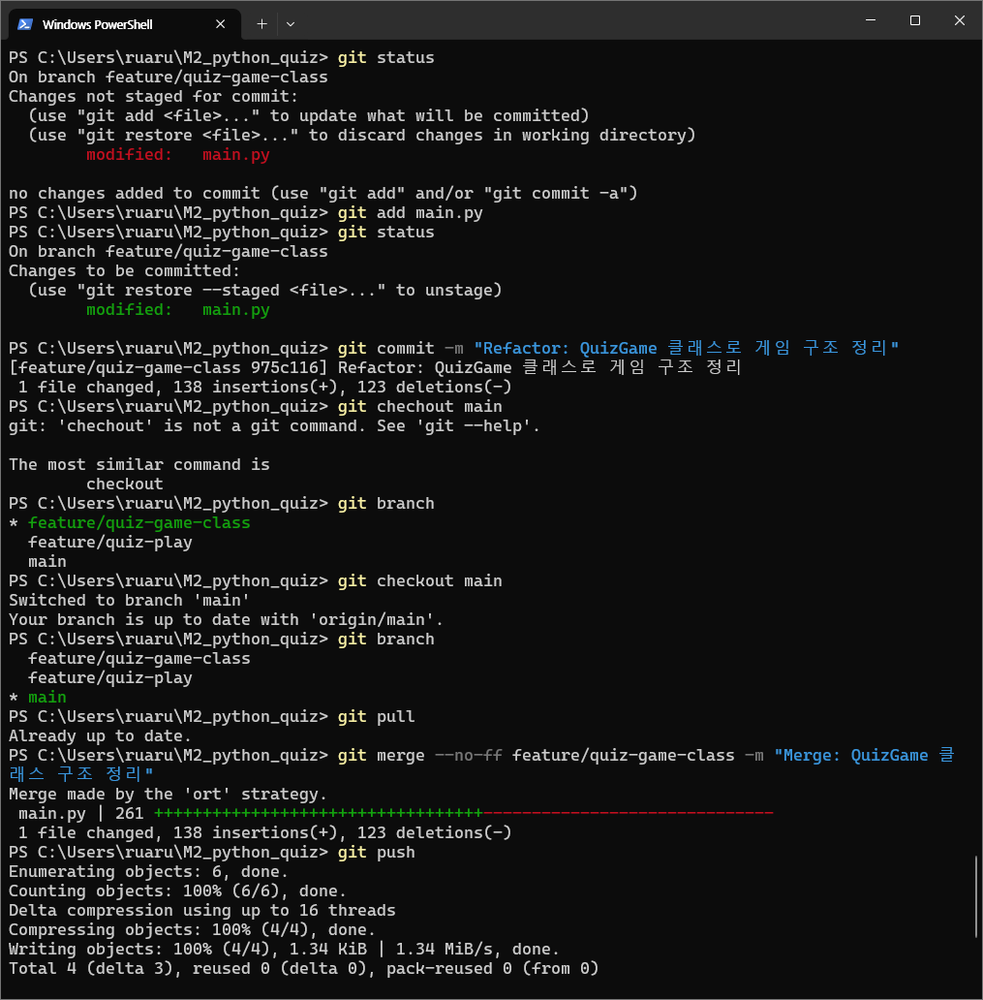

**JSON 저장 기능 병합 과정**

```powershell
git push -u origin feature/json-persistence
git checkout main
git pull origin main
git merge --no-ff feature/json-persistence -m "Merge: JSON 데이터 저장 기능 추가"
git push origin main
```

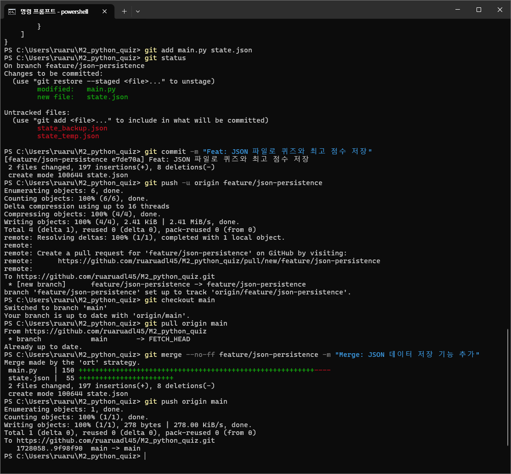

→ 기능 브랜치를 원격 저장소에 push한 뒤 `main`에서 pull·병합하고, 병합 결과를 GitHub에 반영했습니다.

#### 2) Clone 및 Pull 실습

다른 컴퓨터에서 작업하는 상황을 가정해 같은 PC의 별도 폴더(`C:\Users\ruaru\M2_clone_test`)에 저장소를 복제했습니다. 복제본에서 수정·push한 내용을 원래 폴더(`C:\Users\ruaru\M2_python_quiz`)에서 pull해 반영 여부를 확인했습니다.


**① 복제본 만들기 및 실행**

```powershell
cd C:\Users\ruaru
mkdir M2_clone_test
cd M2_clone_test
git clone https://github.com/ruaruadl45/M2_python_quiz.git
cd M2_python_quiz
git pull origin main
python main.py
```


→ 복제 직후 `git pull` 결과 `Already up to date.`, 복제본에서 `python main.py` 정상 실행·종료 확인

**② 복제본에서 수정 후 push**

```powershell
notepad README.md
git status
git add README.md
git commit -m "Docs: clone 실습 기록 추가"
git push origin main
```


→ [8-2](#8-2-git-기초-필수-명령어-7종) 표의 `clone` 항목을 `별도 실습 예정` → `M2_clone_test 폴더에 복제해 실습`으로 수정해 커밋(`4429076`)하고, `354c750..4429076 main -> main`으로 push 확인

**③ 원래 폴더에서 pull 후 반영 확인**

```powershell
cd C:\Users\ruaru\M2_python_quiz
Select-String README.md -Pattern "별도 실습 예정|복제해 실습"
git pull origin main
Select-String README.md -Pattern "별도 실습 예정|복제해 실습"
git log --oneline -3
```


→ pull 전 `별도 실습 예정`이던 줄이 `Fast-forward` 후 `M2_clone_test 폴더에 복제해 실습`으로 바뀌고, 최신 커밋이 `4429076`으로 복제본과 일치함을 확인

#### 3) Init 실습

이 저장소는 GitHub에서 먼저 만든 뒤 `clone`으로 작업을 시작해 `git init`을 쓸 일이 없었기 때문에, 미션 파일이 없는 별도 환경(Docker 컨테이너 `quiz-pc`, Python 3.13·Git 2.47)에서 빈 폴더를 저장소로 초기화하는 과정을 따로 실습했습니다.

```bash
docker exec -it quiz-pc bash        # 별도 환경(컨테이너) 접속
cd /root && ls                      # 미션 파일이 없는 상태 확인
mkdir quiz_init_test && cd quiz_init_test
git init -b main                    # 빈 폴더를 Git 저장소로 초기화
git remote add origin https://github.com/ruaruadl45/M2_python_quiz.git
git remote -v                       # 원격 저장소 연결 확인
git pull origin main                # 원격 저장소의 main 브랜치 내려받기
ls && git log --oneline -3
python main.py
```


→ 빈 폴더에서 `Initialized empty Git repository` 확인, `origin` 연결 후 pull로 파일 4개와 최신 커밋(`6c4c3df`)을 내려받아 `main.py` 정상 실행 확인

**`clone`과 `init`의 차이**

| 구분 | `git clone` | `git init` + `remote add` + `pull` |
| --- | --- | --- |
| 시작점 | 원격 저장소 | 빈 폴더 |
| 원격 연결 | 자동으로 `origin` 등록 | `git remote add`로 직접 등록 |
| 사용하는 상황 | 이미 있는 저장소를 받아 작업할 때 | 내 폴더를 새로 Git 저장소로 만들 때 |

#### 4) Git 작업 이력 확인

**실행 명령어**

```powershell
git log --oneline --graph --all --decorate
```


**GitHub 커밋 목록**


**확인 내용**
- 캡처 시점 기준 `Initial commit`부터 `Docs: init 실습 기록 추가`까지 총 16개의 커밋이 `Feat:` / `Docs:` / `Refactor:` / `Merge:` 규칙에 맞게 기록됨
- `feature/quiz-game-class`, `feature/json-persistence`는 `--no-ff` 병합으로 그래프에 갈라졌다 합쳐지는 모양(`|\`, `|/`)이 남음
- 최신 커밋 `190d2c5`에 `HEAD -> main`, `origin/main`이 함께 표시되어 로컬과 GitHub 원격 저장소가 동기화된 상태임을 확인
- GitHub 커밋 목록에서도 같은 16개 커밋이 확인됨 (이후 문서·이미지 보완 커밋이 추가될 수 있음)

#### 5) 보너스 과제 브랜치

보너스 과제는 항목마다 브랜치를 만들어 작업한 뒤 `main`에 `--no-ff`로 병합했습니다. 그래프에서 보너스 1개가 갈라졌다 합쳐지는 줄기 1개로 보여, 어떤 기능을 언제 넣었는지 구분하기 쉽습니다.

| 순서 | 브랜치 | 기능 커밋 | 병합 커밋 |
| :-: | --- | --- | --- |
| 1 | `feature/bonus-random` | `Feat: 보너스1 퀴즈 랜덤 출제 기능 추가` | `Merge: 보너스1 퀴즈 랜덤 출제 기능 추가` |
| 2 | `feature/bonus-count` | `Feat: 보너스2 풀 문제 수 선택 기능 추가` | `Merge: 보너스2 풀 문제 수 선택 기능 추가` |
| 3 | `feature/bonus-hint` | `Feat: 보너스3 힌트 기능 및 점수 차감 추가` | `Merge: 보너스3 힌트 기능 및 점수 차감 추가` |
| 4 | `feature/bonus-delete` | `Feat: 보너스4 퀴즈 삭제 기능 추가` | `Merge: 보너스4 퀴즈 삭제 기능 추가` |
| 5 | `feature/bonus-history` | `Feat: 보너스5 점수 기록 히스토리 및 최고 점수 기준 개선` | `Merge: 보너스5 점수 기록 히스토리 및 최고 점수 기준 개선` |

- 다음 보너스는 앞 보너스가 `main`에 병합된 뒤 `main`에서 새 브랜치를 만들었습니다. 보너스 1~3이 모두 `play()`를 고치기 때문에, 병합 전에 브랜치를 만들면 이전 기능이 빠진 코드에서 시작하게 됩니다.
- 브랜치 작업 순서: `git checkout -b <브랜치>` → 수정·커밋 → `git push -u origin <브랜치>` → `git checkout main` → `git pull origin main` → `git merge --no-ff <브랜치>` → `git push origin main`

[맨 위로 이동](#top)

---

## 8. 핵심 개념 정리

### 8-1. Python 기초 · 클래스 · 파일 입출력

| 개념 | 한 줄 설명 | 이 프로젝트에서 사용한 예 |
| --- | --- | --- |
| 변수 | 값을 담아 두고 다시 쓰거나 바꾸기 위한 이름표 | `best_score`(최고 점수), `quizzes`(퀴즈 목록) |
| `int` / `str` / `bool` | 정수 / 문자열 / 참·거짓 | 정답 번호·점수 / 문제·선택지·입력값 / 정답 여부 |
| `list` / `dict` | 순서 있는 묶음 / 이름 붙은 항목 묶음 | 퀴즈 목록·선택지 / 퀴즈 1개의 데이터·JSON 데이터 |
| 조건문 `if / elif / else` | 조건에 따라 다른 동작을 실행 | 메뉴 번호별 기능 실행 |
| 반복문 `for` / `while` | 정해진 데이터를 하나씩 반복 / 조건이 맞는 동안 반복 | `for`로 퀴즈를 하나씩 출제, `while`로 메뉴와 입력 재요청 반복 |
| 함수·매개변수·반환값 | 작업을 묶고, 값을 받아, 결과를 돌려줌 | `get_valid_number(prompt, min_value, max_value)`가 범위 안의 숫자를 반환 |
| `__init__` / `self` | 객체를 만들 때 실행되는 초기 설정 / 객체 자신 | `QuizGame.__init__()`에서 퀴즈 목록·최고 점수·저장 파일 경로 초기화 |
| 속성 / 메서드 | 객체가 가진 데이터 / 객체가 하는 기능 | `Quiz`의 `question`·`choices`·`answer` / `display()`·`check_answer()` |
| 파일 입출력 | `open()`으로 열고 `json.load()`로 읽고 `json.dump()`로 쓰기 | `encoding="utf-8"`을 지정해 한글을 정상 저장 |
| JSON | `dict`·`list`와 비슷한 구조로 데이터를 표현하는 텍스트 형식 | 퀴즈 목록과 최고 점수를 `state.json`에 저장 |
| 표준 라이브러리 / `import` | Python 설치 시 함께 들어 있는 기본 도구 상자 / 그 도구를 꺼내 쓰는 명령 | `random`(랜덤 출제), `datetime`(기록 날짜·시간). 외부 라이브러리가 아니므로 미션 조건에 맞음 |
| `random.sample(목록, 개수)` | 원본은 그대로 두고, 무작위로 뽑은 새 목록을 만듦 | 퀴즈 순서를 섞고 선택한 문제 수만큼 뽑기 (원본·`state.json` 순서 유지) |
| `dict.get(키, 기본값)` | 키가 있으면 값을, 없으면 기본값을 돌려줌 (`dict[키]`는 없으면 `KeyError`) | 예전 `state.json`에 없는 `hint`, `history`, `best_question_count`를 오류 없이 읽기 |
| `list.pop(위치)` | 목록에서 해당 위치의 항목을 꺼내며 삭제. 위치는 0부터 셈 | 화면 번호 3 → `pop(3 - 1)`로 퀴즈 삭제 |
| 매개변수 기본값 | 값을 넘기지 않으면 미리 정한 값을 사용 | `Quiz(..., hint="")`, `save_state(show_message=True)` |

**클래스와 함수 방식 비교**

클래스는 데이터와 기능을 함께 담아 놓은 설계도입니다. 함수만으로 만들면 퀴즈 목록이나 최고 점수 같은 데이터를 여러 함수가 함께 쓰기 위해 전역 변수로 두거나 매번 매개변수로 넘겨야 합니다. 클래스를 사용하면 데이터(상태)와 그 데이터를 다루는 기능을 한 객체 안에 함께 두므로, 객체가 자기 데이터를 스스로 관리하고 어떤 기능이 어떤 데이터를 바꾸는지 한곳에서 확인할 수 있습니다.

이번 프로젝트에서는 개별 퀴즈의 정보와 기능을 `Quiz`에 모으고, 게임 전체의 진행과 데이터 관리는 `QuizGame`에 모아 역할을 구분했습니다.

**JSON의 특징과 한계**

- 특징: 가볍고 간단한 텍스트 형식으로 데이터를 저장하고 전달하기 편리하며, 사람이 직접 내용을 읽고 수정하기도 쉽습니다. 여러 프로그램에서 데이터를 주고받을 때 활용할 수 있습니다.
- 한계: 데이터가 많아지면(예: 퀴즈 1000개 이상) 다음과 같은 문제가 생길 수 있습니다.
  - 메모리 부담: 프로그램을 시작할 때 `json.load()`가 파일 전체를 메모리에 한 번에 읽어 오므로, 데이터가 커질수록 메모리 사용량과 시작 시간이 늘어납니다.
  - 저장 부담: 퀴즈를 한 개만 추가해도 `save_state()`가 파일 전체를 다시 쓰고, 저장 중 문제가 생기면 파일 전체가 손상될 위험도 커집니다.
  - 동시 수정: 여러 사용자가 동시에 수정하면 서로의 변경 내용을 덮어쓸 수 있습니다.
  - 대안: 데이터가 더 커지면 데이터베이스(예: SQLite)로 옮기는 방법을 고려할 수 있습니다.
- 주의사항: JSON 문법이 잘못되거나 필수 데이터가 누락되면 정상적으로 읽지 못할 수 있습니다.

**예외 처리 (`try / except`)**

`try / except`는 프로그램 실행 중 오류가 발생했을 때 오류를 처리하고, 프로그램이 갑자기 종료되는 것을 방지하기 위한 문법입니다.

이번 프로젝트에서는 다음과 같이 적용했습니다.

- 숫자로 변환할 수 없는 입력: `ValueError` 처리
- JSON 형식이 잘못된 경우: `json.JSONDecodeError` 처리
- 파일을 읽거나 쓸 수 없는 경우: `OSError` 처리
- Ctrl+C 입력: `KeyboardInterrupt` 처리
- 입력 스트림 종료: `EOFError` 처리

### 8-2. Git 기초 (필수 명령어 7종)

Git은 코드와 문서의 변경 이력을 기록하고 관리하는 버전 관리 도구입니다. 이번 미션에서는 기능별 작업 내용을 기록하고, 브랜치에서 개발한 기능을 `main`에 병합하는 데 사용했습니다.

| 명령어 | 하는 일 | 이번 미션에서 사용한 위치/상황 |
| --- | --- | --- |
| `init` | 현재 폴더를 Git 저장소로 초기화 | 미션 파일이 없는 별도 환경(Docker 컨테이너)의 빈 폴더를 저장소로 만든 뒤 원격 저장소와 연결 ([21](docs/screenshots/21_git_init.png) 화면) |
| `add` | 변경된 파일을 커밋할 대상으로 지정 | `main.py`, `state.json`을 커밋하기 전 추가 |
| `commit` | 변경 내용을 하나의 작업 기록으로 저장 | 기능 구현 및 수정 내용을 기록할 때 |
| `push` | 로컬 저장소의 커밋을 원격 저장소에 업로드 | 기능 브랜치와 `main` 브랜치의 변경 내용을 GitHub에 업로드 |
| `pull` | 원격 저장소의 변경 내용을 가져와 로컬 브랜치에 반영 | `main` 브랜치에서 `origin/main`의 변경 내용 동기화 |
| `checkout` | 브랜치를 전환하거나 특정 작업 상태로 이동 | `main`과 `feature/json-persistence` 브랜치 전환 |
| `clone` | 원격 저장소 전체를 로컬 컴퓨터에 복사 | M2_clone_test 폴더에 복제해 실습 |

※ 각 명령어의 실제 실행 과정은 [7-5](#7-5-git-작업-및-제출-증거)에 정리했습니다.

- **브랜치**: 기존 작업과 분리해 새 기능을 개발하는 작업 공간입니다. 기능별로 3개의 브랜치를 만들어 개발했습니다.
- **병합(merge)**: 다른 브랜치에서 진행한 작업을 하나로 합치는 과정입니다. 각 기능 브랜치를 `main`에 병합해 최종 코드에 반영했습니다.

[맨 위로 이동](#top)

---

## 9. 트러블슈팅

개발 및 실습 과정에서 실제로 발생한 문제를 문제 상황 → 원인 추정 → 확인 방법 → 해결 방법 → 최종 결과 순서로 기록합니다.

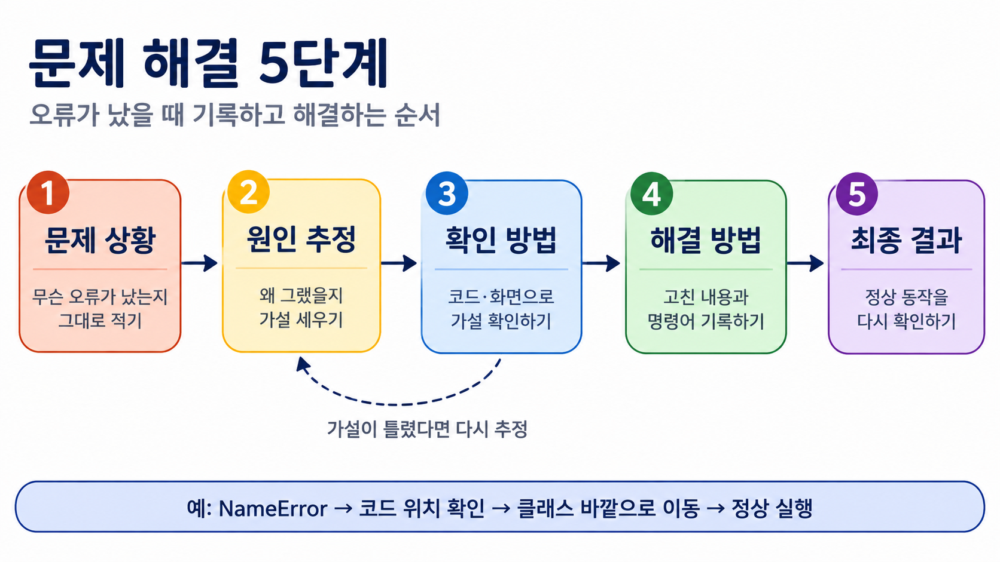

### 9-1. 문제 사례 1: 기본 퀴즈 데이터 코드의 위치 및 들여쓰기 오류

| 구분 | 기록 내용 |
| --- | --- |
| 문제 상황 | `main.py`의 `quizzes`에 해당하는 기본 퀴즈 데이터를 추가한 뒤 프로그램을 실행하자 `NameError: name 'Quiz' is not defined` 오류가 발생했습니다. |
| 원인 추정 | Python 코드 작성과 들여쓰기 규칙에 익숙하지 않아 퀴즈 데이터 코드가 의도한 위치가 아닌 `class Quiz` 내부에 포함된 것이 원인으로 추정되었습니다. |
| 확인 방법 | `main.py`의 클래스 선언 위치와 들여쓰기 구조를 확인하고, 기본 퀴즈 데이터 코드가 어느 클래스에 포함되어 있는지 살펴보았습니다. |
| 해결 방법 | 퀴즈 데이터 코드를 `class Quiz` 내부에서 분리하고, `class Quiz` 바깥(최상위)으로 옮겨 `Quiz` 정의가 끝난 뒤 객체를 만들도록 수정했습니다. 이후 `QuizGame` 클래스를 구현하면서 `QuizGame.__init__()` 안으로 옮겨 정리했습니다. |
| 최종 결과 | 수정 후 `NameError` 없이 프로그램이 정상 실행되는 것을 확인했습니다. |


### 9-2. 문제 사례 2: PowerShell에서 Python 파일의 한글 인코딩 깨짐

| 구분 | 기록 내용 |
| --- | --- |
| 문제 상황 | PowerShell에서 `Get-Content main.py` 명령어로 전체 코드 내용을 확인했을 때 한글이 정상적으로 표시되지 않고 글자가 깨지는 현상이 발생했습니다. |
| 원인 추정 | 원본 `main.py` 파일의 한글 내용에는 문제가 없었으며, PowerShell에서 파일을 읽어 들이는 과정의 인코딩 설정이 원본 파일의 인코딩과 맞지 않는 것으로 추정했습니다. |
| 확인 방법 | VS Code에서 원본 `main.py`의 한글이 정상적으로 표시되는지 확인하고, PowerShell에서 `Get-Content` 명령어를 실행했을 때의 출력 결과와 비교했습니다. |
| 해결 방법 | `Get-Content` 명령어에 인코딩 설정을 추가하여 파일을 읽도록 수정했습니다. (`Get-Content main.py -Encoding UTF8`) |
| 최종 결과 | 원본 파일을 수정하지 않고 PowerShell의 읽기 인코딩 설정만 변경하여 한글 코드가 정상적으로 표시되는 것을 확인했습니다. |


### 9-3. 문제 사례 3: 힌트 저장 코드 추가 후 SyntaxError

| 구분 | 기록 내용 |
| --- | --- |
| 문제 상황 | 보너스 3에서 `save_state()`에 `"hint": quiz.hint`를 추가한 뒤 실행하자 `SyntaxError: invalid syntax. Perhaps you forgot a comma?`가 발생하고 프로그램이 시작되지 않았습니다. 이 때문에 `state.json`도 새로 만들어지지 않았습니다. |
| 원인 추정 | 오류 메시지가 가리킨 `"answer": quiz.answer` 줄 뒤에 항목이 하나 더 생겼는데, 항목을 구분하는 쉼표가 빠진 것으로 추정했습니다. |
| 확인 방법 | 오류 메시지의 줄 번호와 `^` 표시 위치를 따라가 `dict` 안의 항목 구분을 확인했습니다. |
| 해결 방법 | `"answer": quiz.answer` → `"answer": quiz.answer,`로 쉼표를 추가했습니다. |
| 최종 결과 | 프로그램이 정상 실행되고, 힌트가 포함된 `state.json`이 생성되었습니다. |

※ `SyntaxError`(문법 오류)는 Python이 실행 전에 코드 전체를 먼저 읽는 단계에서 발견되므로, 오류가 난 줄까지 가기 전에 프로그램이 아예 시작되지 않습니다.

### 9-4. 문제 사례 4: 힌트를 추가했는데 기존 state.json에 반영되지 않음

| 구분 | 기록 내용 |
| --- | --- |
| 문제 상황 | 기본 퀴즈 5개에 힌트를 넣었는데도 `state.json`을 열어 보면 `hint` 항목이 없고, 게임에서도 힌트가 나오지 않았습니다. |
| 원인 추정 | 프로그램은 `state.json`이 **있으면** 코드의 기본 퀴즈 대신 파일 내용을 읽습니다. 기존 파일에는 힌트가 없으니 `.get("hint", "")`로 빈 힌트가 채워진 것으로 추정했습니다. |
| 확인 방법 | `load_state()`에서 기본 퀴즈(`get_default_quizzes()`)를 쓰는 경우가 파일이 없거나 손상됐을 때뿐인지 확인했습니다. |
| 해결 방법 | 기존 파일을 `state_nohint.json`으로 복사해 둔 뒤 `state.json`을 삭제하고 다시 실행해, 힌트가 포함된 기본 데이터로 새 파일을 만들었습니다. |
| 최종 결과 | 새 파일에 `hint`가 저장되고 힌트가 정상 표시되었습니다. 보관한 예전 파일로도 오류 없이 실행되는 것을 [23_hint_1](docs/screenshots/23_hint_1.png) 화면으로 확인했습니다. |

→ 정리: 기존 파일은 `.get()`으로 오류 없이 읽히지만 새 칸은 빈칸이고, 새 기본값을 쓰려면 파일을 새로 만들어야 합니다.

[맨 위로 이동](#top)

---

## 10. 보너스 과제 수행 내용

필수 항목을 모두 완료한 뒤 보너스 과제 5개를 모두 수행했습니다. 바뀐 `state.json` 구조는 [5장](#5-데이터-파일-설명-statejson)에 함께 반영했습니다.

| 과제 항목 | 수행 여부 | 구현 내용 및 결과 |
| --- | :-: | --- |
| 랜덤 출제 | ✅ | `random.sample()`로 섞은 복사본을 출제. 원본 목록과 `state.json` 순서는 유지 ([10-1](#10-1-랜덤-출제)) |
| 문제 수 선택 | ✅ | 풀 문제 수(1~퀴즈 개수)를 입력받고, 점수는 선택한 문제 수 기준 ([10-2](#10-2-문제-수-선택)) |
| 힌트 기능 및 점수 차감 | ✅ | `Quiz`에 `hint` 속성 추가, 정답 입력에서 `0`으로 힌트 보기, 문제당 10점 차감 ([10-3](#10-3-힌트-기능-및-점수-차감)) |
| 퀴즈 삭제 | ✅ | 메뉴 5번에서 번호로 삭제, `0`은 취소, 삭제 결과 파일 반영 ([10-4](#10-4-퀴즈-삭제)) |
| 점수 기록 히스토리 | ✅ | 게임마다 날짜·시간, 푼 문제 수, 정답 수, 힌트 수, 점수 저장. 최고 점수 기준도 함께 개선 ([10-5](#10-5-점수-기록-히스토리-및-최고-점수-기준)) |

※ 브랜치·커밋 기록은 [7-5의 5)](#5-보너스-과제-브랜치)에 정리했습니다.

### 10-1. 랜덤 출제

**구현 내용** (`QuizGame.play()`)

```python
shuffled_quizzes = random.sample(self.quizzes, question_count)

for quiz in shuffled_quizzes:
```

- `random.shuffle(self.quizzes)`는 원본 목록 자체를 섞습니다. 그 상태에서 최고 점수가 저장되면 섞인 순서가 `state.json`에 기록되고, 퀴즈 목록 번호도 바뀝니다.
- 그래서 원본은 그대로 두고 **섞은 복사본을 만드는** `random.sample()`을 사용했습니다.

**실행 결과** (번호는 원래 퀴즈 목록 번호)

| 화면 | 확인 내용 |
| --- | --- |
| [22_bonus_random_1](docs/screenshots/22_bonus_random_1.png) | 한 회차: 2번 → 4번 퀴즈 순으로 출제 |
| [22_bonus_random_2](docs/screenshots/22_bonus_random_2.png) | 다른 회차: 3번 → 2번 → 4번 → 1번 퀴즈 순으로 출제 |
| [22_bonus_random_3](docs/screenshots/22_bonus_random_3.png) | 풀이 종료 후 퀴즈 목록: 1~5번 원래 순서 유지 |

※ 세 화면은 하나로 이어진 실행이 아니라, 각 화면이 위 내용을 보여주는 별도 회차입니다.

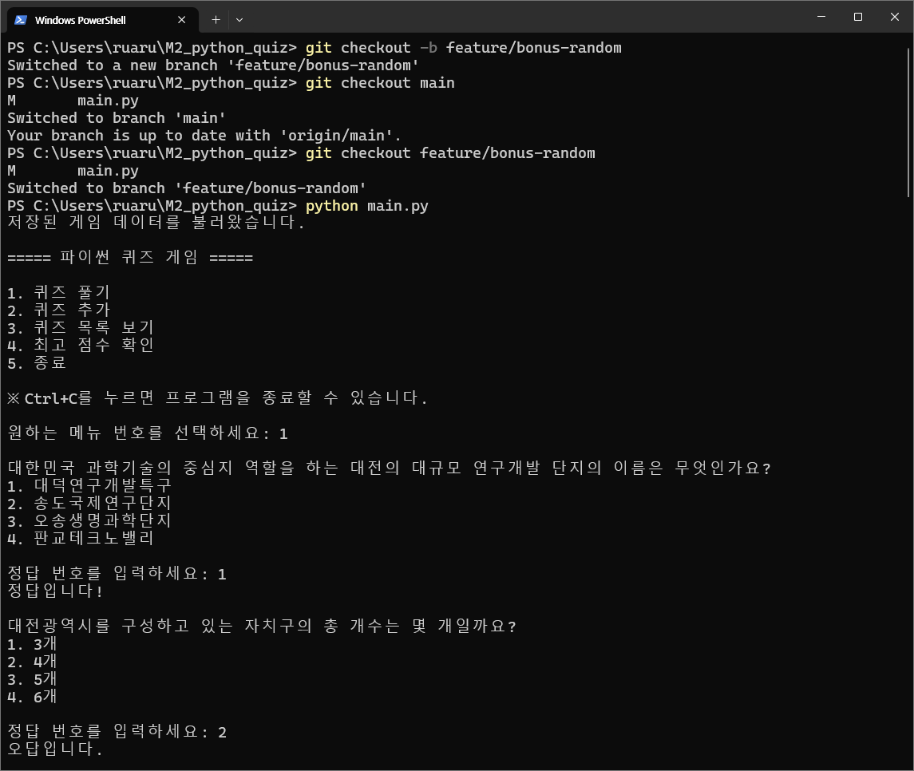

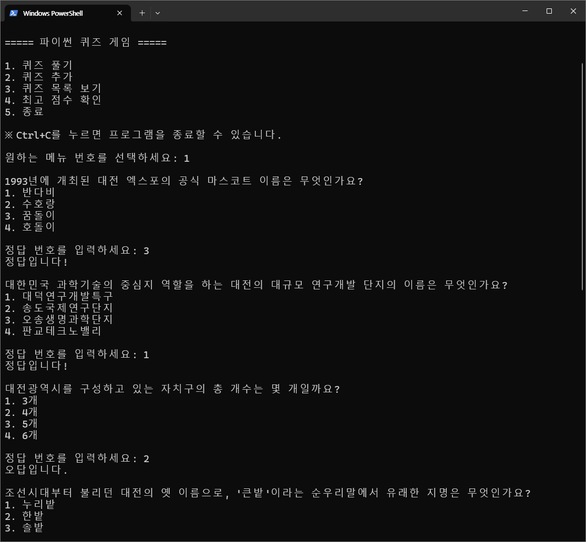

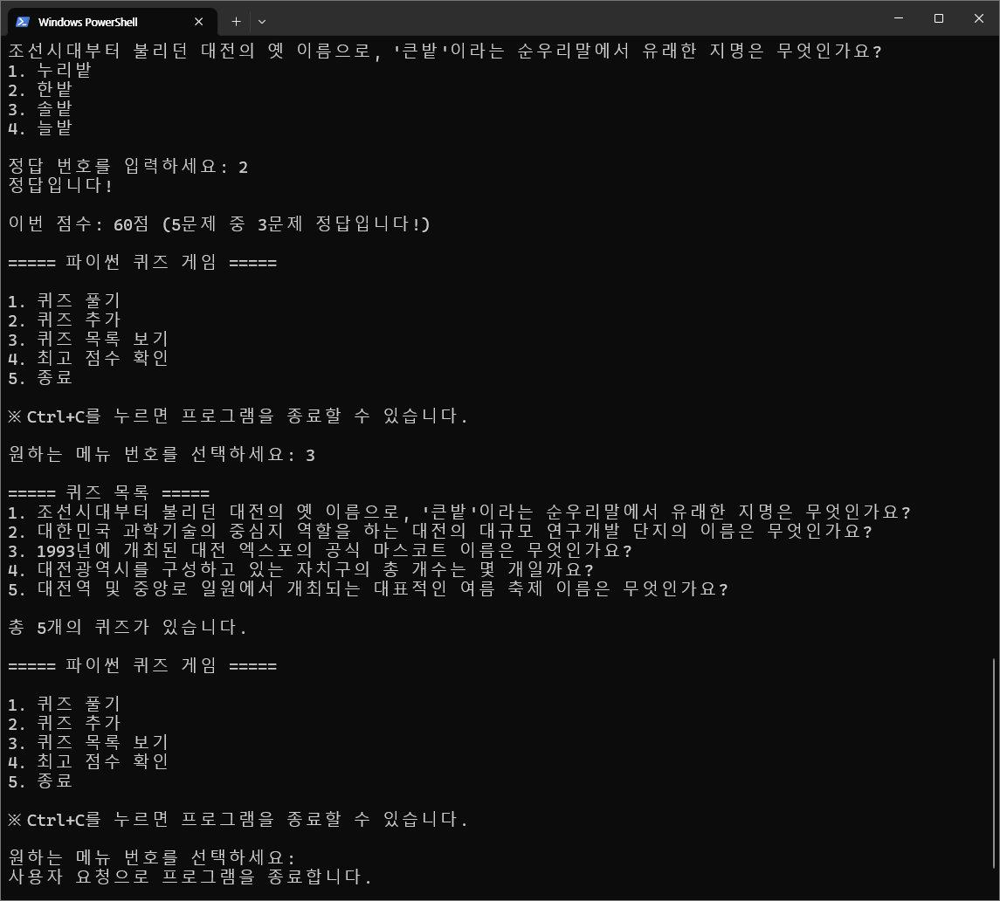

### 10-2. 문제 수 선택

**구현 내용** (`QuizGame.play()`)

```python
quiz_total = len(self.quizzes)
question_count = get_valid_number(
    f"몇 문제를 풀까요? (1~{quiz_total}): ", 1, quiz_total
)
...
total_count = question_count
```

- 기존 입력 검증 함수 `get_valid_number()`를 재사용해 범위 밖 숫자·문자·빈 입력을 처리합니다.
- 점수 기준을 `len(self.quizzes)`에서 `question_count`로 바꿨습니다. 바꾸지 않으면 3문제를 골라 모두 맞혀도 3 ÷ 5 = 60점이 됩니다.

**실행 결과**: [22_bonus_count_1](docs/screenshots/22_bonus_count_1.png) → [22_bonus_count_2](docs/screenshots/22_bonus_count_2.png)는 한 번의 실행입니다.

| 선택 | 출제 | 결과 |
| :-: | --- | --- |
| 1문제 | 2번 퀴즈 1개 | `1문제 중 0문제 정답`, 0점 |
| 2문제 | 3번 → 4번 퀴즈 | `2문제 중 2문제 정답`, 100점 |
| 메뉴 3 | 퀴즈 목록 | 1~5번 원래 순서 유지 |

→ 회차마다 다른 문제가 나와 랜덤 출제(10-1)도 함께 확인됩니다.

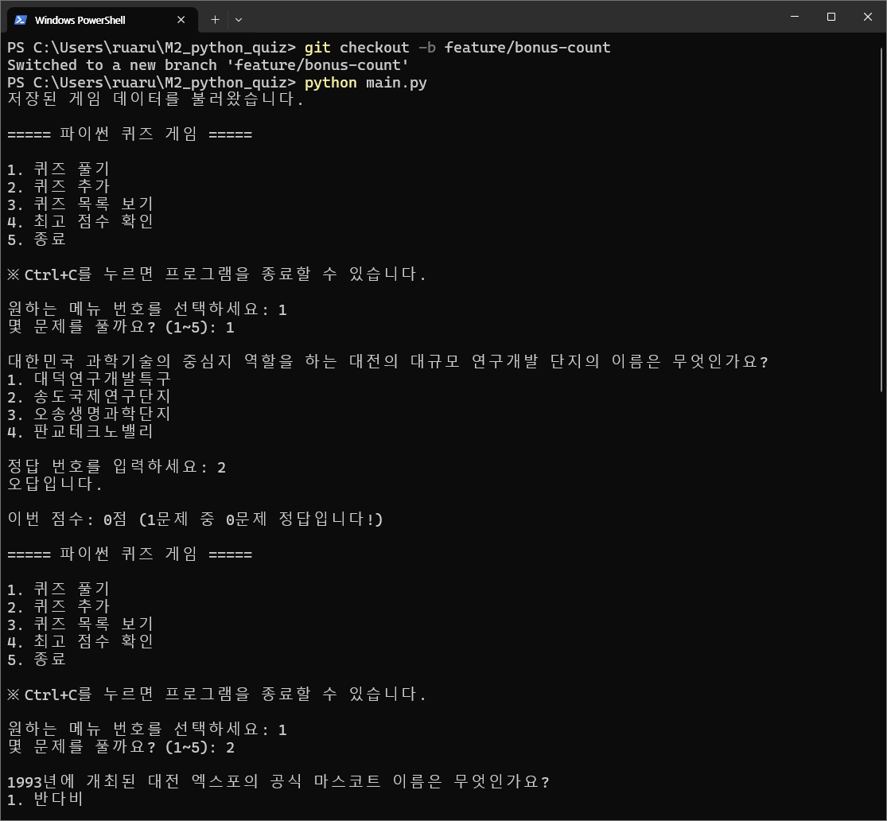

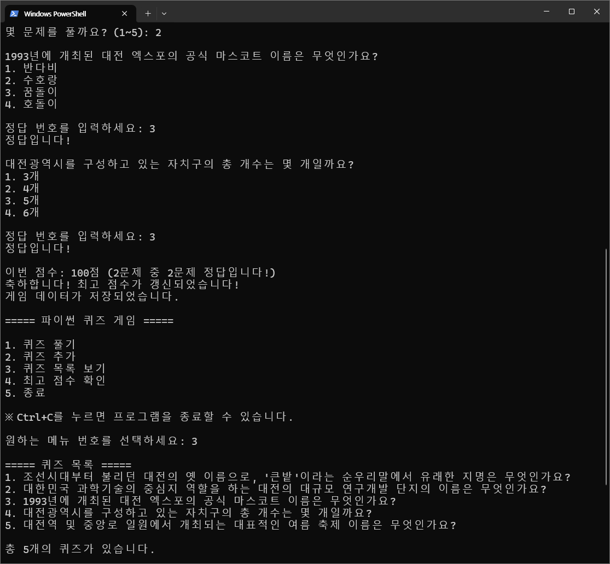

<details>
<summary>문제 수 입력 오류 처리 실습 로그 확인하기</summary>

```text
원하는 메뉴 번호를 선택하세요: 1
몇 문제를 풀까요? (1~5): abc
숫자만 입력할 수 있습니다.
몇 문제를 풀까요? (1~5): 0
1~5 사이의 숫자를 입력하세요.
몇 문제를 풀까요? (1~5): 9
1~5 사이의 숫자를 입력하세요.
몇 문제를 풀까요? (1~5):
숫자만 입력할 수 있습니다.
몇 문제를 풀까요? (1~5):
```

※ 빈 입력은 숫자로 바꿀 수 없어 `abc`와 같은 안내가 나옵니다. 메뉴 입력과 같은 동작입니다.
</details>

### 10-3. 힌트 기능 및 점수 차감

**구현 내용**

| 위치 | 변경 내용 |
| --- | --- |
| `Quiz` | `hint` 속성 추가 (기본값 `""`), 힌트를 보여주는 `show_hint()` 추가 |
| `get_default_quizzes()` | 기본 퀴즈 5개에 힌트 작성. `__init__()`에 중복으로 적혀 있던 기본 퀴즈는 이 메서드를 호출하도록 정리 |
| `save_state()` / `load_state()` | `hint` 저장·불러오기. 불러올 때는 `item.get("hint", "")`로 예전 파일 호환 |
| `add_quiz()` | 힌트 입력 추가 (선택 사항이라 빈 입력 허용) |
| `play()` | 정답 입력에서 `0` → 힌트 표시 후 다시 입력, 힌트 사용 문제 수만큼 10점 차감 |

```python
hint_used = False

while True:
    user_answer = get_valid_number(
        "정답 번호를 입력하세요 (힌트 보기: 0): ", 0, 4
    )

    if user_answer != 0:
        break

    quiz.show_hint()

    if quiz.hint and not hint_used:
        hint_used = True
        hint_count += 1
        print("힌트를 사용하여 10점이 차감됩니다.")
```

- **차감 방식:** 힌트를 쓴 문제 1개당 최종 점수에서 10점 차감, 최저 0점 (`max(score - penalty, 0)`)
- **중복 차감 방지:** 문제마다 `hint_used`를 `False`로 시작해, 같은 문제에서 힌트를 여러 번 봐도 1번만 셉니다.
- **힌트가 없는 퀴즈:** `이 퀴즈에는 힌트가 없습니다.`만 출력하고 차감하지 않습니다.

**실행 결과**

| 화면 | 사용한 파일 | 확인 내용 |
| --- | --- | --- |
| [23_hint_1](docs/screenshots/23_hint_1.png) | 힌트가 없는 예전 `state.json` | 오류 없이 불러옴, `0` 입력 → `이 퀴즈에는 힌트가 없습니다.`, 차감 없이 100점 |
| [23_hint_2](docs/screenshots/23_hint_2.png) | 새로 만든 `state.json` (힌트 포함) | `0` 두 번 → 힌트 2번 표시, 차감 안내 1번, 2문제 정답 100점 − 10점 = **90점** |

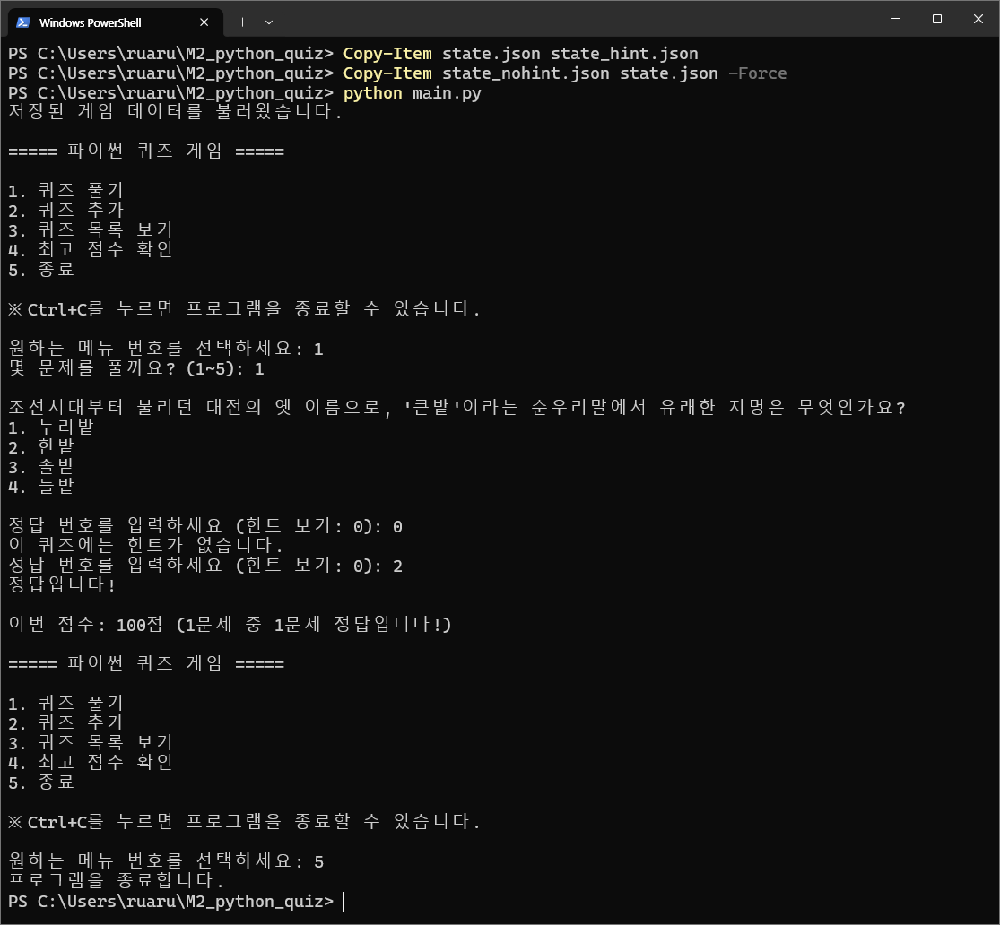


※ 예전 파일 호환 방식과 파일을 새로 만든 이유는 [5-4](#5-4-파일이-없거나-손상된-경우), [9-4](#9-4-문제-사례-4-힌트를-추가했는데-기존-statejson에-반영되지-않음)에 정리했습니다.

### 10-4. 퀴즈 삭제

**구현 내용** (`QuizGame.delete_quiz()`, 메뉴 5번)

```python
quiz_number = get_valid_number(
    f"\n삭제할 퀴즈 번호를 입력하세요 (1~{len(self.quizzes)}, 취소: 0): ",
    0, len(self.quizzes)
)

if quiz_number == 0:
    print("삭제를 취소했습니다.")
    return

deleted_quiz = self.quizzes.pop(quiz_number - 1)
```

- 화면 번호는 1부터, 목록 위치는 0부터 세므로 `quiz_number - 1` 위치를 삭제합니다.
- 삭제 전에 `show_quizzes()`로 목록을 보여주고, 삭제 후 `save_state()`로 파일에 반영합니다.
- 메뉴에 `5. 퀴즈 삭제`를 추가하면서 종료는 `6`번으로 옮겼습니다.

**실행 결과**

| 화면 | 확인 내용 |
| --- | --- |
| [24_delete_1](docs/screenshots/24_delete_1.png) | 퀴즈 6개 → `6` 입력 → `6번 퀴즈가 삭제되었습니다.`, 삭제된 문제 표시, 저장 |
| [24_delete_2](docs/screenshots/24_delete_2.png) | 재실행 후 퀴즈 목록 5개 → 삭제가 파일에 반영됨 |

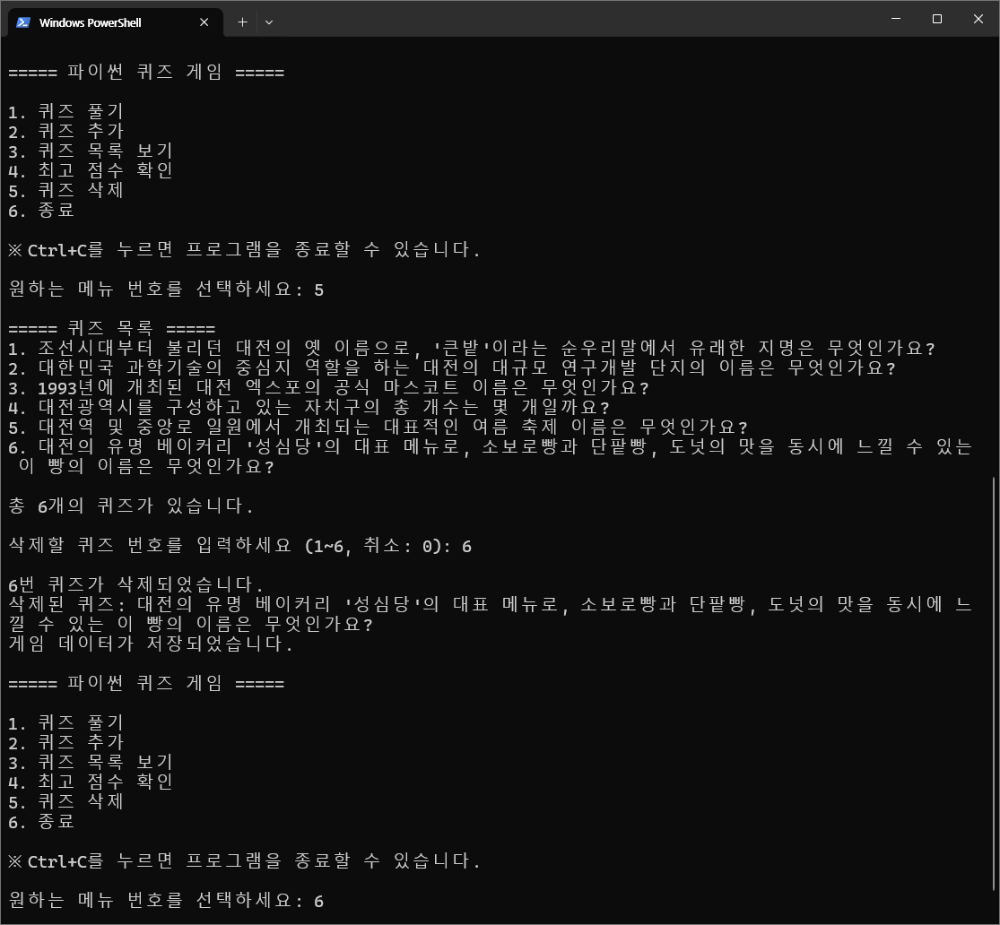

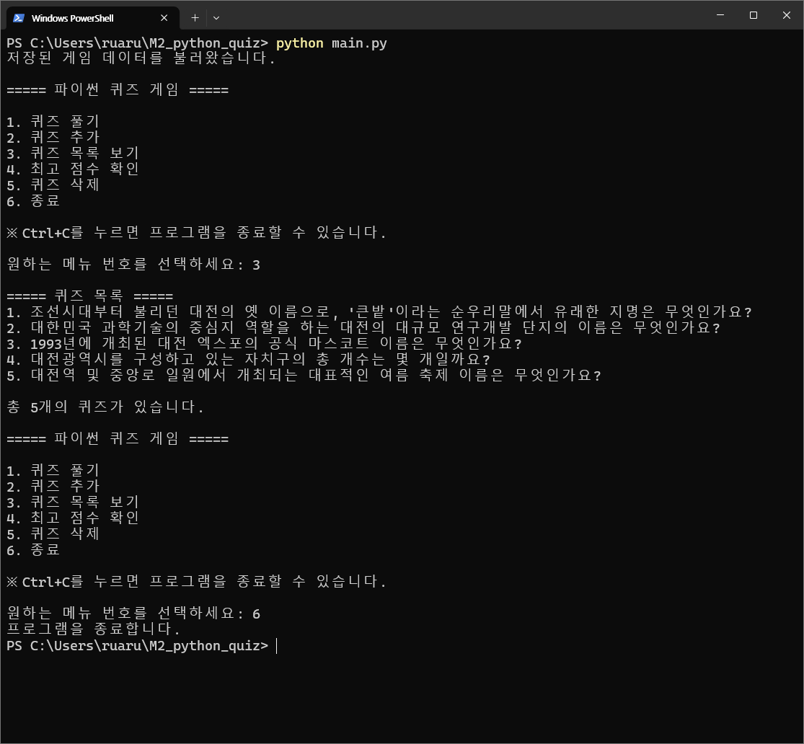

<details>
<summary>삭제 취소 실습 로그 확인하기</summary>

※ 반복되는 메뉴 출력과 퀴즈 목록 일부는 생략했습니다.

```text
원하는 메뉴 번호를 선택하세요: 5

===== 퀴즈 목록 =====
1. 조선시대부터 불리던 대전의 옛 이름으로, ...
... (2~5번 생략) ...
6. 대전의 유명 베이커리 '성심당'의 대표 메뉴로, ...

총 6개의 퀴즈가 있습니다.

삭제할 퀴즈 번호를 입력하세요 (1~6, 취소: 0): 0
삭제를 취소했습니다.
```
</details>

### 10-5. 점수 기록 히스토리 및 최고 점수 기준

**구현 내용**

| 위치 | 변경 내용 |
| --- | --- |
| `import` | `from datetime import datetime` (표준 라이브러리) |
| `__init__()` | `self.history = []`, `self.best_question_count = 0` |
| `save_state()` / `load_state()` | `history`, `best_question_count` 저장·불러오기. 예전 파일은 `.get()`으로 빈 기록·0문제 처리, 기록 형식 검사 추가 |
| `play()` | 게임이 끝날 때마다 기록 1개 추가 후 **매번 저장** |
| `show_scores()` | 기존 `show_best_score()`를 바꾼 것. 최고 점수(문제 수 포함)와 전체 기록을 출력 |

```python
self.history.append({
    "date": datetime.now().strftime("%Y-%m-%d %H:%M"),
    "question_count": total_count,
    "correct_count": correct_count,
    "hint_count": hint_count,
    "score": score
})
```

- 이전에는 최고 점수가 갱신될 때만 저장했습니다. 그대로 두면 갱신되지 않은 판의 기록은 프로그램을 끄면 사라지므로, 게임마다 저장하도록 바꿨습니다.

**최고 점수 기준 개선**

문제 수를 고를 수 있게 되면서 1문제만 맞혀도 100점으로 1등이 되는 문제가 생겼습니다. 농구에서 자유투를 1개만 던져 성공률 100%가 된 선수를 1등으로 치지 않는 것처럼, 점수 계산은 그대로 두고 **최고 점수가 될 자격**을 정했습니다.

```python
if question_count < quiz_total:
    print(f"※ 전체 문제({quiz_total}문제)를 풀어야 최고 점수에 반영됩니다.")

elif score > self.best_score or (
    score == self.best_score
    and question_count > self.best_question_count
):
    self.best_score = score
    self.best_question_count = question_count
```

| 상황 | 처리 |
| --- | --- |
| 일부 문제만 푼 판 | 기록에만 남고 최고 점수에는 반영하지 않음 |
| 모든 문제를 풀고 점수가 더 높음 | 최고 점수 갱신 |
| 모든 문제를 풀고 점수가 같음 | 더 많은 문제를 푼 기록이면 갱신 (예: 5문제 100점 → 퀴즈 추가 후 6문제 100점) |

**실행 결과**: [25_history_1a](docs/screenshots/25_history_1a.png) → [1b](docs/screenshots/25_history_1b.png) → [1c](docs/screenshots/25_history_1c.png)는 한 번의 실행입니다.

| 화면 | 확인 내용 |
| --- | --- |
| 1a | `state.json` 새로 생성 → 메뉴 4: `현재 최고 점수: 0점`, `아직 게임 기록이 없습니다.` |
| 1b | 2문제 100점 → `※ 전체 문제(5문제)를 풀어야 최고 점수에 반영됩니다.` → 기록만 저장 |
| 1c | 5문제 100점 → `최고 점수가 갱신되었습니다!` → 메뉴 4: `100점 (5문제)`와 기록 2개 |
| [25_history_2](docs/screenshots/25_history_2.png) | 재실행 후 최고 점수와 기록 2개 유지 |

※ 1b 끝과 1c 시작 사이에 5문제 풀이 중 일부 화면이 생략되어 있습니다.

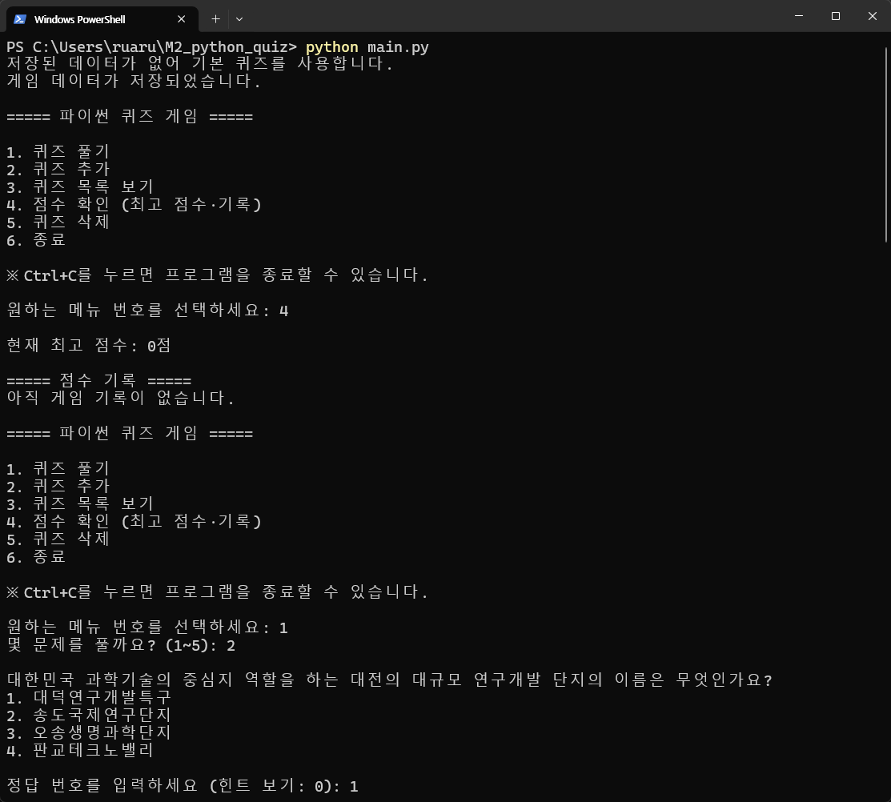

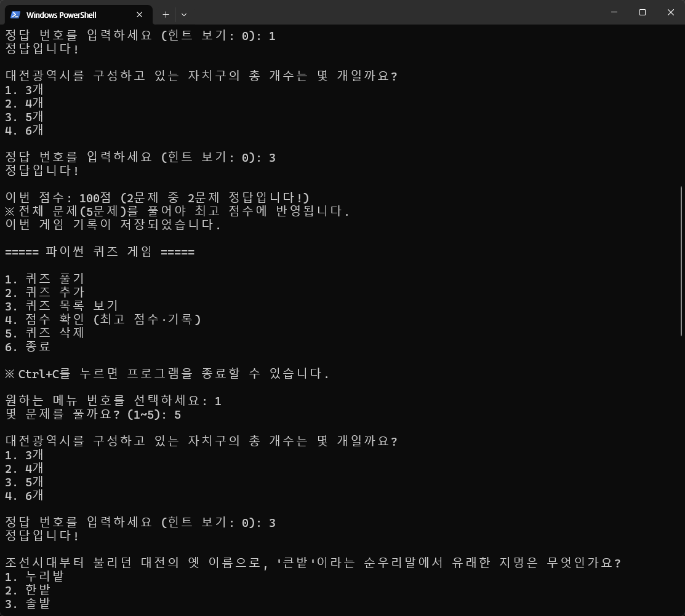

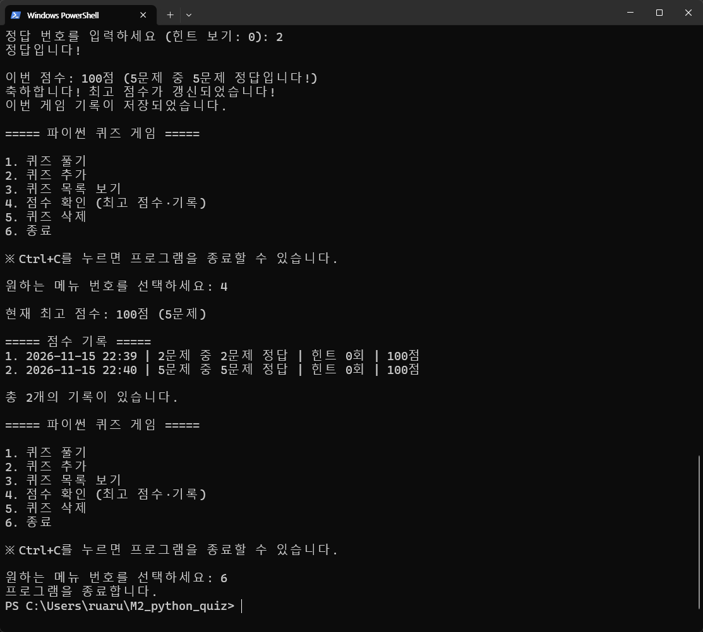

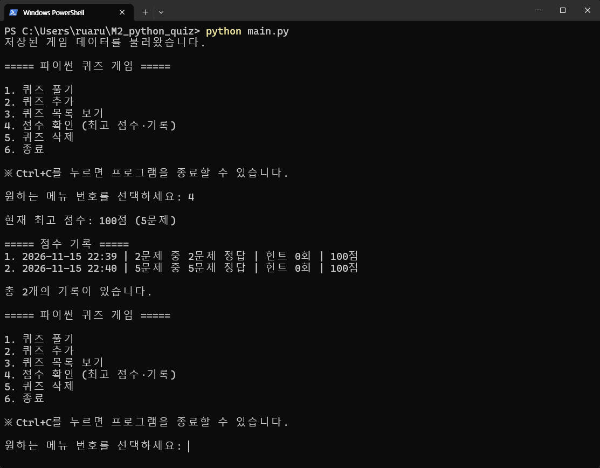

※ 동점일 때 더 많은 문제를 푼 기록으로 바뀌는 규칙은 코드 구현 확인 상태입니다.

### 10-6. 보너스 외 추가 변경 사항

| 변경 내용 | 이유 |
| --- | --- |
| 퀴즈 추가 시 `===== 입력 내용 확인 =====` 화면 삭제, 완료 안내를 `새로운 퀴즈가 추가되어 저장되었습니다!` 한 문장으로 정리 | 방금 입력한 내용이 그대로 한 번 더 출력되어 불필요했음 |
| 퀴즈 추가 질문 입력에서 `0` → 추가 취소 | 실수로 메뉴 2번을 눌렀을 때 메인 메뉴로 돌아갈 방법이 없었음 |
| `save_state(show_message=True)` 매개변수 추가 | 퀴즈 추가·게임 기록 저장 때는 `게임 데이터가 저장되었습니다.`를 끄고 상황에 맞는 문구만 출력 |
| 삭제 안내를 `6번 퀴즈가 삭제되었습니다.` + `삭제된 퀴즈: ...` 두 줄로 변경 | 문제 안의 작은따옴표(`'성심당'`)와 바깥 따옴표가 겹쳐 읽기 불편했음 |
| 기본 퀴즈를 `get_default_quizzes()` 한 곳에서만 관리 | `__init__()`과 중복으로 적혀 있어 힌트를 두 번 써야 했음 |
| 메뉴 4번 이름 변경 (`점수 확인 (최고 점수·기록)`), `show_best_score()` → `show_scores()` | 최고 점수와 기록을 함께 보여주도록 역할이 바뀜 |
| 저장소의 `state.json`을 새 구조 기본 데이터로 초기화 | clone한 사람도 힌트·기록 기능을 바로 쓸 수 있도록 ([4-1](#4-1-데이터-파일-관리)) |

### 10-7. 한계 및 개선 아이디어

- **추가 취소 범위:** 퀴즈 추가 취소는 질문 입력 단계에서만 가능합니다. 선택지를 입력하는 중에는 Ctrl+C로 프로그램을 종료해야 합니다.
- **기록 손상 시 복구 범위:** `history` 형식만 잘못되어도 손상 파일로 처리되어 퀴즈와 최고 점수까지 기본 데이터로 초기화됩니다. 항목별로 따로 복구하면 데이터를 덜 잃을 수 있습니다.
- **기록이 계속 쌓임:** 게임할 때마다 `history`가 늘어나 파일이 커집니다. 최근 N개만 보관하거나 보여주는 방식으로 개선할 수 있습니다.
- **퀴즈 수가 바뀐 뒤의 최고 점수:** 퀴즈를 삭제해 전체 문제 수가 줄어도, 이전에 더 많은 문제로 세운 최고 점수는 그대로 남습니다.

[맨 위로 이동](#top)

---

## 11. 미션을 마치며

### 11-1. 이번 미션에서 배운 내용

이번 미션을 통해 Python을 이용한 간단한 콘솔 퀴즈 게임을 만들고, Git과 GitHub를 활용해 개발 과정을 관리하는 방법을 배웠습니다.

주요 학습 내용은 다음과 같습니다.

- **Python 기초와 클래스:** 기본 문법으로 실행 흐름을 만들고, `Quiz`와 `QuizGame`으로 데이터와 기능을 역할에 맞게 나누는 방법
- **데이터 관리와 예외 처리:** JSON 파일로 퀴즈와 최고 점수를 저장·복원하고, 잘못된 입력과 파일 오류에도 프로그램이 멈추지 않게 하는 방법
- **Git과 GitHub:** 기능 단위로 커밋하고, 브랜치에서 작업한 뒤 병합하며, clone·pull로 저장소를 주고받는 방법
- **기능 확장과 호환성:** 보너스 과제로 저장 데이터에 새 항목을 더하면서, 예전 파일을 `.get()`으로 안전하게 읽고 점수 규칙의 공정성까지 고려하는 방법

특히 프로그램을 한 번 실행하고 끝내는 것이 아니라, 사용자가 추가한 퀴즈와 최고 점수가 다음 실행에도 유지되도록 구현하면서 데이터 저장의 필요성을 이해할 수 있었습니다.

### 11-2. 추가 학습 계획

이번 미션에서 배운 내용을 바탕으로 다음과 같은 학습을 이어갈 계획입니다.

1. **Python 기초와 데이터 관리 복습:** 변수, 조건문, 반복문, 함수, 클래스와 함께 JSON 파일 입출력과 예외 처리를 반복 실습하기
2. **Git과 GitHub 활용:** 브랜치 생성과 병합, 커밋 관리, 원격 저장소 동기화 등 협업에 필요한 기본 기능 익히기
3. **기능 개선과 다음 미션 준비:** 보너스 과제로 기능을 직접 설계·개선해 보고, 계산기 구현에 필요한 연산 처리와 프로그램 구조 설계 학습하기

앞으로도 단순히 코드를 실행하는 데 그치지 않고, 각 코드가 어떤 역할을 하는지 이해하며 스스로 수정하고 개선할 수 있는 개발 역량을 키워 나가겠습니다.

[맨 위로 이동](#top)