<a id="top"></a>

<!--
문서 작성 기준
- 실제 수행한 명령어와 결과를 기준으로 작성한다.
- 확인되지 않은 항목은 완료([x])로 표시하지 않는다.
- 실행 결과가 긴 경우 표 안에 넣지 않고 코드 블록으로 작성한다.
- 스크린샷은 docs/screenshots/ 디렉터리에 보관하고 해당 항목에 링크를 연결한다.
- 개인정보, 인증정보 및 비밀번호는 문서와 스크린샷에서 가린다.
- [TODO]는 실제 수행 결과로 교체하고 제출 전에 남아 있지 않은지 확인한다.
- 설계 설명과 핵심 개념은 코드를 확인한 뒤 내 말로 작성한다.
-->

# Pre1-2. Python 콘솔 퀴즈 게임

## 목차

1. [프로젝트 개요](#1-프로젝트-개요)
2. [실행 방법](#2-실행-방법)
3. [기능 목록](#3-기능-목록)
4. [파일 구조](#4-파일-구조)
5. [데이터 파일 설명 (state.json)](#5-데이터-파일-설명-statejson)
6. [설계 설명](#6-설계-설명)
7. [수행 내용 및 검증](#7-수행-내용-및-검증)
8. [핵심 개념 정리](#8-핵심-개념-정리)
9. [트러블슈팅](#9-트러블슈팅)
10. [보너스 과제 수행 내용](#10-보너스-과제-수행-내용)
11. [미션을 마치며](#11-미션을-마치며)

---

## 1. 프로젝트 개요

터미널에서 실행하는 Python 콘솔 퀴즈 게임을 만드는 프로젝트입니다.

Python 기본 문법으로 메뉴와 퀴즈 진행 기능을 구현하고, `Quiz`와 `QuizGame` 클래스로 역할을 나눕니다. 퀴즈와 최고 점수는 프로젝트 루트의 `state.json` 파일에 저장하여 프로그램을 다시 실행했을 때에도 유지되도록 구현합니다.

Git으로 기능별 변경 이력을 기록하고 GitHub 저장소에 코드를 업로드합니다.

### 1-1. 개발 환경

| 구분 | 사용 환경 |
| --- | --- |
| 운영체제 | Windows 11 Home (64비트) |
| Terminal | Windows PowerShell |
| Python | Python 3.15.2 |
| Git | Git version 2.56.0.windows.4 |
| 코드 편집기 | Visual Studio Code |
| 외부 라이브러리 | 사용하지 않음 (Python 표준 라이브러리만 사용) |

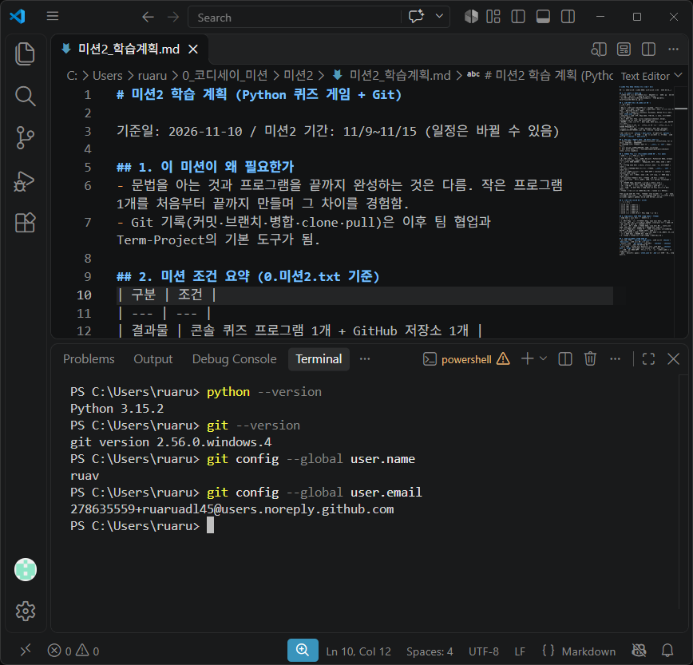

### 1-2. 퀴즈 주제와 선정 이유


- **주제**: 대전 지역의 역사·과학·문화 관련 상식
- **선정 이유**: 코디세이 AI 올인원 교육과정에는 다양한 연령대의 300명이 넘는 교육생들이 함께 참여하고 있습니다. 서로 다른 세대가 공통으로 관심을 갖고 편하게 소통할 수 있는 주제를 고민한 결과, 교육생들이 함께 생활하고 있는 지역인 대전을 선정했습니다. 지역의 역사와 문화, 과학 관련 상식을 통해 세대 간 공감대를 형성하고 즐겁게 참여할 수 있는 퀴즈를 만들고자 했습니다.
- **기본 퀴즈 5개**:
  1. 대전의 옛 이름과 유래
  2. 대전의 대표적인 연구개발 단지
  3. 1993년 대전 엑스포 공식 마스코트
  4. 대전광역시의 자치구 개수
  5. 대전의 대표적인 지역 축제

### 1-3. 수행 항목 체크리스트

- [x] **Git 저장소 설정**: GitHub 저장소 생성, `.gitignore`·`README.md` 생성, 첫 commit/push
- [x] **메뉴 기능**: 메뉴 출력, 번호 선택, 종료, 잘못된 입력 처리
- [x] **공통 입력 검증**: 공백 제거, 숫자 변환 실패, 범위 밖 숫자, 빈 입력 처리
- [x] **안전 종료**: `KeyboardInterrupt`(Ctrl+C)와 `EOFError` 처리
- [x] **Quiz 클래스**: `question`, `choices`, `answer` 속성과 문제 출력·정답 확인 기능
- [x] **기본 퀴즈 데이터**: 대전 지역 관련 퀴즈 5개, 각 문제에 선택지 4개와 정답 포함
- [x] **퀴즈 풀기**: `feature/quiz-play` 브랜치에서 구현 후 `main` 브랜치에 병합
- [x] **퀴즈 추가**: 문제·선택지 4개·정답 번호 입력, 입력 검증, 저장
- [x] **퀴즈 목록**: 등록된 퀴즈 표시
- [x] **점수 확인**: 최고 점수 비교·갱신·저장, 아직 플레이하지 않은 경우 처리
- [x] **QuizGame 클래스**: 게임 전체 관리 및 기능별 메서드 분리
- [x] **state.json 저장/불러오기**: 파일 없음·손상·읽기/쓰기 오류 처리 로직 구현 및 파일 없음·손상 상황 테스트
- [x] **README.md 작성 및 실제 실행 결과 반영**
- [x] **Git 복제 실습**: clone → 복제본 수정 → commit → push → 원래 폴더에서 pull → 반영 확인
- [x] **제출물**: GitHub 저장소 URL, 개발환경 스크린샷, 실행 결과 스크린샷, `git log --oneline --graph` 스크린샷

### 1-4. GitHub 저장소 정보

| 구분 | 내용 |
| --- | --- |
| 저장소 이름 | M2_python_quiz |
| 저장소 주소 | [https://github.com/ruaruadl45/M2_python_quiz](https://github.com/ruaruadl45/M2_python_quiz) |
| 주요 관리 파일 | `main.py`, `state.json`, `README.md`, `.gitignore`, `docs/screenshots/` |

[맨 위로 이동](#top)

---

## 2. 실행 방법

### 2-1. 저장소 복제 및 프로그램 실행

Windows PowerShell에서 다음 명령어를 실행합니다.

```powershell
# GitHub 저장소 복제
git clone https://github.com/ruaruadl45/M2_python_quiz.git

# 복제된 프로젝트 폴더로 이동
cd M2_python_quiz

# Python 버전 확인 (Python 3.15.2 환경에서 동작 확인)
python --version

# 프로그램 실행
python main.py
```

### 2-2. 실행 및 데이터 저장 방식

- **첫 실행 시 기본 데이터 준비**: 프로젝트 폴더에 `state.json` 파일이 없으면 기본 퀴즈 5개를 불러오고, 새로운 `state.json` 파일을 생성합니다. 저장 파일이 이미 있으면 해당 파일의 퀴즈와 최고 점수를 불러옵니다.
- **퀴즈 추가 시 저장**: 새로운 퀴즈의 질문, 선택지 4개, 정답 번호를 입력하고 입력 내용을 화면에 보여준 뒤 바로 저장합니다.
- **최고 점수 변경 시 저장**: 퀴즈 풀이 결과가 기존 최고 점수보다 높으면 최고 점수를 갱신하고 저장합니다.
- **프로그램 재실행 시 데이터 유지**: 저장된 `state.json`을 다시 불러와 등록한 퀴즈와 최고 점수를 유지합니다.

[맨 위로 이동](#top)

---

## 3. 기능 목록

| 번호 | 기능 | 설명 | 구현 위치 | 검증 기록 |
| :-: | --- | --- | --- | --- |
| 1 | 퀴즈 풀기 | 저장된 퀴즈 출제, 정오 안내, 결과 표시 및 최고 점수 갱신 | `QuizGame.play()` | [7-2](#7-2-퀴즈-기능-구현-및-실행) |
| 2 | 퀴즈 추가 | 문제·선택지 4개·정답 번호를 입력받아 등록 및 저장 | `QuizGame.add_quiz()` | [7-2](#7-2-퀴즈-기능-구현-및-실행), [7-3](#7-3-데이터-저장-및-유지-검증) |
| 3 | 퀴즈 목록 | 등록된 퀴즈 목록 표시 | `QuizGame.show_quizzes()` | [7-2](#7-2-퀴즈-기능-구현-및-실행) |
| 4 | 점수 확인 | 최고 점수 표시 및 갱신 결과 저장 | `QuizGame.show_best_score()`, `QuizGame.play()` | [7-2](#7-2-퀴즈-기능-구현-및-실행), [7-3](#7-3-데이터-저장-및-유지-검증) |
| 5 | 종료 | 메뉴에서 종료를 선택하면 프로그램 종료 | `QuizGame.run()` | [7-1](#7-1-프로젝트-초기-설정-및-메뉴-실행), [7-4](#7-4-최종-기능-및-예외-상황-검증) |

### 3-1. 입력 및 예외 상황 처리

| 상황 | 처리 방식 | 확인 결과 |
| --- | --- | --- |
| 잘못된 입력 (문자 `abc`, 범위 밖 숫자 예: 메뉴 9·정답 0, 빈 입력) | 숫자로 변환할 수 없거나 허용 범위를 벗어나거나 비어 있는 입력은 오류 메시지를 표시하고 다시 입력받음 | 실행 확인 ([06](docs/screenshots/06_input_errors.png), [07](docs/screenshots/07_quiz_play.png), [08](docs/screenshots/08_quiz_add.png) 화면) |
| 입력 앞뒤 공백 (예: ` 1 `) | 입력값 앞뒤의 공백을 제거한 후 처리 | 실행 확인 ([07](docs/screenshots/07_quiz_play.png) 화면) |
| 퀴즈가 없는 상태에서 플레이/목록 선택 | 플레이 시 퀴즈가 없다는 안내 메시지를 출력하고, 목록 선택 시 전체 개수 0을 표시 | 별도 실행 검증 미확인 |
| 아직 퀴즈를 풀지 않은 상태에서 점수 확인 | 초기 최고 점수 0점을 표시 | 코드 구현 확인 / 별도 실행 검증 미확인 |
| Ctrl+C (`KeyboardInterrupt`) | 키보드 인터럽트 발생 시 안전하게 종료하도록 예외 처리 | 코드 구현 확인 (초기 버전 실행 화면: [ts1_nameerror.png](docs/screenshots/ts1_nameerror.png) 상단 참고) |
| 입력 스트림 종료 (`EOFError`) | 입력 스트림 종료 시 예외를 처리하고 프로그램을 안전하게 종료하도록 구현 | 코드 구현 확인 |
| `state.json` 파일 없음 | 기본 퀴즈 5개를 사용하고 새로운 저장 파일 생성 | 실행 확인: PASS |
| `state.json` 데이터 손상 또는 읽기/쓰기 오류 | JSON 데이터 손상 시 기본 퀴즈와 초기 점수로 복구하고 저장 | 데이터 손상 복구 실행 확인: PASS / 읽기·쓰기 오류 별도 검증 미확인 |

> ※ 상세 입력 오류 검증 및 퀴즈 추가/풀이 화면은 [7-2. 퀴즈 기능 구현 및 실행](#7-2-퀴즈-기능-구현-및-실행)의 스크린샷에서 확인할 수 있습니다.

[맨 위로 이동](#top)

---

## 4. 파일 구조

```text
M2_python_quiz/
├── .gitignore
├── README.md
├── main.py
├── state.json
└── docs/
    └── screenshots/
        ├── 01_env.png
        ├── 02_github_repo.png
        ├── ...
        └── 20_pull.png
```

※ 스크린샷은 `docs/screenshots/`에 보관하며, 위 구조에서는 일부 파일명만 표기하고 나머지는 생략했습니다.

### 4-1. 주요 파일 및 폴더 역할

| 파일 및 폴더 | 역할 |
| --- | --- |
| `main.py` | `Quiz`, `QuizGame` 클래스와 입력 검증 함수 및 프로그램 실행 코드 |
| `state.json` | 등록된 퀴즈 목록과 최고 점수 저장 |
| `README.md` | 프로젝트 개요, 실행 방법, 기능 및 검증 기록 작성 |
| `.gitignore` | Git에서 추적하지 않을 파일 지정 |
| `docs/screenshots/` | 개발 환경, 프로그램 실행 및 Git 기록 스크린샷 보관 |

### 4-2. 데이터 파일 관리

- `state.json`은 프로젝트 루트에 위치하며, 프로그램 실행 시 퀴즈 목록과 최고 점수를 불러옵니다.
- 파일이 없으면 기본 퀴즈 5개를 사용하고 새로운 `state.json`을 생성합니다.
- 퀴즈 추가 또는 최고 점수 갱신 시 변경된 데이터를 파일에 저장합니다.
- `state.json`은 기본 데이터 제공 및 실행 결과 보존을 위해 Git 저장소에 포함합니다.
- `state_backup.json`, `state_temp.json`은 테스트 과정에서 생성한 백업 파일이며 Git에는 추가하지 않았습니다.

### 4-3. 코드 구조 (클래스와 메서드)

| 클래스 | 주요 속성 | 주요 메서드 | 실제 구현 위치 |
| --- | --- | --- | --- |
| `Quiz` | `question`, `choices`, `answer` | `display()`, `check_answer()` | `main.py`의 `Quiz` 클래스 |
| `QuizGame` | `state_file`, `best_score`, `quizzes` | `calculate_score()`, `save_state()`, `load_state()`, `get_default_quizzes()`, `play()`, `add_quiz()`, `show_quizzes()`, `show_best_score()`, `run()` | `main.py`의 `QuizGame` 클래스 |

### 4-4. 공통 입력 검증 함수

| 함수 | 역할 | 구현 위치 |
| --- | --- | --- |
| `get_valid_number()` | 숫자 변환 및 허용 범위 확인 | `main.py` 전역 함수 |
| `get_valid_text()` | 입력 앞뒤 공백 제거 및 빈 문자열 확인 | `main.py` 전역 함수 |

[맨 위로 이동](#top)

---

## 5. 데이터 파일 설명 (state.json)

`state.json`은 퀴즈 게임의 데이터를 저장하는 파일입니다. 프로그램을 종료한 뒤 다시 실행해도 퀴즈 목록과 최고 점수를 유지할 수 있도록 JSON 형식으로 관리합니다.

| 항목 | 내용 |
| --- | --- |
| 경로 | 프로젝트 루트의 `state.json` |
| 인코딩 | UTF-8 |
| 역할 | 퀴즈 목록과 최고 점수 저장 |
| 생성 시점 | 최초 실행 시 파일이 없는 경우 기본 퀴즈 데이터로 생성 및 저장 |
| 갱신 시점 | 퀴즈 추가 시, 새로운 최고 점수가 기록될 때, 또는 데이터 손상 감지 복구 시 |

### 5-1. 데이터 구조 (스키마)

`state.json`은 최상위에 `quizzes`와 `best_score` 두 가지 항목을 가집니다.

| 키 | 자료형 | 설명 |
| --- | --- | --- |
| `quizzes` | list | 등록된 퀴즈 목록 |
| `quizzes[]` | dict | 개별 퀴즈 데이터 |
| `quizzes[].question` | str | 퀴즈 문제 |
| `quizzes[].choices` | list[str] | 4개의 선택지 |
| `quizzes[].answer` | int | 정답 번호 (1~4) |
| `best_score` | int | 최고 점수 (0~100점) |

**JSON 데이터 예시**

```json
{
    "quizzes": [
        {
            "question": "대전의 옛 이름은 무엇인가요?",
            "choices": [
                "누리밭",
                "한밭",
                "솔밭",
                "늘밭"
            ],
            "answer": 2
        }
    ],
    "best_score": 0
}
```

※ 위 데이터는 구조를 설명하기 위한 예시이며, 실제 실행 시에는 기본 퀴즈 5개와 사용자가 추가한 퀴즈가 저장될 수 있습니다.

### 5-2. 데이터 구조를 이렇게 설계한 이유

- **퀴즈 목록을 `list`로 관리하는 이유:** 여러 개의 퀴즈를 하나의 목록으로 관리하고, 퀴즈 추가 및 조회를 쉽게 하기 위해 사용합니다.
- **각 퀴즈를 `dict` 형태로 표현하는 이유:** 문제, 선택지, 정답처럼 서로 관련된 정보를 이름이 있는 항목으로 묶어 관리하기 위해 사용합니다.
- **`best_score`를 별도 항목으로 저장하는 이유:** 퀴즈 데이터와 최고 점수를 구분하여 관리하고, 프로그램을 다시 실행해도 최고 점수를 유지하기 위해 사용합니다.

### 5-3. 점수 계산 방식

- **점수 기준:** 정답 수를 전체 퀴즈 수로 나눈 뒤 100점 만점으로 환산합니다.
- **점수 계산을 담당하는 메서드:** `QuizGame.calculate_score()`
- **계산 방식:** 계산된 정답률의 소수점 이하를 반올림하여 0~100점 범위의 정수 점수로 반환합니다.
- **최고 점수 갱신 조건:** 새 점수가 기존 최고 점수보다 높은 경우에만 `best_score`를 변경하고 `state.json`에 저장합니다.
- **예외 처리:** 전체 퀴즈 수가 0개이면 0점을 반환합니다.

### 5-4. 파일이 없거나 손상된 경우

| 상황 | 처리 방식 |
| --- | --- |
| 파일이 없는 첫 실행 | 기본 퀴즈 5개를 사용하고 `state.json`을 새로 생성합니다. |
| JSON 형식이 손상된 경우 | 오류를 감지하고 기본 퀴즈 데이터와 최고 점수 0으로 초기화한 뒤 파일을 다시 저장합니다. |
| 데이터 항목이나 자료형이 올바르지 않은 경우 | 데이터 검증 과정에서 오류를 감지하면 기본 데이터로 복구합니다. |
| 파일 읽기 오류 | `OSError`를 감지하여 기본 데이터로 초기화하고 저장을 시도합니다. |
| 파일 쓰기 오류 | `OSError`를 감지하고 저장 실패 메시지를 출력합니다. |

**기존 데이터 보호 및 한계**

- 손상된 데이터가 발견되면 프로그램은 기본 데이터로 복구하여 실행을 이어갑니다.
- 코드 자체에서 손상 전 데이터를 자동 백업하는 기능은 구현하지 않았습니다.
- 따라서 중요한 기존 데이터는 별도로 복사해 보관해야 합니다.
- 파일 쓰기 오류가 발생하면 저장에 실패할 수 있으므로, 화면에 표시되는 오류 메시지를 확인해야 합니다.

[맨 위로 이동](#top)

---

## 6. 설계 설명

본 프로젝트는 퀴즈 데이터 관리, 게임 진행, 입력 검증, 데이터 저장 기능을 구분하여 코드의 역할을 명확하게 구성했습니다.

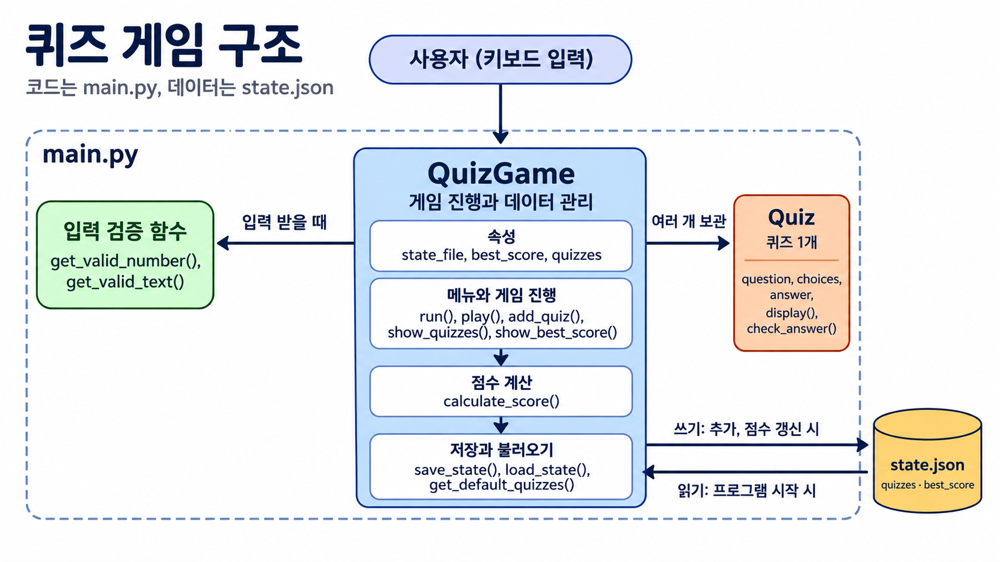

### 6-1. 클래스의 책임 나누기

| 클래스 | 맡은 일 | 관리하는 데이터 | 담당하지 않는 일 |
| --- | --- | --- | --- |
| `Quiz` | 개별 퀴즈의 문제와 선택지를 출력하고 정답을 확인 | 문제(`question`), 선택지(`choices`), 정답 번호(`answer`) | 게임 메뉴 관리, 전체 점수 관리, 파일 저장 |
| `QuizGame` | 퀴즈 게임 전체 진행과 데이터 관리 | 퀴즈 목록(`quizzes`), 최고 점수(`best_score`), 저장 파일 경로(`state_file`) | 개별 퀴즈의 출력 및 정답 판정 세부 처리 |

### 6-2. 기능별 로직 분리

| 구분 | 담당 함수/메서드 | 이렇게 나눈 이유 |
| --- | --- | --- |
| 입력 받기 및 검증 | `get_valid_number()`, `get_valid_text()` | 숫자와 문자열 입력을 각각 검증하여 잘못된 입력으로 인한 오류를 방지 |
| 퀴즈 진행 및 채점 | `Quiz.display()`, `Quiz.check_answer()`, `QuizGame.play()` | 문제 출력, 정답 판정, 게임 진행을 구분하여 관리 |
| 퀴즈 추가 및 목록 | `QuizGame.add_quiz()`, `QuizGame.show_quizzes()` | 새로운 퀴즈 등록과 전체 퀴즈 조회 기능을 독립적으로 관리 |
| 점수 관리 | `QuizGame.calculate_score()`, `QuizGame.show_best_score()`, `QuizGame.play()` | 점수 계산, 최고 점수 조회, 최고 점수 갱신을 구분 |
| 데이터 저장 및 불러오기 | `QuizGame.save_state()`, `QuizGame.load_state()`, `QuizGame.get_default_quizzes()` | 데이터 저장, 기존 데이터 불러오기, 기본 데이터 복구를 별도로 관리 |

**입력 검증 기준**

- 숫자를 입력받는 메뉴 선택, 퀴즈 정답 선택, 새 퀴즈의 정답 번호 입력에는 `get_valid_number()`를 사용합니다.
- 숫자로 변환할 수 없는 입력은 다시 입력하도록 안내합니다.
- 허용 범위를 벗어난 숫자는 거부하고 다시 입력받습니다.
- 문제와 선택지를 입력받을 때는 `get_valid_text()`를 사용합니다.
- 입력값 앞뒤의 공백을 제거하고, 빈 문자열은 허용하지 않습니다.

### 6-3. state.json 읽기/쓰기 흐름

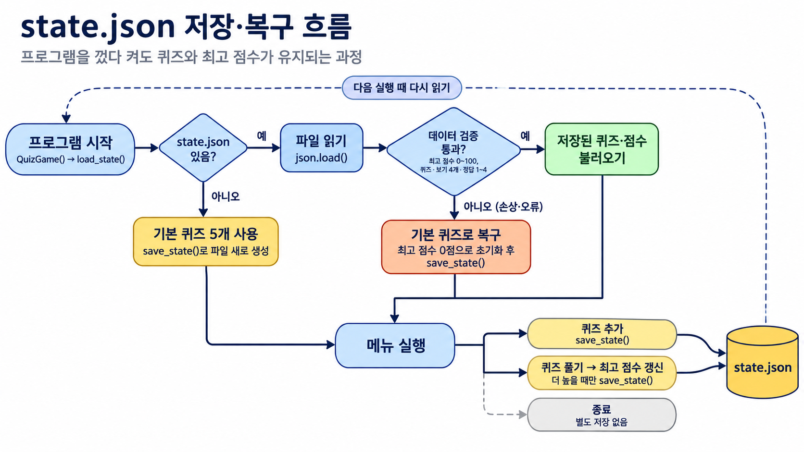

| 순서 | 시점 | 읽기/쓰기 | 호출 함수/메서드 | 이유 |
| :-: | --- | :-: | --- | --- |
| 1 | 프로그램 시작 | 읽기 (필요 시 쓰기) | `QuizGame.__init__()` → `load_state()` | 저장된 데이터를 불러오며, 파일이 없거나 손상된 경우 기본 데이터를 새로 저장(`save_state()`) |
| 2 | 퀴즈 추가 직후 | 쓰기 | `add_quiz()` → `save_state()` | 새로 등록한 퀴즈를 프로그램 종료 후에도 유지하기 위해 |
| 3 | 퀴즈를 모두 푼 뒤 점수 갱신 시 | 쓰기 | `play()` → `save_state()` | 기존 최고 점수보다 높은 점수를 저장하기 위해 |
| 4 | 프로그램 종료 시 | 별도 저장 없음 | `run()` | 데이터 변경 시점에 이미 저장하므로 종료 시 별도 저장이 필요하지 않음 |

**데이터 처리 흐름**

1. 프로그램이 시작되면 `load_state()`가 실행됩니다.
2. 저장 파일이 있으면 기존 데이터를 읽고, 없거나 손상된 경우 기본 퀴즈 데이터를 사용하고 새 파일로 즉시 저장합니다.
3. 사용자가 퀴즈를 추가하면 `save_state()`가 실행됩니다.
4. 게임 종료 후 점수가 기존 최고 점수보다 높으면 `save_state()`가 다시 실행됩니다.
5. 프로그램을 다시 시작하면 저장된 데이터를 불러와 이전 상태를 유지합니다.

### 6-4. 안전 종료 (Ctrl+C / EOF)

| 상황 | 처리하지 않으면 생길 수 있는 문제 | 실제 처리 방식 |
| --- | --- | --- |
| Ctrl+C (`KeyboardInterrupt`) | 실행 중단 시 오류 메시지와 함께 프로그램이 비정상 종료될 수 있음 | `QuizGame.run()`에서 예외를 처리하고 안전 종료 안내 메시지를 출력 |
| 입력 스트림 종료 (`EOFError`) | 입력을 기다리는 도중 입력이 종료되면 예외가 발생하여 비정상 종료될 수 있음 | `QuizGame.run()`에서 예외를 처리하고 안전 종료 안내 메시지를 출력 |

※ 두 예외는 `run()`의 입력 및 메뉴 처리 흐름을 감싸는 예외 처리 구문에서 처리합니다.

### 6-5. 커밋 단위와 메시지 규칙

- **커밋 단위:** 기능 하나가 완성되거나 의미 있는 코드 변경이 끝났을 때 커밋합니다.
- **메시지 형식:** `<접두어>: <변경 내용 요약>`
- **접두어 사용 규칙:**
  - `Feat:` 새로운 기능 추가
  - `Fix:` 기존 기능의 오류 수정
  - `Docs:` README 등 문서 수정
  - `Refactor:` 기능 변경 없이 코드 구조 개선
  - `Merge:` 기능 브랜치 병합 커밋 (예: `Merge: JSON 데이터 저장 기능 추가`)
- **규칙을 정한 이유:**
  - 변경 유형을 한눈에 파악하여 작업 이력을 체계적으로 관리하고, 오류 발생 시 추적을 용이하게 하기 위함입니다.

또한 Git 브랜치를 활용하여 기능을 개발한 뒤 `main` 브랜치에 병합하는 방식으로 작업했습니다.


[맨 위로 이동](#top)

---

## 7. 수행 내용 및 검증

각 단계는 **수행 목적 → 실행 명령어/코드 → 실행 결과 → 확인한 내용** 순서로 기록합니다. 실제로 실행한 명령어와 결과를 남깁니다.

### 7-1. 프로젝트 초기 설정 및 메뉴 실행

#### 1) 프로젝트 준비

GitHub 저장소를 생성하고 로컬 컴퓨터에 프로젝트 작업 환경을 구성했습니다.

| 구분 | 내용 |
|---|---|
| GitHub 저장소 | `ruaruadl45/M2_python_quiz` |
| 로컬 프로젝트 경로 | `C:\Users\ruaru\M2_python_quiz` |
| 주요 파일 | `main.py`, `state.json`, `README.md` |
| 개발 도구 | VS Code, Windows PowerShell |
| 실행 언어 | Python 3.15.2 |

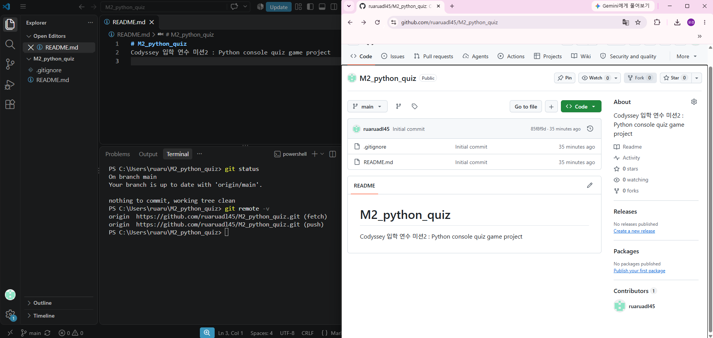

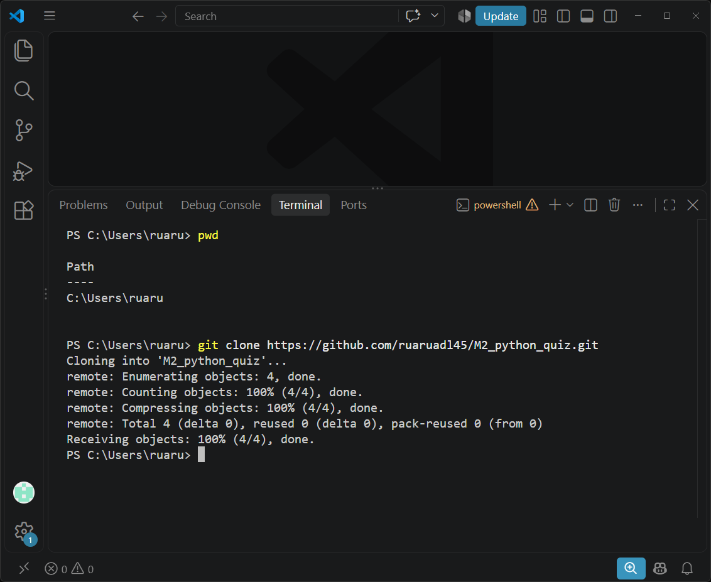

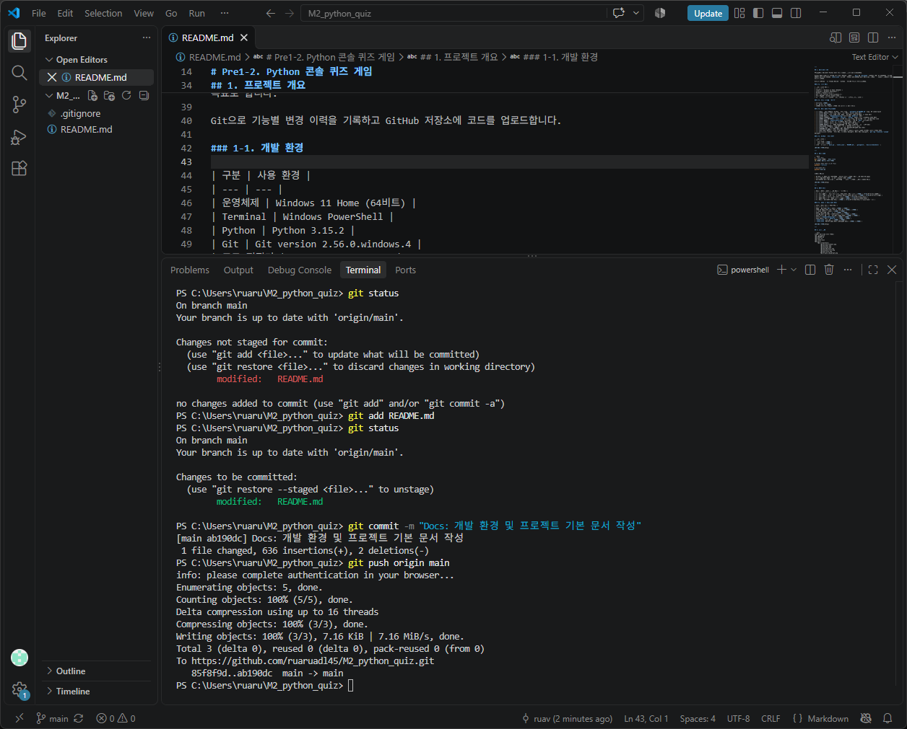

#### 2) 프로그램 실행

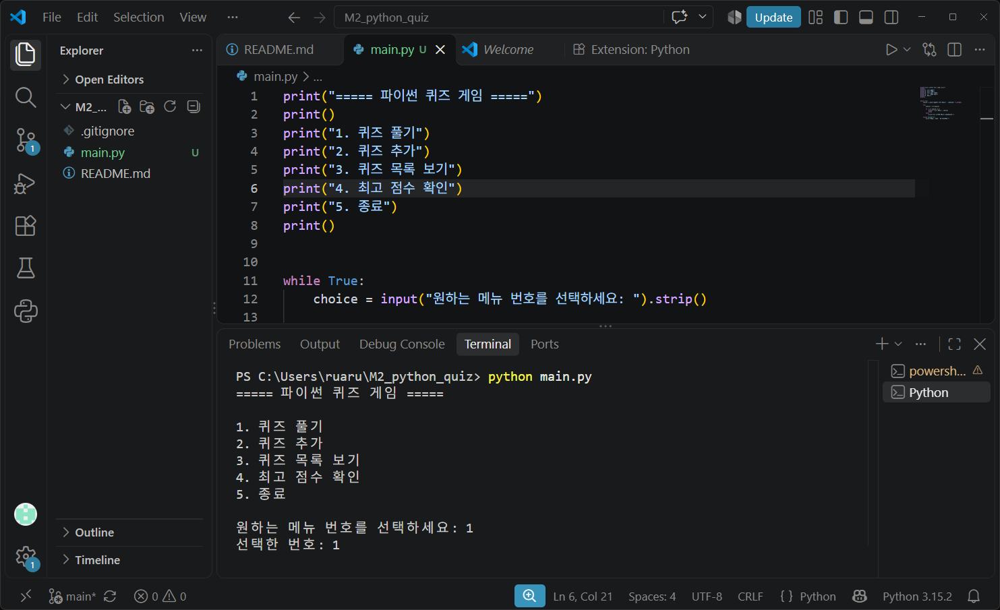

**실행 명령어**

```powershell
cd C:\Users\ruaru\M2_python_quiz
python main.py
```

**확인 내용**
- Python 프로그램 정상 실행
- 메인 메뉴 출력
- 메뉴 번호에 따른 기능 선택
- 종료 메뉴 선택 시 프로그램 종료

### 7-2. 퀴즈 기능 구현 및 실행

#### 1) 퀴즈 데이터 및 클래스 구성

- `Quiz` 클래스를 이용해 개별 퀴즈의 질문, 보기, 정답 관리
- `QuizGame` 클래스를 이용해 게임 전체 기능 관리
- 대전의 역사·과학·문화 관련 기본 퀴즈 5개 구성

#### 2) 주요 기능 실행

| 기능 | 관련 메서드 | 확인 내용 |
|---|---|---|
| 퀴즈 출제 | `QuizGame.play()` | 질문과 보기 출력 및 정답 입력 |
| 정답 확인 | `check_answer()` | 입력한 답과 정답 비교 |
| 퀴즈 추가 | `add_quiz()` | 질문, 보기, 정답 입력 및 등록 |
| 퀴즈 목록 | `show_quizzes()` | 등록된 퀴즈 목록 출력 |
| 점수 확인 | `show_best_score()` | 최고 점수 출력 |
| 점수 계산 | `calculate_score()` | 정답률을 백분율로 계산 |
| 최고 점수 갱신 | `QuizGame.play()` | 기존 최고 점수와 비교 후 갱신 |

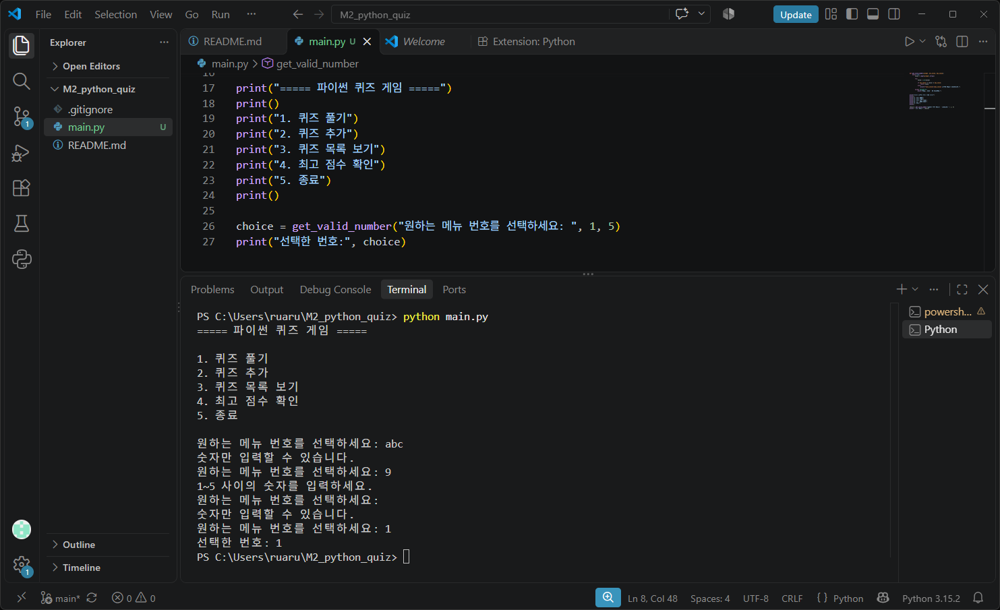

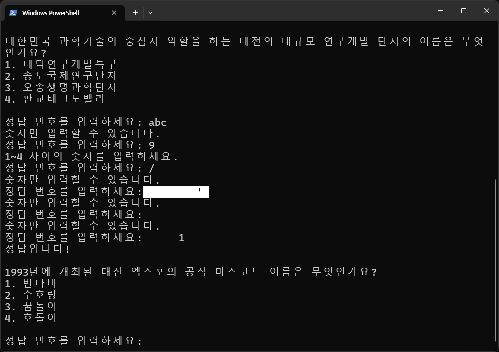

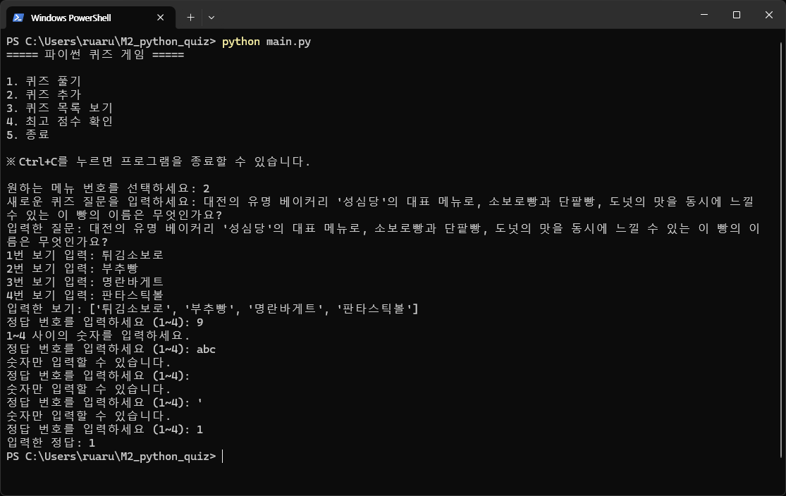
> ※ 이 화면은 JSON 저장 기능 구현 전 단계로, 현재 버전에서 출력되는 등록·저장 완료 메시지는 표시되지 않습니다.

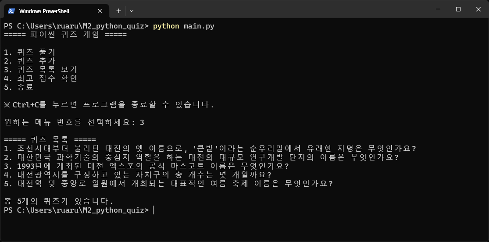

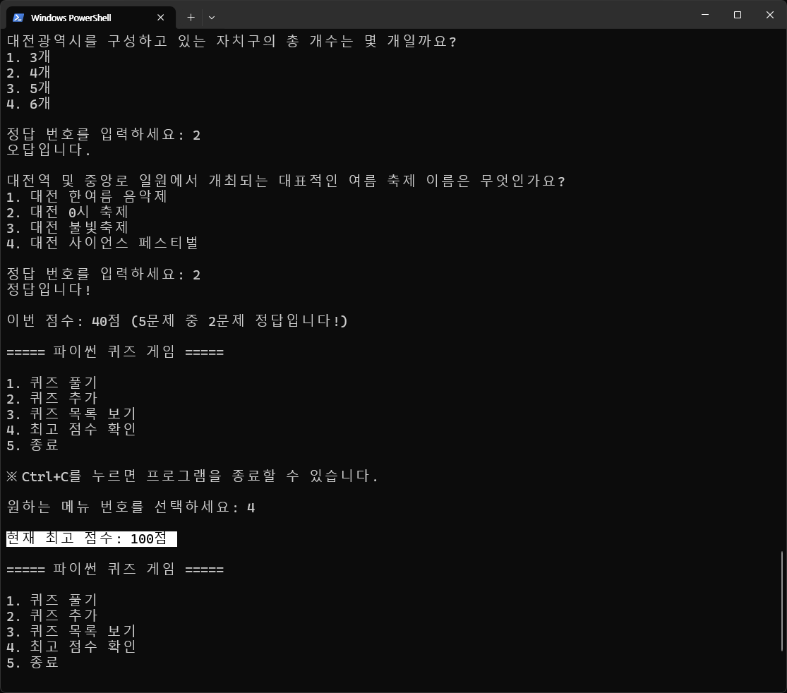
> ※ 이 화면은 JSON 저장 기능 구현 전(메모리에서만 유지되던 단계)입니다.

#### 3) 퀴즈 추가 확인

**추가 퀴즈:** 대전 성심당의 대표 메뉴인 튀김소보로 관련 문제

**실행 결과**
- 질문과 보기 4개 입력
- 정답 번호 입력
- 등록 내용 확인 메시지 출력

### 7-3. 데이터 저장 및 유지 검증

#### 1) JSON 파일 저장

게임 데이터를 프로그램 실행 이후에도 유지하기 위해 프로젝트 루트에 `state.json` 파일을 사용했습니다.

| 저장 데이터 | 저장 시점 | 확인 내용 |
|---|---|---|
| 퀴즈 목록 | 퀴즈 추가 시 | 추가한 퀴즈 저장 |
| 최고 점수 | 기존 점수보다 높은 점수 획득 시 | 최고 점수 갱신 및 저장 |

#### 2) 데이터 유지 테스트

| 테스트 항목 | 실행 결과 | 판정 |
|---|---|---|
| 퀴즈 추가 후 재실행 | 추가한 6번째 퀴즈 유지 확인 | PASS |
| 최고 점수 33점 저장 후 재실행 | 33점 유지 확인 | PASS |
| 최고 점수 67점으로 갱신 후 재실행 | 67점 유지 확인 | PASS |
| 저장 파일 손상 | 기본 퀴즈 5개와 최고 점수 0점으로 복구 확인 | PASS |
| 손상 전 백업 데이터 복원 | 퀴즈 6개와 최고 점수 67점 복원 확인 | PASS |
| `state.json` 파일 누락 | 기본 퀴즈 5개로 실행하고 파일 재생성 확인 | PASS |

#### 3) 저장 파일 복구 실습

**백업 파일 생성**

```powershell
Copy-Item state.json state_backup.json
```

**저장 파일 손상 상황 재현**

```powershell
Set-Content state.json "{ 잘못된 JSON 데이터 }" -Encoding UTF8
```

**백업 파일 복원**

```powershell
Copy-Item state_backup.json state.json -Force
```

**저장 파일 누락 상황 재현**

```powershell
Move-Item state.json state_temp.json
python main.py
```

<details>
<summary>손상 복구 및 백업 복원 실습 로그 확인하기</summary>

※ 반복되는 메뉴 출력과 퀴즈 목록 일부는 생략했으며, 프롬프트 경로(`PS C:\Users\ruaru\M2_python_quiz>`)는 `PS>`로 줄여 표기했습니다.

```text
PS> Set-Content state.json "{ 잘못된 JSON 데이터 }" -Encoding UTF8
PS> Get-Content state.json -Encoding UTF8
{ 잘못된 JSON 데이터 }
PS> python main.py
저장 데이터에 문제가 있습니다: Unexpected UTF-8 BOM (decode using utf-8-sig): line 1 column 1 (char 0)
기본 퀴즈 데이터로 복구합니다.
게임 데이터가 저장되었습니다.
... (메뉴 출력 생략) ...
원하는 메뉴 번호를 선택하세요: 3
... (기본 퀴즈 1~5번 목록 생략) ...
총 5개의 퀴즈가 있습니다.
원하는 메뉴 번호를 선택하세요: 4
현재 최고 점수: 0점
원하는 메뉴 번호를 선택하세요: 5
프로그램을 종료합니다.

PS> Copy-Item state_backup.json state.json -Force
PS> python main.py
저장된 게임 데이터를 불러왔습니다.
원하는 메뉴 번호를 선택하세요: 3
... (기본 퀴즈 1~5번 목록 생략) ...
6. 대전의 유명 베이커리 '성심당'의 대표 메뉴로, ... 이 빵의 이름은 무엇인가요?
총 6개의 퀴즈가 있습니다.
원하는 메뉴 번호를 선택하세요: 4
현재 최고 점수: 67점
```
</details>

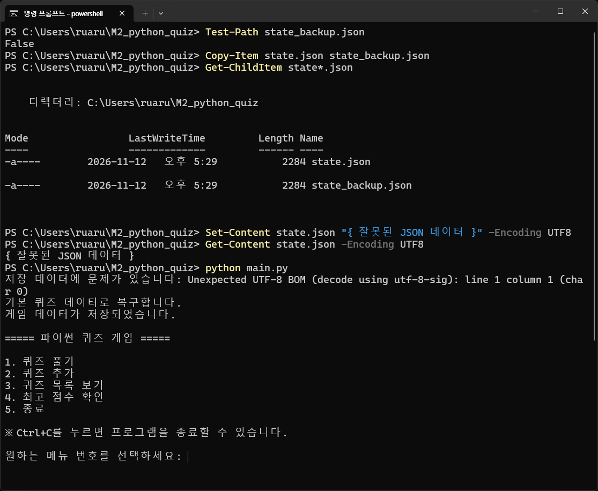

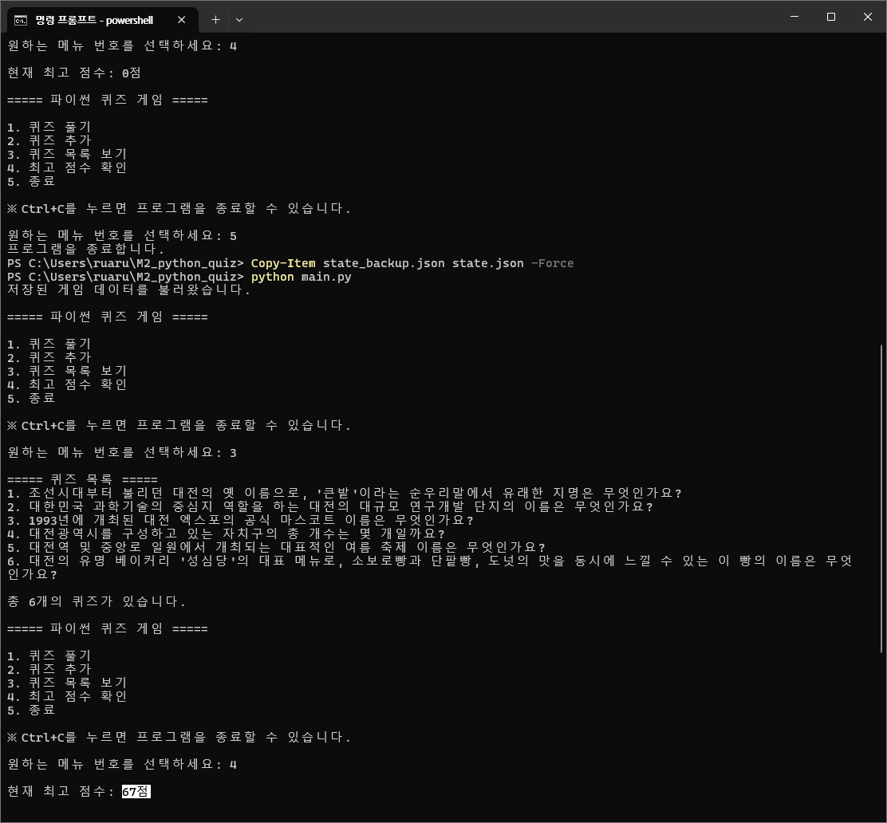

프로그램이 저장 파일의 손상 또는 누락 상황을 확인하고 기본 퀴즈 데이터를 이용해 실행되는 것을 확인했습니다.

> ※ 손상 파일 생성 시 PowerShell이 BOM을 붙여, BOM 오류로 감지된 뒤 복구되었습니다.

> ※ 백업 및 임시 파일은 복구 실습을 위해 별도로 생성한 파일이며, GitHub 저장소에는 포함하지 않았습니다.

### 7-4. 최종 기능 및 예외 상황 검증

| 검증 항목 | 확인 내용 | 검증 상태 |
| --- | --- | --- |
| 기본 퀴즈 5개 | 대전 역사·과학·문화 퀴즈 5개가 목록과 퀴즈 풀기에서 제공됨 | 실행 확인 |
| 잘못된 입력 | 숫자 아님·범위 밖·빈 입력·공백 입력 시 안내 후 재입력 | 실행 확인 |
| 정상 종료 | 메뉴 5번 선택 시 "프로그램을 종료합니다." 메시지 출력 후 종료 | 실행 확인 ([7-3](#7-3-데이터-저장-및-유지-검증)의 15번 화면) |
| 게임 시작 전 점수 | 초기 최고 점수 0점 출력 | 코드 구현 확인 |
| 퀴즈 없음 | 퀴즈 풀기는 안내 메시지 출력, 목록은 "총 0개" 표시 | 코드 구현 확인 |
| Ctrl+C·입력 종료 | `KeyboardInterrupt`, `EOFError` 처리 후 안전 종료 | 코드 구현 확인 (실행 참고: [ts1_nameerror.png](docs/screenshots/ts1_nameerror.png)) |
| `state.json` 없음·손상 | 기본 퀴즈와 초기 점수로 복구, 백업 복원 시 기존 데이터 유지 | 실행 확인 ([7-3](#7-3-데이터-저장-및-유지-검증)) |

※ '코드 구현 확인'은 소스 코드에 처리 로직이 있는 것을 확인한 상태이며, 직접 실행해 검증했다는 의미는 아닙니다.

### 7-5. Git 작업 및 제출 증거

#### 1) Git 기본 작업

Git을 이용해 프로젝트 변경 사항을 기록하고 GitHub 원격 저장소에 반영했습니다.

| 명령어 | 사용 목적 |
|---|---|
| `git init` | Git 저장소 초기화 |
| `git add` | 변경 파일을 커밋 대상으로 등록 |
| `git commit` | 변경 내용 기록 |
| `git push` | 원격 저장소에 변경 사항 반영 |
| `git pull` | 원격 저장소 변경 사항 가져오기 |
| `git checkout` | 브랜치 이동 |
| `git clone` | 원격 저장소 복제 |

※ Clone/Pull 실습 과정은 [4) Clone 및 Pull 실습](#4-clone-및-pull-실습), Init 실습 과정은 [5) Init 실습](#5-init-실습)에 정리했습니다.

#### 2) 브랜치 생성 및 병합

기능별 작업을 분리하기 위해 브랜치를 생성하고 작업 완료 후 `main` 브랜치에 병합했습니다.

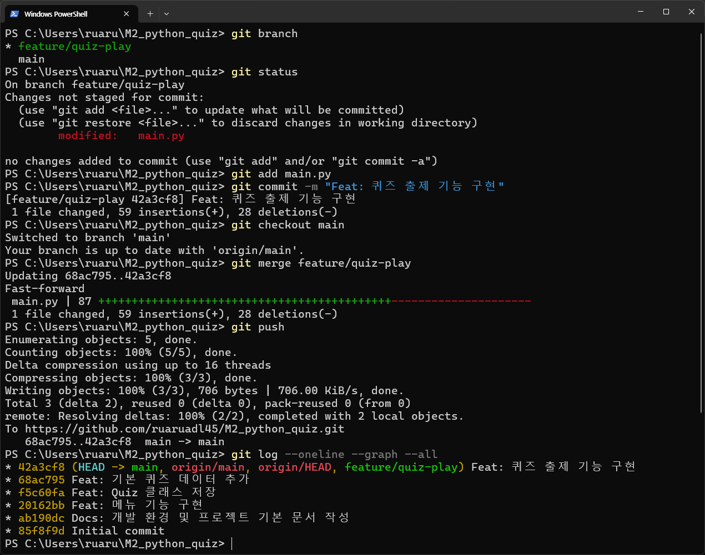

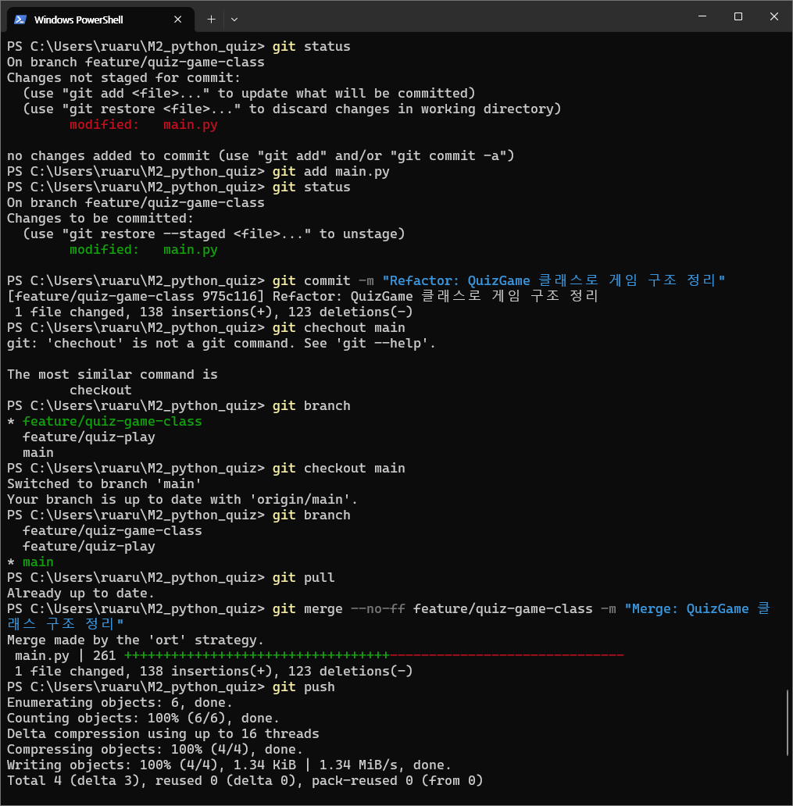

**사용한 브랜치**
- `feature/quiz-play`
- `feature/quiz-game-class`
- `feature/json-persistence`

**JSON 저장 기능 병합 과정**

```powershell
git push -u origin feature/json-persistence
git checkout main
git pull origin main
git merge --no-ff feature/json-persistence -m "Merge: JSON 데이터 저장 기능 추가"
git push origin main
```

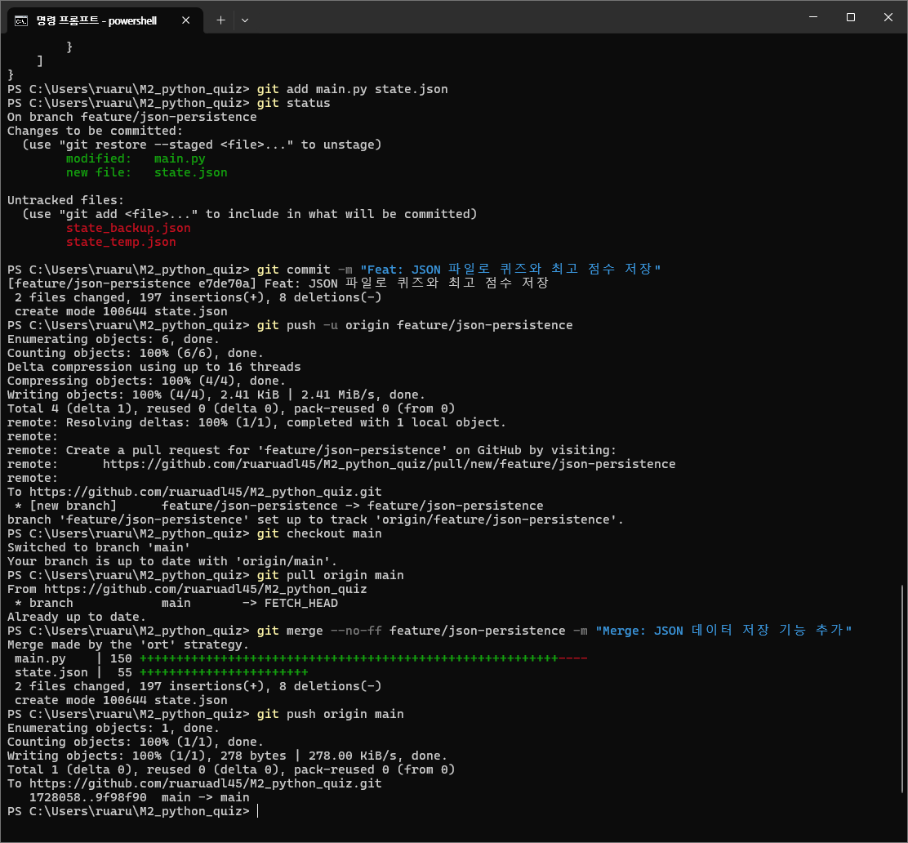

**확인 내용**
- 기능 브랜치 원격 저장소 Push
- `main` 브랜치 이동 및 Pull
- 기능 브랜치 병합
- 병합 결과 GitHub 반영

#### 3) 주요 커밋 작업

| 작업 단계 | 주요 변경 내용 |
|---|---|
| 초기 구성 | Git 저장소 및 README 작성 |
| 기본 기능 | 메뉴와 Quiz 클래스 구현 |
| 퀴즈 기능 | 기본 퀴즈, 출제, 추가 및 목록 기능 구현 |
| 점수 기능 | 최고 점수 계산 및 갱신 |
| 구조 개선 | QuizGame 클래스로 게임 기능 통합 |
| 데이터 관리 | JSON 파일을 이용한 퀴즈 및 최고 점수 저장 |

#### 4) Clone 및 Pull 실습

다른 컴퓨터에서 저장소를 처음 내려받아 작업하는 상황을 가정하여, 같은 PC의 별도 폴더(`C:\Users\ruaru\M2_clone_test`)에 저장소를 복제했습니다. 복제본에서 수정한 내용을 GitHub에 Push한 뒤, 원래 작업 폴더에서 Pull하여 변경 사항이 반영되는지 확인했습니다.

| 구분 | 경로 | 역할 |
| --- | --- | --- |
| 원래 폴더 | `C:\Users\ruaru\M2_python_quiz` | 기존 미션 작업 폴더 |
| 복제본 폴더 | `C:\Users\ruaru\M2_clone_test\M2_python_quiz` | `git clone`으로 새로 내려받은 폴더 |

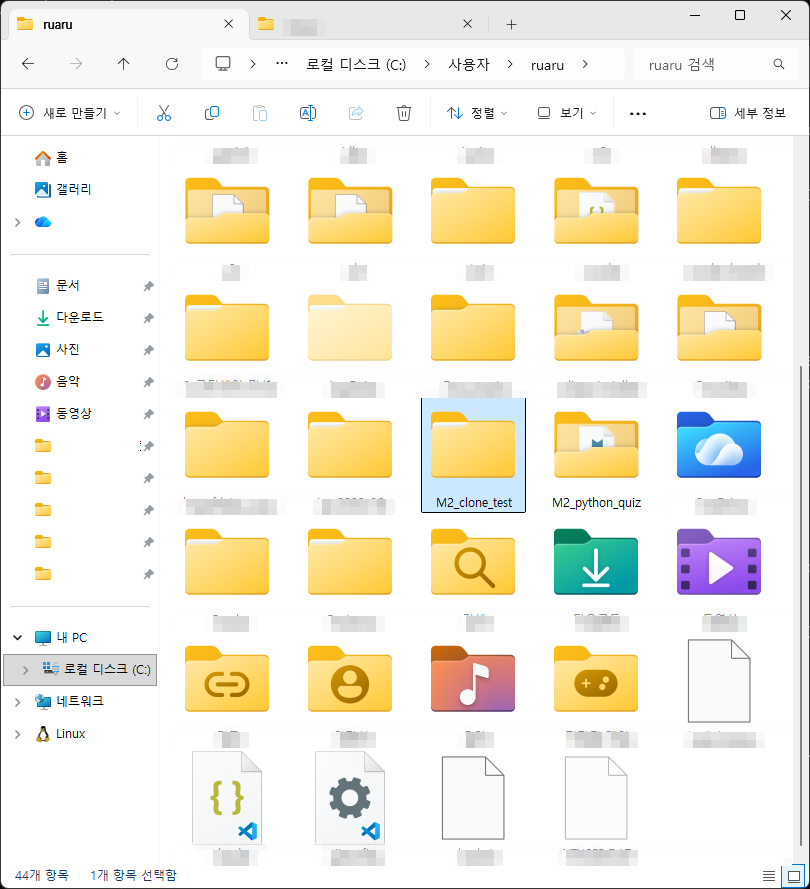

**① 복제본 만들기 및 실행 (Clone → Pull → 실행)**

```powershell
cd C:\Users\ruaru
mkdir M2_clone_test
cd M2_clone_test
git clone https://github.com/ruaruadl45/M2_python_quiz.git
cd M2_python_quiz
git pull origin main
python main.py
```

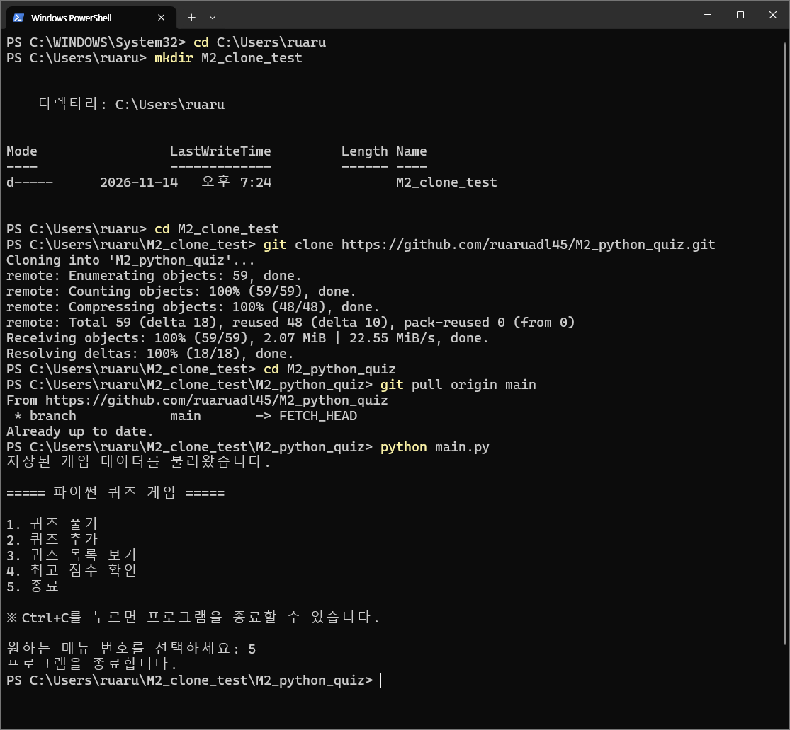

- `git clone`으로 원격 저장소의 파일과 커밋 이력 전체를 내려받음
- 복제 직후 `git pull` 결과 `Already up to date.`로 원격 저장소와 같은 상태임을 확인
- 복제본에서 `python main.py` 실행 시 저장된 데이터를 불러오고 정상 종료됨을 확인

**② 복제본에서 수정 후 Push (수정 → add → commit → push)**

```powershell
notepad README.md
git status
git add README.md
git commit -m "Docs: clone 실습 기록 추가"
git push origin main
```

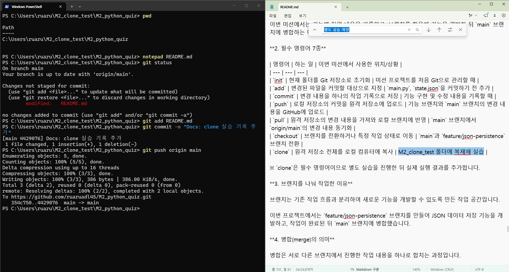

- 복제본의 `README.md`에서 [8-2](#8-2-git-기초-필수-명령어-7종) `clone` 항목을 `별도 실습 예정` → `M2_clone_test 폴더에 복제해 실습`으로 수정
- `git status`로 수정된 파일을 확인한 뒤 `git add`, `git commit` 실행 (`4429076`)
- `git push` 결과 `354c750..4429076 main -> main`으로 GitHub에 반영됨을 확인

**③ 원래 폴더에서 Pull 후 반영 확인**

```powershell
cd C:\Users\ruaru\M2_python_quiz
Select-String README.md -Pattern "별도 실습 예정|복제해 실습"
git pull origin main
Select-String README.md -Pattern "별도 실습 예정|복제해 실습"
git log --oneline -3
```

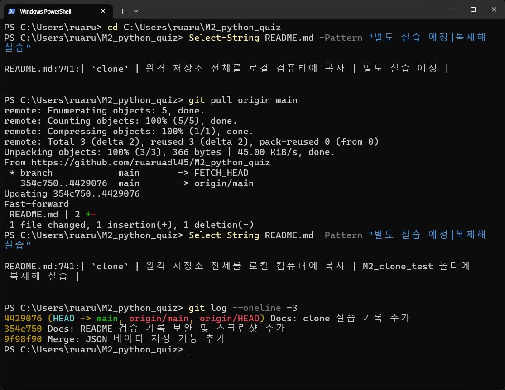

- Pull 전: 원래 폴더의 `README.md`는 `별도 실습 예정` 상태
- `git pull` 결과 `Updating 354c750..4429076`, `Fast-forward`로 복제본의 변경 사항을 내려받음
- Pull 후: 같은 줄이 `M2_clone_test 폴더에 복제해 실습`으로 바뀐 것을 확인
- `git log`에서 최신 커밋이 `4429076 Docs: clone 실습 기록 추가`로 복제본과 일치함을 확인

#### 5) Init 실습

이 프로젝트 저장소는 GitHub에서 먼저 만든 뒤 `clone`으로 작업 폴더를 준비했기 때문에, `git init`은 사용하지 않았습니다. 그래서 미션 파일이 전혀 없는 별도 환경(Docker 컨테이너 `quiz-pc`, Python 3.13·Git 2.47 설치)을 만들어 빈 폴더를 Git 저장소로 초기화하는 과정을 따로 실습했습니다.

**실행 명령어**

```bash
docker exec -it quiz-pc bash        # 별도 환경(컨테이너) 접속
cd /root && ls                      # 미션 파일이 없는 상태 확인
mkdir quiz_init_test && cd quiz_init_test
git init -b main                    # 빈 폴더를 Git 저장소로 초기화
git remote add origin https://github.com/ruaruadl45/M2_python_quiz.git
git remote -v                       # 원격 저장소 연결 확인
git pull origin main                # 원격 저장소의 main 브랜치 내려받기
ls && git log --oneline -3
python main.py
```

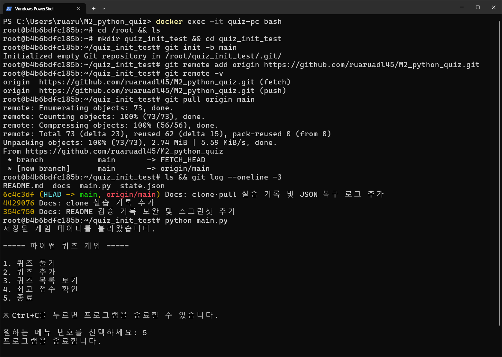

**확인 내용**
- 실습 전 `ls` 결과가 비어 있어 미션 파일이 없는 환경임을 확인
- `git init -b main` 결과 `Initialized empty Git repository`로 빈 저장소 생성 확인
- `git remote -v`로 `origin`(fetch/push) 연결 확인
- `git pull origin main`으로 `README.md`, `docs`, `main.py`, `state.json`을 내려받고, 최신 커밋 `6c4c3df`가 GitHub와 일치함을 확인
- 내려받은 `main.py`를 실행해 저장된 데이터를 불러오고 정상 종료됨을 확인

**`clone`과 `init`의 차이**

| 구분 | `git clone` | `git init` + `remote add` + `pull` |
| --- | --- | --- |
| 시작점 | 원격 저장소 | 빈 폴더 |
| 원격 연결 | 자동으로 `origin` 등록 | `git remote add`로 직접 등록 |
| 사용하는 상황 | 이미 있는 저장소를 받아 작업할 때 | 내 폴더를 새로 Git 저장소로 만들 때 |

#### 6) Git 작업 이력 확인

**실행 명령어**

```powershell
git log --oneline --graph --all --decorate
```

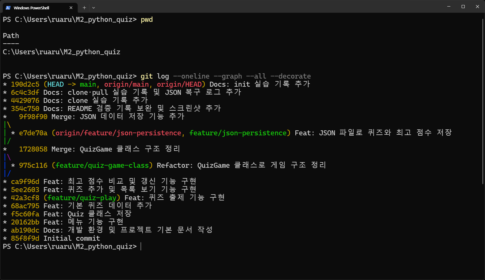

**확인 내용**
- 커밋 메시지와 변경 이력 확인
- 기능별 브랜치 작업 확인
- 브랜치 병합 이력 확인
- `main` 브랜치와 원격 저장소 동기화 확인

[맨 위로 이동](#top)

---

## 8. 핵심 개념 정리

미션에서 사용한 Python 문법과 Git 명령어의 역할을 정리했습니다. 각 기술을 단순히 사용하는 데 그치지 않고, 실제 프로젝트에서 어떤 목적으로 적용했는지 설명합니다.

### 8-1. Python 기초 · 클래스 · 파일 입출력

**1. 변수란 무엇이고 왜 사용하는가**

변수는 데이터를 담아두는 이름표가 붙은 상자와 같습니다. 프로그램에서 필요한 값을 저장하고, 나중에 다시 사용하거나 변경하기 위해 사용합니다.

이번 프로젝트에서는 `best_score`에 최고 점수를 저장하고, `quizzes`에 등록된 퀴즈 목록을 저장했습니다.

**2. 주요 자료형의 차이**

| 자료형 | 의미 | 프로젝트 사용 예시 |
| --- | --- | --- |
| `int` | 정수 | 정답 번호, 최고 점수 |
| `str` | 문자열 | 문제, 선택지, 사용자 입력 |
| `bool` | 참 또는 거짓 | 정답 여부 확인 결과 |
| `list` | 여러 데이터를 순서대로 저장 | 퀴즈 목록, 선택지 목록 |
| `dict` | 이름이 있는 항목으로 데이터를 묶어 저장 | 퀴즈 정보, JSON 데이터 |

**3. `if / elif / else`의 역할**

조건에 따라 서로 다른 동작을 실행하는 문법입니다.

- `if`: 조건이 참이면 실행
- `elif`: 앞선 조건이 거짓이고 다른 조건이 참이면 실행
- `else`: 앞의 모든 조건이 거짓일 때 실행

이번 프로젝트에서는 메뉴 번호에 따라 퀴즈 시작, 퀴즈 추가, 목록 조회, 최고 점수 확인, 종료 기능을 실행하는 데 사용했습니다.

**4. `for`와 `while`의 차이 및 선택 기준**

- `for`: 목록처럼 정해진 데이터들을 하나씩 꺼내 반복할 때 사용합니다.
- `while`: 특정 조건이 유지되는 동안 반복할 때 사용합니다.

이번 프로젝트에서는 `for`를 사용해 등록된 퀴즈를 하나씩 출제하고, `while`을 사용해 메뉴와 입력 검증을 반복하도록 구현했습니다.

**5. 함수, 매개변수, 반환값의 의미**

함수는 특정 작업을 수행하도록 명령어를 묶어 놓은 것입니다.

- 매개변수: 함수가 작업할 때 전달받는 값
- 반환값: 함수가 작업을 마친 뒤 돌려주는 결과

예를 들어 `get_valid_number(prompt, min_value, max_value)`는 입력 안내 문구와 허용 범위를 전달받아 올바른 숫자를 반환합니다.

**6. 클래스가 무엇이고 왜 사용하는가**

클래스는 데이터와 기능을 함께 담아 놓은 설계도입니다. 기본 구조를 한 번 만들어 두면 필요한 데이터만 바꿔 여러 객체를 만들 수 있어 편리합니다.

이번 프로젝트에서는 `Quiz`와 `QuizGame` 두 클래스를 사용했습니다.

**7. 클래스를 사용한 이유와 함수만으로 만들 때의 차이**

함수만 사용하면 데이터가 달라질 때 비슷한 코드를 반복해서 작성해야 할 수 있습니다. 클래스는 데이터와 기능을 하나로 묶어 기본 구조를 재사용할 수 있어 반복 작업을 줄이고 코드를 효율적으로 관리할 수 있습니다.

이번 프로젝트에서는 개별 퀴즈의 정보와 기능을 `Quiz`에 모으고, 게임 전체의 진행과 데이터 관리는 `QuizGame`에 모아 역할을 구분했습니다.

**8. `__init__`과 `self`의 역할**

- `__init__`: 객체가 만들어질 때 처음 실행되는 초기 설정 기능입니다.
- `self`: 현재 만들어진 객체 자신을 가리킵니다.

이번 프로젝트에서는 `QuizGame.__init__()`에서 퀴즈 목록, 최고 점수, 저장 파일 경로를 초기화했습니다.

**9. 속성(attribute)과 메서드(method)의 차이**

- 속성: 객체가 가지고 있는 데이터
- 메서드: 객체가 수행할 수 있는 기능

예를 들어 `Quiz`의 `question`, `choices`, `answer`는 속성이고, `display()`, `check_answer()`는 메서드입니다.

**10. 파일을 열고, 읽고, 쓰는 과정**

파일 입출력은 프로그램과 파일 사이에서 데이터를 주고받는 과정입니다.

이번 프로젝트에서는 다음과 같이 사용했습니다.

- 파일 열기: `open()`으로 파일에 접근
- 파일 읽기: `json.load()`로 저장된 JSON 데이터를 읽기
- 파일 쓰기: `json.dump()`로 데이터를 JSON 형식으로 저장
- 인코딩: `encoding="utf-8"`을 지정하여 한글이 정상적으로 저장되도록 처리

**11. JSON이 무엇이고 데이터 저장에 사용하는 이유**

JSON(JavaScript Object Notation)은 데이터를 정해진 형식으로 표현하고 저장하는 방식입니다.

Python의 `dict`, `list`와 비슷한 구조로 데이터를 관리할 수 있어 퀴즈 목록과 최고 점수를 파일에 저장하는 데 사용했습니다.

**12. JSON 형식의 특징과 한계**

- 특징: 가볍고 간단한 텍스트 형식으로 데이터를 저장하고 전달하기 편리하며, 사람이 직접 내용을 읽고 수정하기도 쉽습니다. 여러 프로그램에서 데이터를 주고받을 때 활용할 수 있습니다.
- 한계: 데이터가 커지거나 여러 사용자가 동시에 수정하는 상황에서는 관리가 어려워질 수 있습니다.
- 주의사항: JSON 문법이 잘못되거나 필수 데이터가 누락되면 정상적으로 읽지 못할 수 있습니다.

**13. `try / except`가 필요한 이유와 파일 입출력 실패 사례**

`try / except`는 프로그램 실행 중 오류가 발생했을 때 오류를 처리하고, 프로그램이 갑자기 종료되는 것을 방지하기 위한 문법입니다.

이번 프로젝트에서는 다음과 같이 적용했습니다.

- 숫자로 변환할 수 없는 입력: `ValueError` 처리
- JSON 형식이 잘못된 경우: `json.JSONDecodeError` 처리
- 파일을 읽거나 쓸 수 없는 경우: `OSError` 처리
- Ctrl+C 입력: `KeyboardInterrupt` 처리
- 입력 스트림 종료: `EOFError` 처리

### 8-2. Git 기초 (필수 명령어 7종)

**1. Git이 무엇이고 왜 필요한가**

Git은 코드와 문서의 변경 이력을 기록하고 관리하는 버전 관리 도구입니다.

이번 미션에서는 기능별 작업 내용을 기록하고, 브랜치를 활용해 기능을 개발한 뒤 `main` 브랜치에 병합하는 데 사용했습니다.

**2. 필수 명령어 7종**

| 명령어 | 하는 일 | 이번 미션에서 사용한 위치/상황 |
| --- | --- | --- |
| `init` | 현재 폴더를 Git 저장소로 초기화 | 미션 파일이 없는 별도 환경(Docker 컨테이너)의 빈 폴더를 저장소로 만든 뒤 원격 저장소와 연결 ([21](docs/screenshots/21_git_init.png) 화면) |
| `add` | 변경된 파일을 커밋할 대상으로 지정 | `main.py`, `state.json`을 커밋하기 전 추가 |
| `commit` | 변경 내용을 하나의 작업 기록으로 저장 | 기능 구현 및 수정 내용을 기록할 때 |
| `push` | 로컬 저장소의 커밋을 원격 저장소에 업로드 | 기능 브랜치와 `main` 브랜치의 변경 내용을 GitHub에 업로드 |
| `pull` | 원격 저장소의 변경 내용을 가져와 로컬 브랜치에 반영 | `main` 브랜치에서 `origin/main`의 변경 내용 동기화 |
| `checkout` | 브랜치를 전환하거나 특정 작업 상태로 이동 | `main`과 `feature/json-persistence` 브랜치 전환 |
| `clone` | 원격 저장소 전체를 로컬 컴퓨터에 복사 | M2_clone_test 폴더에 복제해 실습 |

※ `clone`과 `pull`의 실제 실행 과정은 [7-5의 Clone 및 Pull 실습](#4-clone-및-pull-실습), `init`의 실행 과정은 [7-5의 Init 실습](#5-init-실습)에서 확인할 수 있습니다.

※ 이 프로젝트 저장소는 GitHub에서 먼저 생성한 뒤 `clone`으로 작업 폴더를 만들었기 때문에, `init`은 별도 환경에서 따로 실습했습니다.

**3. 브랜치를 나눠 작업한 이유**

브랜치는 기존 작업 흐름과 분리하여 새로운 기능을 개발할 수 있도록 만든 작업 공간입니다.

이번 프로젝트에서는 `feature/json-persistence` 브랜치를 만들어 JSON 데이터 저장 기능을 개발하고, 작업이 완료된 뒤 `main` 브랜치에 병합했습니다.

**4. 병합(merge)의 의미**

병합은 서로 다른 브랜치에서 진행한 작업 내용을 하나로 합치는 과정입니다.

이번 프로젝트에서는 `feature/json-persistence`에서 완성한 JSON 저장 기능을 `main` 브랜치에 병합하여 최종 코드에 반영했습니다.

[맨 위로 이동](#top)

---

## 9. 트러블슈팅

개발 및 실습 과정에서 실제로 발생한 문제를 문제 상황 → 원인 추정 → 확인 방법 → 해결 방법 → 최종 결과 순서로 기록합니다.

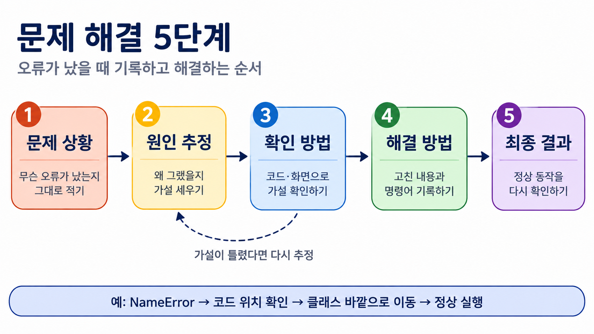

### 9-1. 문제 사례 1: 기본 퀴즈 데이터 코드의 위치 및 들여쓰기 오류

| 구분 | 기록 내용 |
| --- | --- |
| 문제 상황 | `main.py`의 `quizzes`에 해당하는 기본 퀴즈 데이터를 추가한 뒤 프로그램을 실행하자 `NameError: name 'Quiz' is not defined` 오류가 발생했습니다. |
| 원인 추정 | Python 코드 작성과 들여쓰기 규칙에 익숙하지 않아 퀴즈 데이터 코드가 의도한 위치가 아닌 `class Quiz` 내부에 포함된 것이 원인으로 추정되었습니다. |
| 확인 방법 | `main.py`의 클래스 선언 위치와 들여쓰기 구조를 확인하고, 기본 퀴즈 데이터 코드가 어느 클래스에 포함되어 있는지 살펴보았습니다. |
| 해결 방법 | 퀴즈 데이터 코드를 `class Quiz` 내부에서 분리하고, `class Quiz` 바깥(최상위)으로 옮겨 `Quiz` 정의가 끝난 뒤 객체를 만들도록 수정했습니다. 이후 `QuizGame` 클래스를 구현하면서 `QuizGame.__init__()` 안으로 옮겨 정리했습니다. |
| 최종 결과 | 클래스 정의가 끝난 뒤 객체를 생성하도록 위치를 옮겨 구조를 수정한 결과, 프로그램을 정상 실행할 수 있었습니다. |

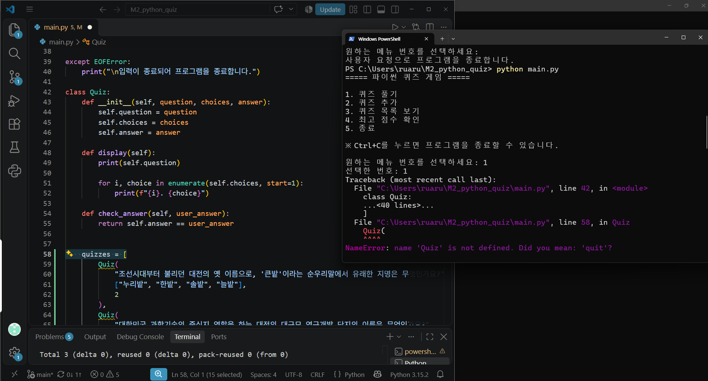

### 9-2. 문제 사례 2: PowerShell에서 Python 파일의 한글 인코딩 깨짐

| 구분 | 기록 내용 |
| --- | --- |
| 문제 상황 | PowerShell에서 `Get-Content main.py` 명령어로 전체 코드 내용을 확인했을 때 한글이 정상적으로 표시되지 않고 글자가 깨지는 현상이 발생했습니다. |
| 원인 추정 | 원본 `main.py` 파일의 한글 내용에는 문제가 없었으며, PowerShell에서 파일을 읽어 들이는 과정의 인코딩 설정이 원본 파일의 인코딩과 맞지 않는 것으로 추정했습니다. |
| 확인 방법 | VS Code에서 원본 `main.py`의 한글이 정상적으로 표시되는지 확인하고, PowerShell에서 `Get-Content` 명령어를 실행했을 때의 출력 결과와 비교했습니다. |
| 해결 방법 | `Get-Content` 명령어에 인코딩 설정을 추가하여 파일을 읽도록 수정했습니다. (`Get-Content main.py -Encoding UTF8`) |
| 최종 결과 | 원본 파일을 수정하지 않고 PowerShell의 읽기 인코딩 설정만 변경하여 한글 코드가 정상적으로 표시되는 것을 확인했습니다. |

```powershell
Get-Content main.py -Encoding UTF8
```

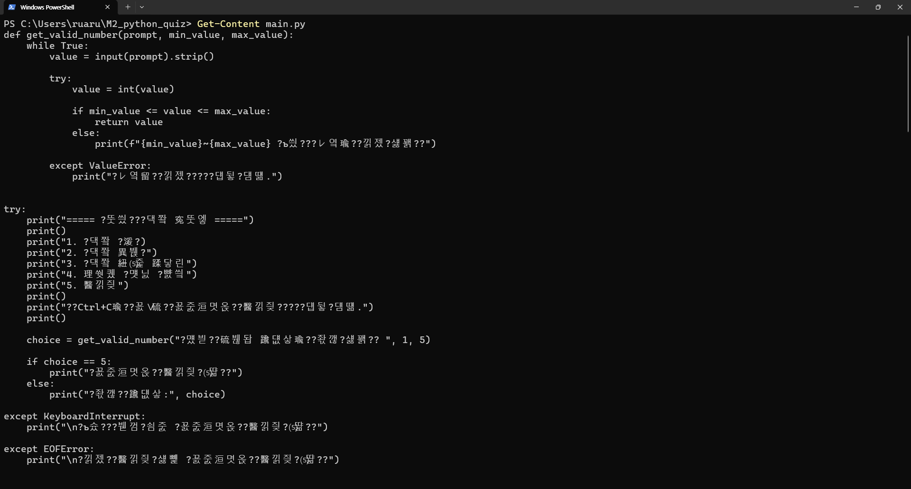

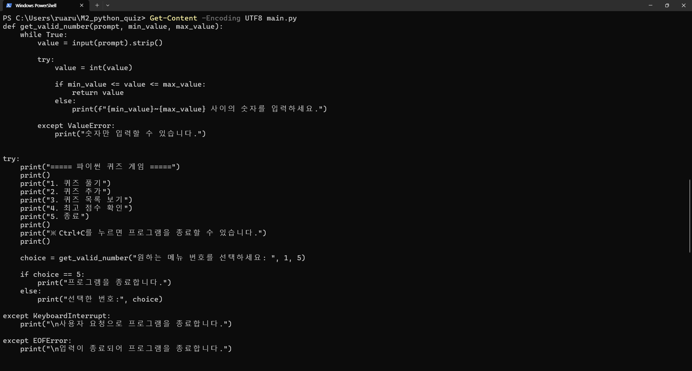

[맨 위로 이동](#top)

---

## 10. 보너스 과제 수행 내용

필수 항목을 모두 완료한 뒤 선택적으로 진행합니다. 보너스 기능으로 `state.json` 구조가 바뀌면 5장도 함께 수정합니다.

| 과제 항목 | 수행 여부 | 구현 내용 및 결과 |
| --- | :-: | --- |
| 랜덤 출제 | ⬜ | [TODO] |
| 문제 수 선택 | ⬜ | [TODO] |
| 힌트 기능 및 점수 차감 | ⬜ | [TODO] |
| 퀴즈 삭제 | ⬜ | [TODO] |
| 점수 기록 히스토리 | ⬜ | [TODO] |

[맨 위로 이동](#top)

---

## 11. 미션을 마치며

### 11-1. 이번 미션에서 배운 내용

이번 미션을 통해 Python을 이용한 간단한 콘솔 퀴즈 게임을 만들고, Git과 GitHub를 활용해 개발 과정을 관리하는 방법을 배웠습니다.

주요 학습 내용은 다음과 같습니다.

- **Python 기초:** 변수, 조건문, 반복문, 함수 등을 활용하여 프로그램의 실행 흐름을 구성하는 방법
- **클래스와 객체:** `Quiz`와 `QuizGame` 클래스를 구분하고, 데이터와 기능을 역할에 맞게 구성하는 방법
- **데이터 관리:** JSON 파일을 이용해 퀴즈 목록과 최고 점수를 저장하고, 프로그램을 다시 실행했을 때 데이터를 불러오는 방법
- **예외 처리:** 잘못된 입력이나 파일 관련 오류에 대비하여 프로그램이 비정상적으로 종료되지 않도록 처리하는 방법
- **Git과 GitHub:** 변경 사항을 커밋으로 기록하고, 브랜치를 생성하여 작업한 뒤 병합하는 방법

특히 프로그램을 한 번 실행하고 끝내는 것이 아니라, 사용자가 추가한 퀴즈와 최고 점수가 다음 실행에도 유지되도록 구현하면서 데이터 저장의 필요성을 이해할 수 있었습니다.

### 11-2. 추가 학습 계획

이번 미션에서 배운 내용을 바탕으로 다음과 같은 학습을 이어갈 계획입니다.

1. **Python 기초 문법 복습:** 변수, 조건문, 반복문, 함수, 클래스와 객체의 개념을 반복 실습하여 코드 구조에 익숙해지기
2. **파일 및 데이터 관리 학습:** JSON 데이터의 구조와 파일 입출력, 예외 처리 방법을 더 깊이 이해하기
3. **Git과 GitHub 활용:** 브랜치 생성과 병합, 커밋 관리, 원격 저장소 동기화 등 협업에 필요한 기본 기능 익히기
4. **다음 미션 준비:** 이번 미션에서 익힌 Python 기초를 바탕으로 계산기 구현에 필요한 연산 처리와 프로그램 구조 설계 학습하기
5. **보너스 미션 도전:** 기본 미션에서 구현한 기능을 개선하고 추가 기능을 직접 설계하면서 문제 해결 경험 넓히기

앞으로도 단순히 코드를 실행하는 데 그치지 않고, 각 코드가 어떤 역할을 하는지 이해하며 스스로 수정하고 개선할 수 있는 개발 역량을 키워 나가겠습니다.

[맨 위로 이동](#top)