<a id="top"></a>

# Pre1-2. Python 콘솔 퀴즈 게임

## 목차

1. [프로젝트 개요](#1-프로젝트-개요)
2. [실행 방법](#2-실행-방법)
3. [기능 목록](#3-기능-목록)
4. [파일 구조](#4-파일-구조)
5. [데이터 파일 설명 (state.json)](#5-데이터-파일-설명-statejson)
6. [설계 설명](#6-설계-설명)
7. [수행 내용 및 검증](#7-수행-내용-및-검증)
8. [핵심 개념 정리](#8-핵심-개념-정리)
9. [트러블슈팅](#9-트러블슈팅)
10. [보너스 과제 수행 내용](#10-보너스-과제-수행-내용)
11. [미션을 마치며](#11-미션을-마치며)

---

## 1. 프로젝트 개요

터미널에서 실행하는 Python 콘솔 퀴즈 게임입니다.

Python 기본 문법으로 메뉴와 퀴즈 진행 기능을 구현하고, `Quiz`와 `QuizGame` 클래스로 역할을 나눴습니다. 퀴즈·최고 점수·게임 기록은 프로젝트 루트의 `state.json`에 저장해 프로그램을 다시 실행해도 유지됩니다. 보너스 과제로 랜덤 출제, 문제 수 선택, 힌트, 퀴즈 삭제, 점수 기록 히스토리 기능을 추가했습니다.

Git으로 기능별 변경 이력을 기록하고 GitHub 저장소에 업로드했습니다.

### 1-1. 개발 환경

| 구분 | 사용 환경 |
| --- | --- |
| 운영체제 | Windows 11 Home (64비트) |
| Terminal | Windows PowerShell |
| Python | Python 3.15.2 |
| Git | Git version 2.56.0.windows.4 |
| 코드 편집기 | Visual Studio Code |
| 외부 라이브러리 | 사용하지 않음 (Python 표준 라이브러리 `json`, `pathlib`, `random`, `datetime`만 사용) |


### 1-2. 퀴즈 주제와 선정 이유


- **주제**: 대전 지역의 역사·과학·문화 관련 상식
- **선정 이유**: 코디세이 AI 올인원 교육과정에는 다양한 연령대의 300명이 넘는 교육생들이 함께 참여하고 있습니다. 서로 다른 세대가 공통으로 관심을 갖고 편하게 소통할 수 있는 주제를 고민한 결과, 교육생들이 함께 생활하고 있는 지역인 대전을 선정했습니다. 지역의 역사와 문화, 과학 관련 상식을 통해 세대 간 공감대를 형성하고 즐겁게 참여할 수 있는 퀴즈를 만들고자 했습니다.
- **기본 퀴즈 5개**: 대전의 옛 이름(한밭), 대표 연구개발 단지, 1993년 엑스포 마스코트, 자치구 개수, 대표 여름 축제

### 1-3. GitHub 저장소 정보

| 구분 | 내용 |
| --- | --- |
| 저장소 이름 | M2_python_quiz |
| 저장소 주소 | [https://github.com/ruaruadl45/M2_python_quiz](https://github.com/ruaruadl45/M2_python_quiz) |

[맨 위로 이동](#top)

---

## 2. 실행 방법

Windows PowerShell에서 다음 명령어를 실행합니다.

```powershell
git clone https://github.com/ruaruadl45/M2_python_quiz.git   # 저장소 복제
cd M2_python_quiz                                             # 프로젝트 폴더로 이동
python --version                                              # Python 버전 확인
python main.py                                                # 프로그램 실행
```

- **필요 환경:** Python 3.10 이상 (Python 3.15.2에서 동작 확인, macOS·Linux는 `python3 main.py`)
- **입력 규칙:** 메뉴는 번호로 선택합니다. 정답 입력에서 `0`은 힌트 보기, 퀴즈 추가(질문 입력)와 삭제 중 `0`은 취소입니다.

[맨 위로 이동](#top)

---

## 3. 기능 목록

| 번호 | 기능 | 설명 | 구현 위치 |
| :-: | --- | --- | --- |
| 1 | 퀴즈 풀기 | 풀 문제 수 선택, 랜덤 출제, 힌트 보기, 정오 안내, 결과 표시, 게임 기록 저장 및 최고 점수 갱신 | `QuizGame.play()` |
| 2 | 퀴즈 추가 | 문제·선택지 4개·정답 번호·힌트(선택)를 입력받아 등록 및 저장 | `QuizGame.add_quiz()` |
| 3 | 퀴즈 목록 | 등록된 퀴즈 목록 표시 | `QuizGame.show_quizzes()` |
| 4 | 점수 확인 | 최고 점수(달성한 문제 수 포함)와 전체 게임 기록 표시 | `QuizGame.show_scores()` |
| 5 | 퀴즈 삭제 | 번호를 골라 퀴즈를 삭제하고 저장 | `QuizGame.delete_quiz()` |
| 6 | 종료 | 프로그램 종료 | `QuizGame.run()` |

※ 실행 화면은 [7-2](#7-2-퀴즈-기능-실행)(보너스 전)와 [10장](#10-보너스-과제-수행-내용)(보너스 후)에 있습니다. 보너스 과제로 메뉴에 `5. 퀴즈 삭제`가 추가되어 종료가 `6`번이 되었습니다.

### 3-1. 입력 및 예외 상황 처리

| 상황 | 처리 방식 | 확인 결과 |
| --- | --- | --- |
| 잘못된 숫자 입력 (`abc`, 범위 밖 숫자, 빈 입력) | 메뉴·정답·문제 수 입력 모두 `get_valid_number()`에서 안내 후 다시 입력받음 | 실행 확인 ([06](docs/screenshots/06_input_errors.png) 화면, [10장 로그](#10-보너스-과제-수행-내용)) |
| 입력 앞뒤 공백 (예: ` 1 `) | `strip()`으로 공백을 제거한 후 처리 | 실행 확인 ([07](docs/screenshots/07_quiz_play.png) 화면) |
| 빈 문제·선택지 입력 | `get_valid_text()`에서 안내 후 다시 입력받음 | 실행 확인 ([08](docs/screenshots/08_quiz_add.png) 화면) |
| 입력 중 `0` | 정답 입력: 힌트 보기 / 퀴즈 추가 질문: 추가 취소 / 삭제 번호: 삭제 취소 | 힌트·삭제 취소: 실행 확인 ([10장](#10-보너스-과제-수행-내용)) / 추가 취소: 코드 구현 확인 |
| 퀴즈가 없을 때 풀기·목록·삭제 | 안내 메시지 출력, 목록은 총 0개 표시 | 풀기·목록: 실행 확인 ([7-2 로그](#7-2-퀴즈-기능-실행)) / 삭제: 코드 구현 확인 |
| 아직 퀴즈를 풀지 않고 점수 확인 | 최고 점수 0점, `아직 게임 기록이 없습니다.` 표시 | 실행 확인 ([25_history_1a](docs/screenshots/25_history_1a.png) 화면) |
| Ctrl+C (`KeyboardInterrupt`) / 입력 종료 (`EOFError`) | `run()`에서 처리하고 안내 메시지 출력 후 안전 종료 ([6-3](#6-3-안전-종료)) | Ctrl+C: 실행 확인 / EOF: 코드 구현 확인 |
| `state.json` 없음·손상 | 기본 데이터로 시작하거나 복구한 뒤 저장 ([5-4](#5-4-파일이-없거나-손상된-경우)) | 실행 확인 ([7-3](#7-3-데이터-저장-및-복구-검증)) |
| `state.json` 읽기·쓰기 오류 (`OSError`) | 읽기: 기본 데이터로 복구 시도 / 쓰기: 저장 실패 메시지 출력 | 코드 구현 확인 |

※ '코드 구현 확인'은 소스 코드에 처리 로직이 있는 것을 확인한 상태이며, 직접 실행해 검증했다는 의미는 아닙니다.

[맨 위로 이동](#top)

---

## 4. 파일 구조

```text
M2_python_quiz/
├── .gitignore          # Git에서 추적하지 않을 파일 지정
├── README.md           # 프로젝트 설명 및 검증 기록
├── main.py             # Quiz·QuizGame 클래스, 입력 검증 함수, 실행 코드
├── state.json          # 퀴즈 목록·최고 점수·게임 기록 저장 (5장 참고)
└── docs/
    └── screenshots/    # 실행·Git 기록 스크린샷과 다이어그램
        ├── 01_env.png
        ├── ...
        ├── 21_git_init.png
        ├── 22_bonus_random_1.png   # 22~25: 보너스 과제 실행 화면
        ├── ...
        └── 25_history_2.png
```

※ 스크린샷 파일명은 일부만 표기했습니다.

### 4-1. 데이터 파일 관리

- `state.json`은 기본 데이터 제공을 위해 저장소에 포함했습니다. 보너스 과제 후 새 구조(힌트·게임 기록 포함)의 기본 데이터로 초기화해 올렸습니다.
- `state_backup.json`, `state_temp.json`은 복구 실습 중 만든 파일이라 `.gitignore`에 등록해 올리지 않았습니다.

[맨 위로 이동](#top)

---

## 5. 데이터 파일 설명 (state.json)

| 항목 | 내용 |
| --- | --- |
| 경로 | 프로젝트 루트의 `state.json` (`main.py`와 같은 폴더) |
| 인코딩 | UTF-8 |
| 역할 | 퀴즈 목록, 최고 점수, 게임 기록 저장 |
| 생성 시점 | 최초 실행 시 파일이 없으면 기본 퀴즈 데이터로 생성 |
| 갱신 시점 | 퀴즈 추가·삭제 시, 게임을 마칠 때마다, 데이터 손상 복구 시 |

### 5-1. 데이터 구조 (스키마)

| 키 | 자료형 | 설명 |
| --- | --- | --- |
| `best_score` | int | 최고 점수 (0~100점) |
| `best_question_count` | int | 최고 점수를 낸 판의 문제 수 |
| `quizzes` | list[dict] | 퀴즈 목록 |
| `quizzes[].question` | str | 퀴즈 문제 |
| `quizzes[].choices` | list[str] | 4개의 선택지 |
| `quizzes[].answer` | int | 정답 번호 (1~4) |
| `quizzes[].hint` | str | 힌트 (없으면 빈 문자열) |
| `history` | list[dict] | 게임 기록 목록 |
| `history[].date` | str | 게임한 날짜·시간 (예: `2026-11-15 22:40`) |
| `history[].question_count` / `correct_count` / `hint_count` | int | 푼 문제 수 / 맞힌 문제 수 / 힌트 사용 문제 수 |
| `history[].score` | int | 힌트 차감 후 점수 |

<details>
<summary>JSON 데이터 예시 보기</summary>

```json
{
    "best_score": 100,
    "best_question_count": 5,
    "quizzes": [
        {
            "question": "조선시대부터 불리던 대전의 옛 이름으로, '큰밭'이라는 순우리말에서 유래한 지명은 무엇인가요?",
            "choices": ["누리밭", "한밭", "솔밭", "늘밭"],
            "answer": 2,
            "hint": "대전에 있는 '○○수목원', '○○대학교' 이름에도 쓰여요."
        }
    ],
    "history": [
        {
            "date": "2026-11-15 22:40",
            "question_count": 5,
            "correct_count": 5,
            "hint_count": 0,
            "score": 100
        }
    ]
}
```
</details>

### 5-2. 데이터 구조를 이렇게 설계한 이유

- **목록은 `list`, 항목 1개는 `dict`:** 퀴즈와 게임 기록은 여러 개가 계속 추가·삭제되므로 `list`로, 퀴즈 1개(문제·선택지·정답·힌트)와 기록 1개(날짜·문제 수·점수)는 서로 관련된 정보라 이름 붙은 `dict`로 묶었습니다.
- **점수는 별도 항목:** 최고 점수는 퀴즈와 성격이 다른 데이터라 최상위에 따로 두었고, 동점일 때 비교하기 위해 `best_question_count`를 함께 저장합니다.

### 5-3. 점수 계산 방식

- **점수:** 맞힌 수 ÷ **이번에 푼 문제 수** × 100, 소수점 반올림 (`QuizGame.calculate_score()`, 퀴즈 0개면 0점)
- **힌트 차감:** 힌트를 사용한 문제 1개당 10점, 최저 0점 (`QuizGame.play()`)
- **최고 점수 갱신:** 등록된 **모든 문제를 푼 판만** 후보가 되고, 점수가 더 높거나 **점수가 같으면 더 많은 문제를 푼 기록**으로 갱신합니다. 일부만 푼 판은 기록에만 남습니다.

### 5-4. 파일이 없거나 손상된 경우

| 상황 | 처리 방식 |
| --- | --- |
| 파일 없음 (첫 실행) | 기본 퀴즈 5개로 시작하고 `state.json` 생성 |
| JSON 형식 손상, 항목·자료형 오류 | 안내 후 기본 퀴즈와 최고 점수 0으로 복구하고 다시 저장 |
| 파일 읽기 오류 / 쓰기 오류 | `OSError` 처리 → 읽기는 기본 데이터로 복구 시도, 쓰기는 실패 메시지 출력 |
| 예전 구조의 파일 (`hint`, `history`, `best_question_count` 없음) | `.get(키, 기본값)`으로 오류 없이 읽고 빈 힌트·빈 기록·0문제로 채움 |

- **구조가 바뀌었을 때:** `item["hint"]`처럼 꺼내면 이름표가 없을 때 `KeyError`가 나서 손상 파일로 처리되고, 사용자가 추가한 퀴즈까지 기본 데이터로 덮어써집니다. 그래서 새 항목은 `.get()`으로 읽습니다. 기존 파일은 `.get()`으로 오류 없이 읽히지만 새 칸은 빈칸이고, 새 기본값(힌트 포함 기본 퀴즈)을 쓰려면 파일을 새로 만들어야 합니다.
- **한계:** 손상 전 데이터를 자동으로 백업하지 않으므로, 중요한 데이터는 별도로 복사해 두어야 합니다. ([7-3](#7-3-데이터-저장-및-복구-검증)에서 백업 복원 실습)

[맨 위로 이동](#top)

---

## 6. 설계 설명

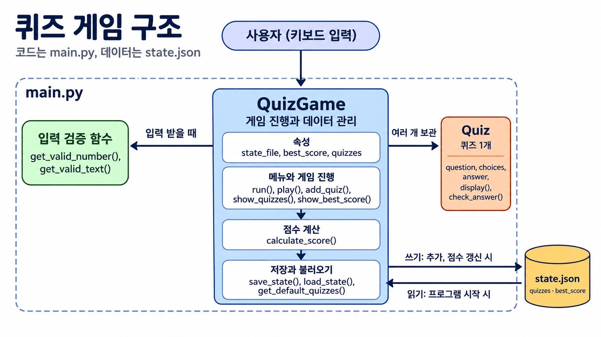

※ 그림은 보너스 과제 전 구조 기준입니다. 보너스 이후 추가된 `show_scores()`, `delete_quiz()`, `show_hint()`, `history`는 아래 표에 반영했습니다.

### 6-1. 역할 분리

| 구분 | 담당 클래스·함수 | 역할 |
| --- | --- | --- |
| 퀴즈 1개 | `Quiz` (`display()`, `check_answer()`, `show_hint()`) | 문제·선택지·정답·힌트를 가지고, 문제 출력과 정답 확인 |
| 게임 전체 | `QuizGame` (`run()`, `play()`, `add_quiz()`, `show_quizzes()`, `delete_quiz()`, `show_scores()`) | 메뉴, 게임 진행, 퀴즈 목록·점수·기록 관리 |
| 입력 검증 | `get_valid_number()`, `get_valid_text()` | 숫자 범위·빈 입력 검증. 메뉴·정답·문제 수·퀴즈 추가에서 재사용 |
| 점수 계산 | `QuizGame.calculate_score()` | 정답률을 0~100점으로 환산 |
| 데이터 관리 | `save_state()`, `load_state()`, `get_default_quizzes()` | JSON 저장·불러오기, 기본 데이터 제공 |

- **나눈 기준:** 한 클래스·함수가 한 가지 역할만 하도록 나눴습니다. 퀴즈 1개의 일은 `Quiz`, 전체 진행은 `QuizGame`, 반복되는 입력 검증은 클래스 밖 함수로 두어 여러 곳에서 재사용합니다. 저장 방식이 바뀌어도 `save_state()`, `load_state()`만 고치면 됩니다.

### 6-2. state.json 읽기와 쓰기 흐름

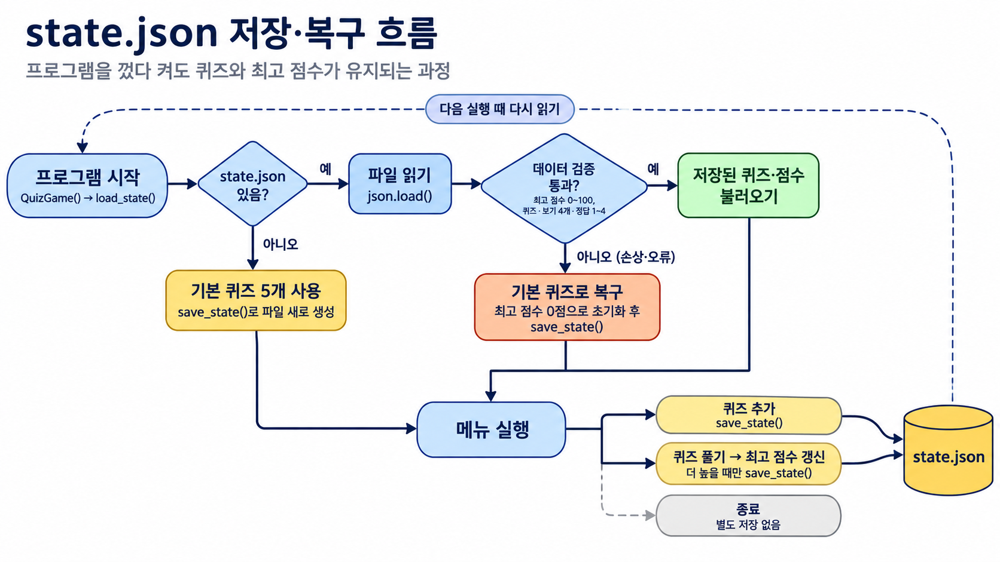

1. **프로그램 시작:** `QuizGame.__init__()` → `load_state()`로 읽기 (파일이 없거나 손상되면 기본 데이터로 `save_state()`)
2. **퀴즈 추가·삭제 직후:** `add_quiz()`, `delete_quiz()` → `save_state()`
3. **게임을 마칠 때마다:** `play()` → 기록 추가(최고 점수 갱신 포함) 후 `save_state()`
4. **프로그램 종료:** 별도 저장 없음 (변경 시점마다 이미 저장)

※ 그림은 보너스 전 흐름이라 2·3번의 "삭제 시 저장", "게임마다 저장"은 그림에 없습니다.

### 6-3. 안전 종료

처리하지 않으면 Ctrl+C(`KeyboardInterrupt`)나 입력 종료(`EOFError`) 때 오류 메시지와 함께 비정상 종료됩니다. `run()` 전체를 `try`로 감싸고 두 예외를 `except`에서 처리해 안내 메시지만 출력하고 종료합니다. 데이터는 바뀔 때마다 이미 저장했으므로 갑자기 종료돼도 잃지 않습니다.

### 6-4. 커밋 단위와 메시지 규칙

- **커밋 단위:** 기능 하나가 완성되거나 의미 있는 변경이 끝났을 때 커밋합니다.
- **메시지 형식:** `<접두어>: <변경 내용 요약>`
- **접두어:** `Feat:` 새 기능 / `Fix:` 오류 수정 / `Docs:` 문서 수정 / `Refactor:` 구조 개선 / `Merge:` 브랜치 병합
- **이유:** 이력만 보고도 변경 유형을 파악하고, 문제가 생겼을 때 원인을 추적하기 쉽게 하기 위해서입니다.

[맨 위로 이동](#top)

---

## 7. 수행 내용 및 검증

실제로 실행한 명령어와 결과 화면을 남깁니다. 7장의 실행 화면은 **보너스 과제 전 버전**이며, 보너스 이후 화면은 [10장](#10-보너스-과제-수행-내용)에 있습니다.

### 7-1. 프로젝트 초기 설정

GitHub 저장소를 만들고 clone한 뒤, README를 수정해 첫 push를 했습니다.

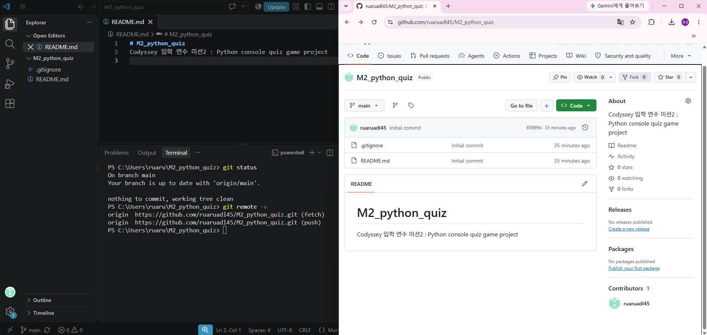


### 7-2. 퀴즈 기능 실행

| 화면 | 확인 내용 |
| --- | --- |
| 05 메뉴 | `python main.py` 실행 후 메뉴 출력 |
| 06 입력 오류 | 메뉴에 `abc`, `9`, 빈 입력 → 안내 후 다시 입력 |
| 07 퀴즈 풀기 | 정답·오답 안내, 공백·범위 밖 입력 처리, 결과 표시 |
| 08 퀴즈 추가 | 문제·선택지·정답 입력 후 등록 (JSON 저장 기능 구현 전 화면) |
| 09 퀴즈 목록 | 추가한 퀴즈 포함 목록 표시 |
| 10 점수 확인 | 이번 점수와 최고 점수 표시 (JSON 저장 기능 구현 전 화면) |


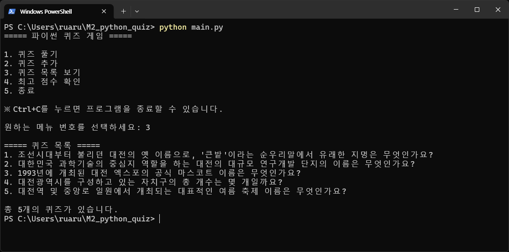

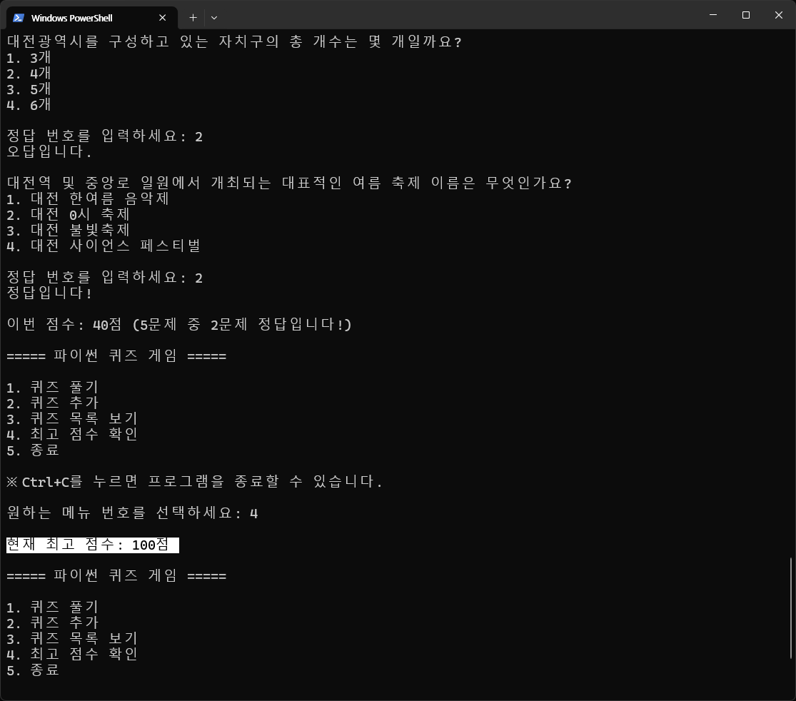

<details>
<summary>퀴즈 없음 · 초기 점수 0점 실습 로그 보기</summary>

※ 기존 `state.json`을 백업한 뒤 퀴즈가 없는 데이터로 바꿔 실행하고, 실습 후 원래 파일로 복원했습니다. 반복되는 메뉴 출력은 생략했습니다.

```text
PS> Copy-Item state.json state_before_empty.json
PS> Set-Content state.json '{"quizzes": [], "best_score": 0}' -Encoding ascii
PS> python main.py
저장된 게임 데이터를 불러왔습니다.
원하는 메뉴 번호를 선택하세요: 1
등록된 퀴즈가 없습니다.
원하는 메뉴 번호를 선택하세요: 3
===== 퀴즈 목록 =====
총 0개의 퀴즈가 있습니다.
원하는 메뉴 번호를 선택하세요: 4
현재 최고 점수: 0점
원하는 메뉴 번호를 선택하세요: 5
프로그램을 종료합니다.

PS> Copy-Item state_before_empty.json state.json -Force
PS> Remove-Item state_before_empty.json
```

※ `-Encoding UTF8`로 저장하면 PowerShell이 BOM을 붙여 손상 파일로 감지되므로, 한글이 없는 이 데이터는 `ascii`로 저장했습니다.
</details>

### 7-3. 데이터 저장 및 복구 검증

| 테스트 항목 | 실행 결과 | 판정 |
| --- | --- | :-: |
| 퀴즈 추가 후 재실행 | 추가한 6번째 퀴즈 유지 | PASS |
| 최고 점수 33점 저장 → 67점 갱신 후 재실행 | 각각 유지 | PASS |
| 저장 파일 손상 | 기본 퀴즈 5개와 최고 점수 0점으로 복구 | PASS |
| 손상 전 백업 파일 복원 | 퀴즈 6개와 최고 점수 67점 복원 | PASS |
| `state.json` 파일 누락 | 기본 퀴즈 5개로 실행하고 파일 재생성 | PASS |

```powershell
Copy-Item state.json state_backup.json                          # 1. 백업 파일 생성
Set-Content state.json "{ 잘못된 JSON 데이터 }" -Encoding UTF8   # 2. 손상 상황 재현
python main.py                                                  #    → 손상 감지 후 기본 데이터로 복구
Copy-Item state_backup.json state.json -Force                   # 3. 백업 파일 복원
python main.py                                                  #    → 퀴즈 6개·최고 점수 67점 유지
Move-Item state.json state_temp.json                            # 4. 파일 누락 상황 재현
python main.py                                                  #    → 기본 퀴즈 5개로 실행 후 파일 재생성
```

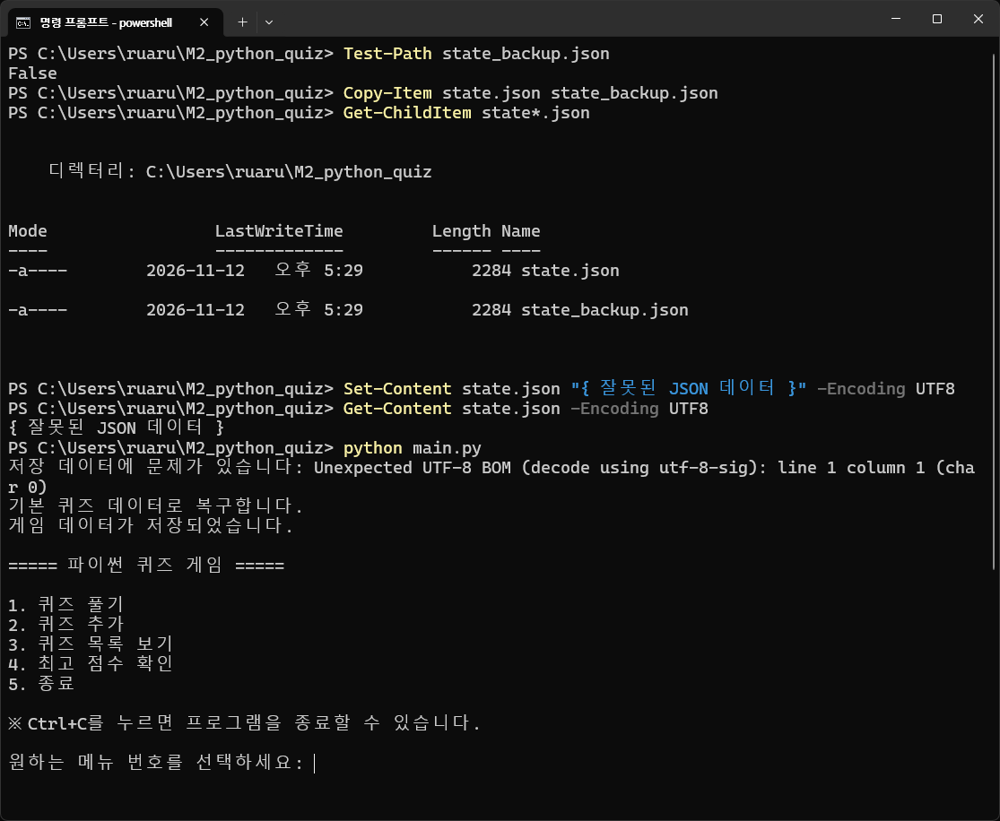


※ 손상 파일을 만들 때 PowerShell이 BOM을 붙여 BOM 오류로 감지된 뒤 복구되었습니다.

<details>
<summary>손상 복구 및 백업 복원 실습 로그 보기</summary>

※ 반복되는 메뉴 출력과 퀴즈 목록 일부는 생략했으며, 프롬프트 경로는 `PS>`로 줄였습니다.

```text
PS> Set-Content state.json "{ 잘못된 JSON 데이터 }" -Encoding UTF8
PS> python main.py
저장 데이터에 문제가 있습니다: Unexpected UTF-8 BOM (decode using utf-8-sig): line 1 column 1 (char 0)
기본 퀴즈 데이터로 복구합니다.
게임 데이터가 저장되었습니다.
원하는 메뉴 번호를 선택하세요: 3
총 5개의 퀴즈가 있습니다.
원하는 메뉴 번호를 선택하세요: 4
현재 최고 점수: 0점

PS> Copy-Item state_backup.json state.json -Force
PS> python main.py
저장된 게임 데이터를 불러왔습니다.
원하는 메뉴 번호를 선택하세요: 3
6. 대전의 유명 베이커리 '성심당'의 대표 메뉴로, ... 이 빵의 이름은 무엇인가요?
총 6개의 퀴즈가 있습니다.
원하는 메뉴 번호를 선택하세요: 4
현재 최고 점수: 67점
```
</details>

### 7-4. Git 작업 기록

#### 1) 브랜치 생성 및 병합

필수 기능은 `feature/quiz-play`, `feature/quiz-game-class`, `feature/json-persistence` 3개 브랜치, 보너스 과제는 5개 브랜치에서 작업한 뒤 `main`에 병합했습니다. 첫 브랜치는 fast-forward로 병합되어 한 줄로 이어지고, 이후에는 `--no-ff`로 병합 기록을 남겼습니다.


```powershell
git checkout -b <브랜치>             # 브랜치 생성 및 이동 → 수정·커밋
git push -u origin <브랜치>
git checkout main
git pull origin main
git merge --no-ff <브랜치> -m "Merge: <내용>"
git push origin main
```

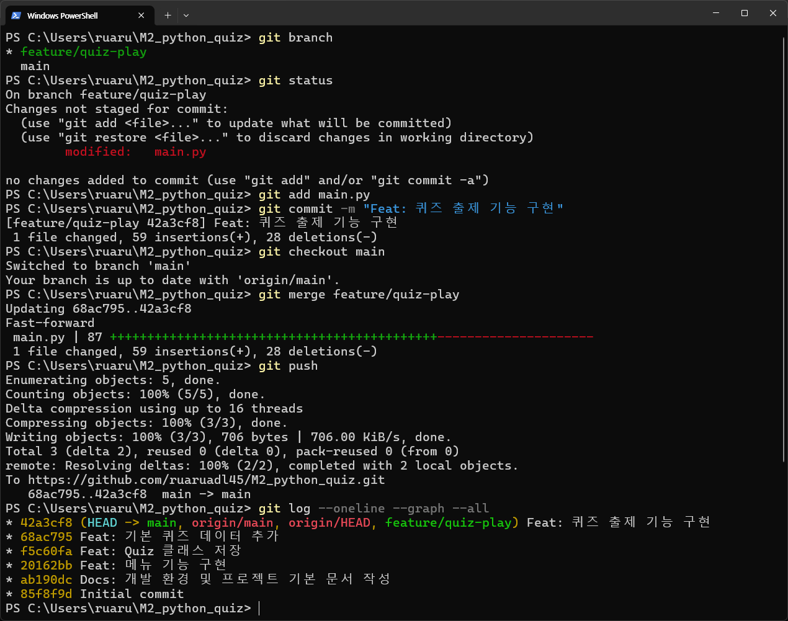


#### 2) Clone 및 Pull 실습

같은 PC의 별도 폴더(`C:\Users\ruaru\M2_clone_test`)에 저장소를 clone해 수정·push하고, 원래 폴더에서 pull해 반영 여부를 확인했습니다.

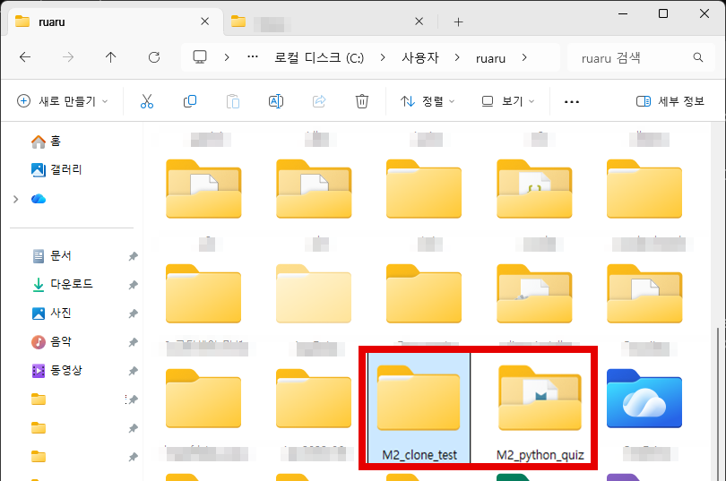

```powershell
# ① 복제본 만들기 및 실행
cd C:\Users\ruaru\M2_clone_test
git clone https://github.com/ruaruadl45/M2_python_quiz.git
cd M2_python_quiz
python main.py

# ② 복제본에서 README 수정 후 push
git add README.md
git commit -m "Docs: clone 실습 기록 추가"
git push origin main

# ③ 원래 폴더에서 pull 후 확인
cd C:\Users\ruaru\M2_python_quiz
git pull origin main
git log --oneline -3
```

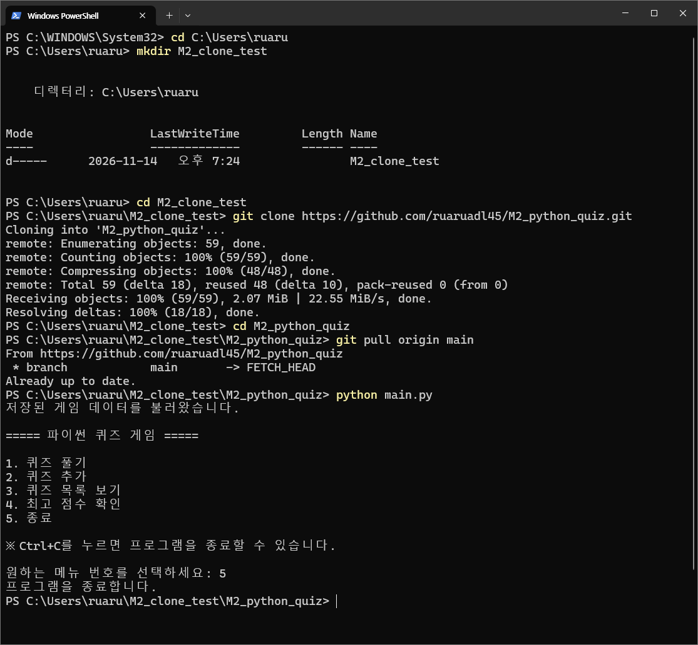

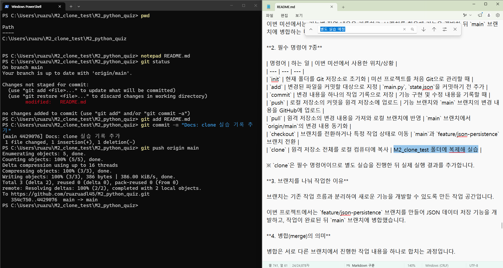

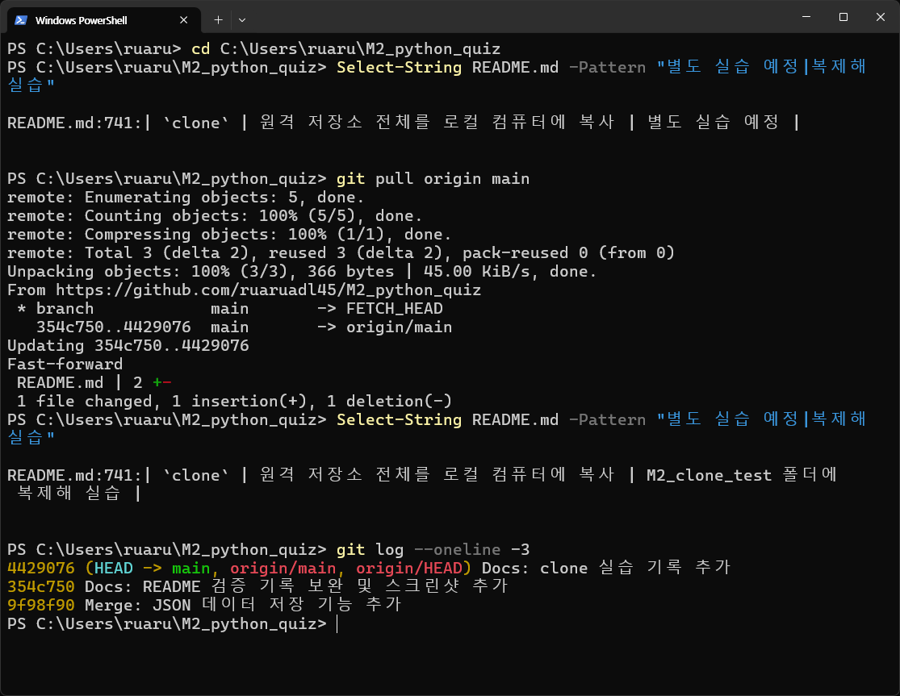

→ 복제본에서 push한 커밋(`4429076`)이 원래 폴더에 `Fast-forward`로 반영되고 README 내용이 바뀐 것을 확인했습니다.

#### 3) Init 실습

이 저장소는 clone으로 시작해 `git init`을 쓸 일이 없었기 때문에, 미션 파일이 없는 별도 환경(Docker 컨테이너 `quiz-pc`, Python 3.13·Git 2.47)에서 빈 폴더를 저장소로 초기화했습니다.

```bash
docker exec -it quiz-pc bash        # 별도 환경(컨테이너) 접속
mkdir quiz_init_test && cd quiz_init_test
git init -b main                    # 빈 폴더를 Git 저장소로 초기화
git remote add origin https://github.com/ruaruadl45/M2_python_quiz.git
git pull origin main                # 원격 저장소의 main 브랜치 내려받기
python main.py
```

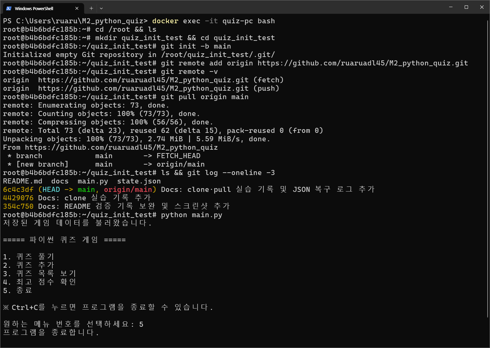

<details>
<summary>quiz-pc 컨테이너 준비 방법 (재현용 예시)</summary>

`quiz-pc`는 실습 전에 미리 만들어 둔 컨테이너이며, 생성 당시 명령어 기록이 없어 아래는 **직접 실행해 검증하지 않은 재현용 예시**입니다.

```powershell
docker run -dit --name quiz-pc python:3.13 bash   # Python 3.13 컨테이너 생성
docker exec -it quiz-pc bash                       # 컨테이너 접속
apt-get update && apt-get install -y git           # (컨테이너 안) Git 설치
```
</details>

| 구분 | `git clone` | `git init` + `remote add` + `pull` |
| --- | --- | --- |
| 시작점 | 원격 저장소 | 빈 폴더 |
| 원격 연결 | 자동으로 `origin` 등록 | `git remote add`로 직접 등록 |

#### 4) Git 작업 이력

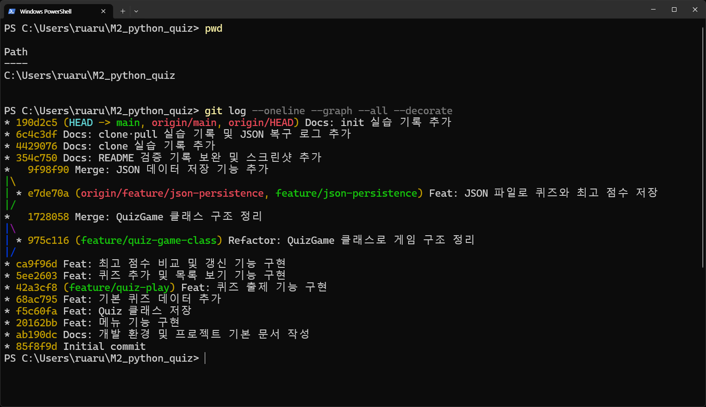

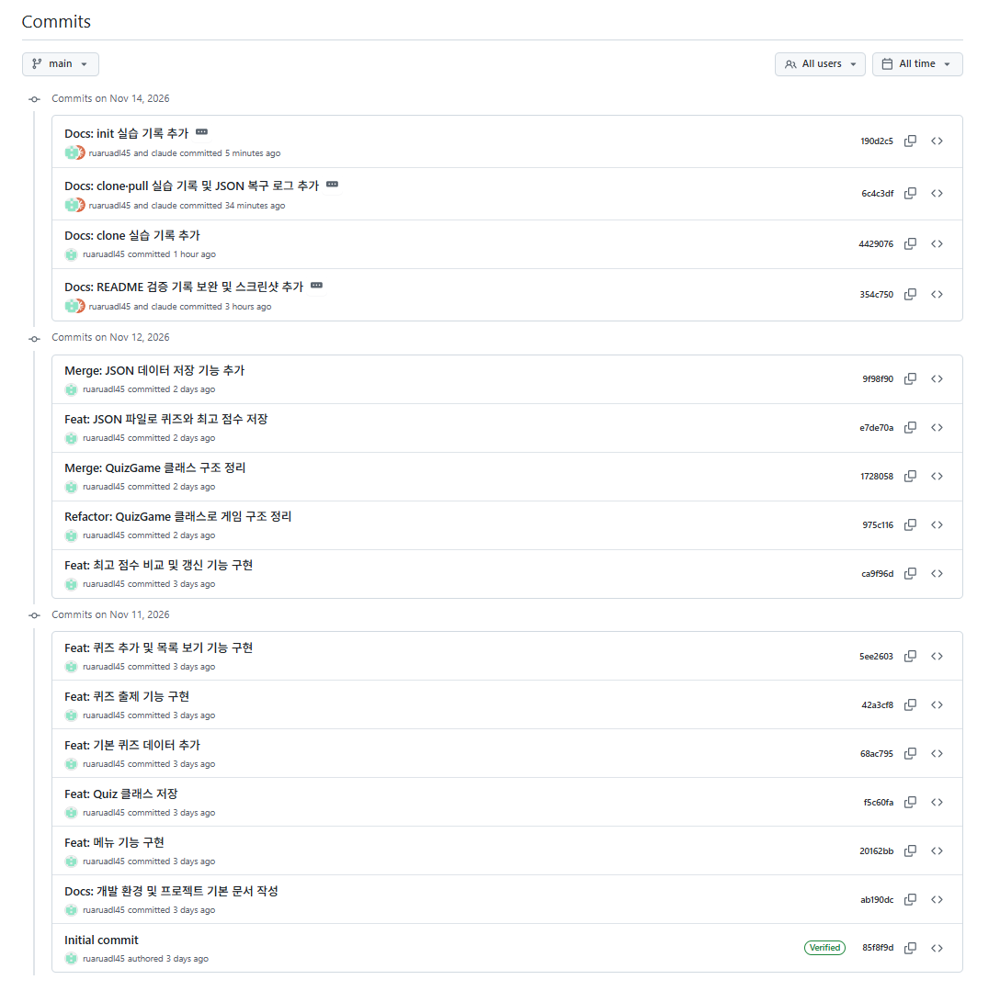

- 캡처 시점(보너스 전) 기준 16개 커밋이 접두어 규칙에 맞게 기록되었고, `--no-ff` 병합은 그래프에 갈라졌다 합쳐지는 모양(`|\`, `|/`)으로 남았습니다.
- 이후 보너스 과제 커밋이 추가되어 현재 커밋 수는 더 많습니다.

[맨 위로 이동](#top)

---

## 8. 핵심 개념 정리

### 8-1. Python 핵심 개념

| 개념 | 한 줄 설명 | 이 프로젝트에서 사용한 예 |
| --- | --- | --- |
| 변수와 자료형 | 값을 담는 이름표 / `int`·`str`·`bool`·`list`·`dict` | `best_score`(int), 문제(str), 퀴즈 목록(list), 퀴즈 1개(dict) |
| 조건문과 반복문 | 조건에 따라 다른 동작 / `for` 정해진 묶음 반복, `while` 조건이 맞는 동안 반복 | 메뉴 번호별 기능 실행, `for`로 퀴즈 출제, `while`로 메뉴·입력 재요청 |
| 함수와 반환값 | 작업을 묶고, 값을 받아, 결과를 돌려줌 | `get_valid_number(prompt, min_value, max_value)`가 범위 안의 숫자 반환 |
| 클래스와 객체 | 데이터와 기능을 함께 담는 설계도 / `__init__` 초기 설정, `self` 객체 자신 | `Quiz`·`QuizGame`, `self.quizzes` |
| 파일 입출력과 JSON | `open()`으로 열고 `json.load()` 읽기, `json.dump()` 쓰기 | `encoding="utf-8"`로 `state.json` 저장·불러오기 |
| 예외 처리 `try/except` | 오류가 나도 프로그램이 멈추지 않게 처리 | `ValueError`, `JSONDecodeError`, `OSError`, `KeyboardInterrupt`, `EOFError` |

- **클래스를 쓴 이유:** 함수만으로 만들면 퀴즈 목록·최고 점수를 여러 함수가 쓰기 위해 전역 변수로 두거나 매번 넘겨야 합니다. 클래스는 데이터와 기능을 한 객체에 두어 `self`로 함께 쓰고, 어떤 기능이 어떤 데이터를 바꾸는지 한곳에서 볼 수 있습니다.
- **JSON을 쓴 이유와 한계:** 사람이 읽기 쉬운 텍스트 형식이고 `dict`·`list`와 모양이 비슷해 표준 라이브러리만으로 저장할 수 있습니다. 다만 퀴즈가 1000개 이상으로 늘면 시작할 때 파일 전체를 읽고 저장할 때마다 전체를 다시 써서 느려지고, 동시 수정 시 덮어쓰기 위험이 있습니다. 그때는 SQLite 같은 데이터베이스를 고려할 수 있습니다.

### 8-2. Git 기초 (필수 명령어 7종)

| 명령어 | 하는 일 | 이번 미션에서 사용한 위치 |
| --- | --- | --- |
| `init` | 폴더를 Git 저장소로 초기화 | 별도 환경(Docker 컨테이너)의 빈 폴더 ([7-4 3)](#7-4-git-작업-기록)) |
| `add` | 커밋할 파일 지정 | `main.py`, `README.md` 등 커밋 전 |
| `commit` | 변경 내용을 작업 기록으로 저장 | 기능 구현·문서 수정마다 |
| `push` | 로컬 커밋을 GitHub에 업로드 | 기능 브랜치와 `main` 업로드 |
| `pull` | GitHub의 변경 내용을 가져와 반영 | 병합 전 `main` 동기화, clone 실습 |
| `checkout` | 브랜치 생성·전환 | `checkout -b`로 기능 브랜치 생성, `main`으로 전환 |
| `clone` | 원격 저장소 전체를 복사 | `M2_clone_test` 폴더에 복제 |

- **브랜치와 병합(`merge`):** 브랜치는 `main`을 건드리지 않고 새 기능을 따로 만드는 작업 공간이고, 병합은 완성된 작업을 `main`에 합치는 것입니다. 필수 기능 브랜치 3개와 보너스 브랜치 5개를 병합했습니다.

[맨 위로 이동](#top)

---

## 9. 트러블슈팅

실제로 발생한 문제를 문제 상황 → 원인 추정 → 확인 방법 → 해결 방법 → 최종 결과 순서로 기록합니다.


### 9-1. 문제 사례 1: 기본 퀴즈 데이터 코드의 위치 및 들여쓰기 오류

| 구분 | 기록 내용 |
| --- | --- |
| 문제 상황 | 기본 퀴즈 데이터를 추가한 뒤 실행하자 `NameError: name 'Quiz' is not defined` 오류가 발생했습니다. |
| 원인 추정 | 들여쓰기 규칙에 익숙하지 않아 퀴즈 데이터 코드가 `class Quiz` 내부에 들어간 것으로 추정했습니다. |
| 확인 방법 | 클래스 선언 위치와 들여쓰기 구조를 확인했습니다. |
| 해결 방법 | 퀴즈 데이터 코드를 `class Quiz` 바깥으로 옮겨 `Quiz` 정의가 끝난 뒤 객체를 만들도록 수정했습니다. |
| 최종 결과 | `NameError` 없이 정상 실행되었습니다. |

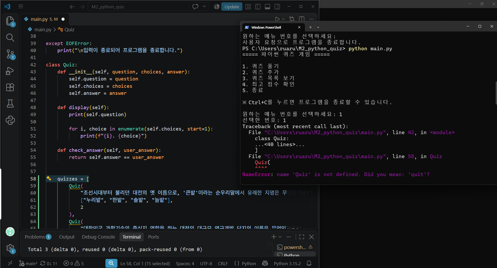

### 9-2. 문제 사례 2: PowerShell에서 Python 파일의 한글 인코딩 깨짐

| 구분 | 기록 내용 |
| --- | --- |
| 문제 상황 | `Get-Content main.py`로 코드를 확인하자 한글이 깨져서 표시되었습니다. |
| 원인 추정 | 파일은 정상이고, PowerShell의 읽기 인코딩이 파일 인코딩(UTF-8)과 맞지 않는 것으로 추정했습니다. |
| 확인 방법 | VS Code에서는 한글이 정상인 것을 확인하고 PowerShell 출력과 비교했습니다. |
| 해결 방법 | `Get-Content main.py -Encoding UTF8`로 인코딩을 지정했습니다. |
| 최종 결과 | 원본 파일을 바꾸지 않고 한글이 정상 표시되었습니다. |

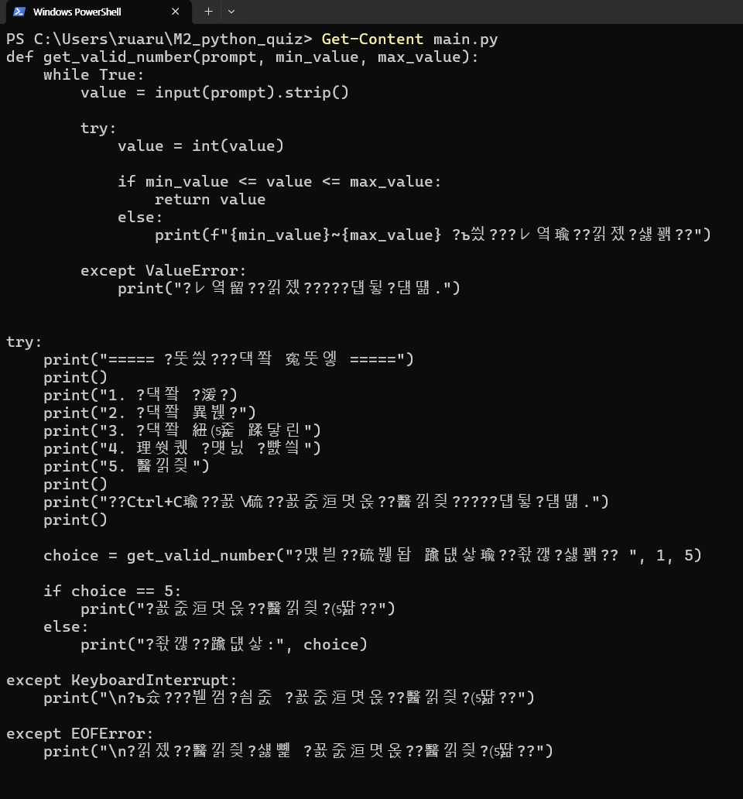

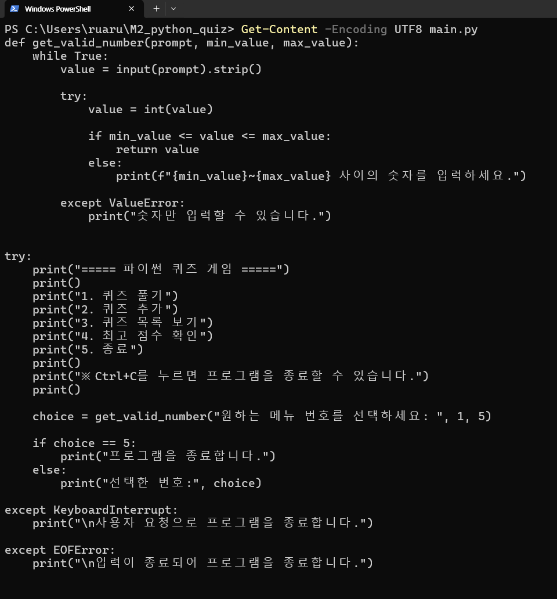

### 9-3. 문제 사례 3: 힌트 저장 코드 추가 후 SyntaxError

| 구분 | 기록 내용 |
| --- | --- |
| 문제 상황 | 보너스 3에서 `save_state()`에 `"hint": quiz.hint`를 추가하자 `SyntaxError: invalid syntax. Perhaps you forgot a comma?`가 발생하고 프로그램이 시작되지 않았습니다. |
| 원인 추정 | `"answer": quiz.answer` 뒤에 항목이 하나 더 생겼는데 구분 쉼표가 빠진 것으로 추정했습니다. |
| 확인 방법 | 오류 메시지의 줄 번호와 `^` 위치를 따라가 `dict` 항목 구분을 확인했습니다. |
| 해결 방법 | `"answer": quiz.answer,`로 쉼표를 추가했습니다. |
| 최종 결과 | 정상 실행되고 힌트가 포함된 `state.json`이 생성되었습니다. |

※ `SyntaxError`는 Python이 실행 전에 코드 전체를 읽는 단계에서 발견되므로, 프로그램이 아예 시작되지 않습니다.

[맨 위로 이동](#top)

---

## 10. 보너스 과제 수행 내용

보너스 과제 5개를 모두 수행했습니다. 바뀐 `state.json` 구조와 점수 규칙은 [5장](#5-데이터-파일-설명-statejson)에 반영했습니다.

| 보너스 기능 | 구현 내용 | 확인 결과 |
| --- | --- | --- |
| 랜덤 출제 | `random.sample()`로 섞은 복사본을 출제. 원본 목록과 `state.json` 순서는 유지 (`shuffle()`은 원본을 섞어 저장 순서까지 바뀜) | 실행 확인 ([22_bonus_random_1](docs/screenshots/22_bonus_random_1.png)·[2](docs/screenshots/22_bonus_random_2.png)·[3](docs/screenshots/22_bonus_random_3.png)) |
| 문제 수 선택 | 풀 문제 수(1~퀴즈 개수) 입력, 점수는 선택한 문제 수 기준 | 실행 확인 ([22_bonus_count_1](docs/screenshots/22_bonus_count_1.png)·[2](docs/screenshots/22_bonus_count_2.png)) |
| 힌트 및 점수 차감 | `Quiz`에 `hint` 속성 추가, 정답 입력에서 `0`으로 힌트 보기, 문제당 10점 차감(같은 문제는 1번만) | 실행 확인 ([23_hint_1](docs/screenshots/23_hint_1.png)·[2](docs/screenshots/23_hint_2.png)) |
| 퀴즈 삭제 | 메뉴 5번에서 번호로 삭제(`list.pop(번호 - 1)`), `0`은 취소, 삭제 결과 저장 | 실행 확인 ([24_delete_1](docs/screenshots/24_delete_1.png)·[2](docs/screenshots/24_delete_2.png)) |
| 점수 기록 히스토리 | 게임마다 날짜·시간(`datetime`), 푼 문제 수, 정답 수, 힌트 수, 점수를 `history`에 저장. 최고 점수는 모든 문제를 푼 판만 인정 | 실행 확인 ([25_history_1a](docs/screenshots/25_history_1a.png)·[1b](docs/screenshots/25_history_1b.png)·[1c](docs/screenshots/25_history_1c.png)·[2](docs/screenshots/25_history_2.png)) |

- **예전 파일 호환:** 새로 추가한 `hint`, `history`, `best_question_count`는 `.get()`으로 읽어 보너스 전 `state.json`도 오류 없이 불러옵니다. ([23_hint_1](docs/screenshots/23_hint_1.png): 힌트 없는 예전 파일로 실행)
- **기타 변경:** 퀴즈 추가 질문에서 `0` 입력 시 취소, 기본 퀴즈를 `get_default_quizzes()` 한 곳에서 관리, 메뉴 4번을 `점수 확인 (최고 점수·기록)`으로 변경
- **동점 규칙**(점수가 같으면 더 많은 문제를 푼 기록으로 갱신)은 코드 구현 확인 상태입니다.

**대표 실행 화면**


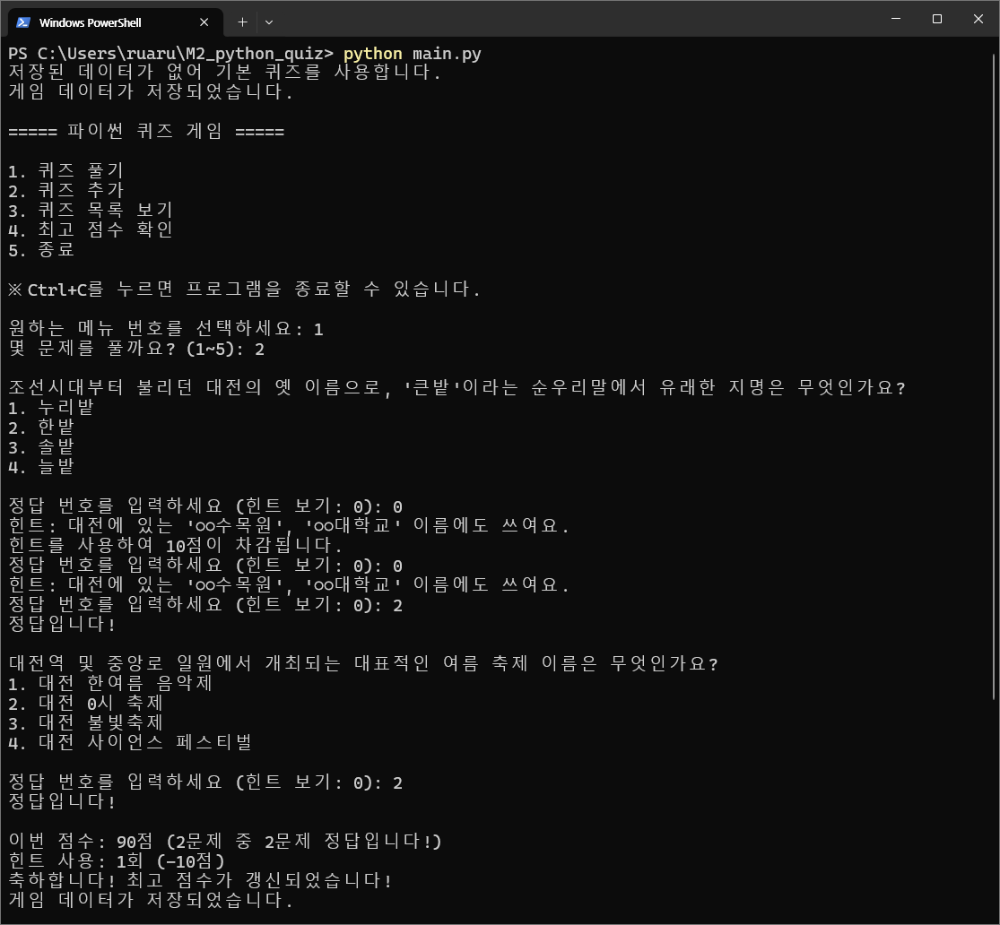


<details>
<summary>문제 수 입력 오류 · 삭제 취소 실습 로그 보기</summary>

```text
원하는 메뉴 번호를 선택하세요: 1
몇 문제를 풀까요? (1~5): abc
숫자만 입력할 수 있습니다.
몇 문제를 풀까요? (1~5): 0
1~5 사이의 숫자를 입력하세요.
몇 문제를 풀까요? (1~5): 9
1~5 사이의 숫자를 입력하세요.
몇 문제를 풀까요? (1~5):
숫자만 입력할 수 있습니다.

원하는 메뉴 번호를 선택하세요: 5
... (퀴즈 목록 1~6번 생략) ...
삭제할 퀴즈 번호를 입력하세요 (1~6, 취소: 0): 0
삭제를 취소했습니다.
```
</details>

[맨 위로 이동](#top)

---

## 11. 미션을 마치며

### 11-1. 이번 미션에서 배운 내용

- **Python 기초와 클래스:** 기본 문법으로 실행 흐름을 만들고, `Quiz`와 `QuizGame`으로 데이터와 기능을 역할에 맞게 나누는 방법
- **데이터 관리와 예외 처리:** JSON 파일로 데이터를 저장·복원하고, 잘못된 입력과 파일 오류에도 프로그램이 멈추지 않게 하는 방법
- **Git과 GitHub:** 기능 단위로 커밋하고, 브랜치에서 작업한 뒤 병합하며, clone·pull로 저장소를 주고받는 방법
- **기능 확장과 호환성:** 저장 데이터에 새 항목을 더하면서 예전 파일을 `.get()`으로 안전하게 읽고, 점수 규칙의 공정성까지 고려하는 방법

### 11-2. 한계와 개선 아이디어

- 퀴즈 추가 취소는 질문 입력 단계에서만 가능합니다.
- `history` 형식만 잘못되어도 손상 파일로 처리되어 퀴즈와 최고 점수까지 초기화됩니다. 항목별 복구나 자동 백업을 넣으면 데이터를 덜 잃을 수 있습니다.
- 게임할 때마다 `history`가 계속 쌓여 파일이 커집니다. 최근 N개만 보관하는 방식으로 개선할 수 있습니다.

### 11-3. 추가 학습 계획

1. 변수·조건문·반복문·함수·클래스와 JSON 입출력, 예외 처리를 반복 실습하기
2. 브랜치 생성과 병합, 원격 저장소 동기화 등 협업에 필요한 Git 기능 익히기
3. 다음 미션(계산기)에 필요한 연산 처리와 프로그램 구조 설계 학습하기

[맨 위로 이동](#top)
